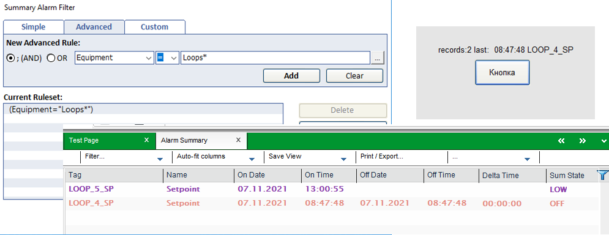

# CiCode функції для роботи з тривогами


| Функція               | Опис                                                         |
| --------------------- | ------------------------------------------------------------ |
| AlarmActive           | Визначає, чи є активні тривоги в області користувача.        |
| AlarmCatGetFormat     | Повертає рядок формату відображення для вказаної категорії тривог. |
| AlarmClear            | Видаляє підтверджені неактивні тривоги зі списку активних тривог. |
| AlarmClearRec         | Видаляє тривогу за номером запису.                           |
| AlarmClearTag         | Видаляє тривогу за ім'ям тега.                               |
| AlarmCount            | Підраховує кількість тривог, що відповідають заданим критеріям фільтрації. |
| AlarmCountEquipment   | Підраховує кількість тривог для вказаного обладнання з урахуванням заданих критеріїв фільтрації. |
| AlarmCountList        | Підраховує кількість тривог у вибраному списку тривог.       |
| AlarmDelete           | Видаляє записи зі зведення тривог, які наразі відображаються. |
| AlarmDisable          | Вимикає тривоги.                                             |
| AlarmDisableRec       | Вимикає тривогу за номером запису.                           |
| AlarmDisableTag       | Вимикає тривогу за ім'ям тега.                               |
| AlarmEnable           | Вмикає тривоги.                                              |
| AlarmEnableRec        | Вмикає тривогу за номером запису.                            |
| AlarmEnableTag        | Вмикає тривогу за ім'ям тега.                                |
| AlarmEventQue         | Відкриває чергу подій тривог.                                |
| AlarmGetDelay         | Отримує значення затримки для тривоги.                       |
| AlarmGetDelayRec      | Отримує значення затримки для тривоги за номером запису.     |
| AlarmGetDsp           | Отримує дані поля із запису тривоги, що відображається у вказаному AN. |
| AlarmGetFieldRec      | Отримує значення поля тривоги за номером запису.             |
| AlarmGetInfo          | Отримує інформацію про список тривог, що відображається у вказаному AN. |
| AlarmGetOrderbyKey    | Повертає список ключів, які визначають порядок сортування списку тривог. |
| AlarmGetThreshold     | Отримує порогові значення аналогових тривог.                 |
| AlarmGetThresholdRec  | Отримує порогові значення аналогової тривоги за номером запису. |
| AlarmHelp             | Відображає сторінку довідки для тривоги, на якій знаходиться курсор. |
| AlarmHighestPriority  | Повертає пріоритет і стан тривоги з найвищим пріоритетом для заданого обладнання. |
| AlarmListCreate       | Створює список тривог для вказаного AN.                      |
| AlarmListDestroy      | Видаляє список тривог, пов'язаний із вказаним AN.            |
| AlarmListDisplay      | Відображає список тривог у вказаному AN.                     |
| AlarmListFill         | Заповнює список тривог у вказаному AN для використання іншою функцією. |
| AlarmNextCatRec       | Шукає наступний запис тривоги із заданою категорією та типом. |
| AlarmNextPriRec       | Шукає наступний запис тривоги із заданим пріоритетом і типом. |
| AlarmNextTagRec       | Шукає наступний запис тривоги за тегом, ім'ям і описом.      |
| AlarmNotifyVarChange  | Активує дискретну або аналогову тривогу з часовою міткою.    |
| AlarmQueryFirstRec    | Шукає перший запис тривоги із заданою категорією (або пріоритетом) і типом. |
| AlarmQueryNextRec     | Шукає наступний запис тривоги із заданою категорією (або пріоритетом) і типом. |
| AlarmResetQuery       | Очищає фільтр для вказаного джерела фільтрації. Використовується для скидання фільтра, створеного функцією `AlarmFilterForm()`. |
| AlarmSetDelay         | Змінює значення затримки для тривоги.                        |
| AlarmSetDelayRec      | Змінює значення затримки для тривоги за номером запису.      |
| AlarmSetInfo          | Змінює параметри відображення списку тривог у вказаному AN.  |
| AlarmSetQuery         | Функція застаріла. Рекомендується використовувати функції фільтрації тривог (Alarm Filter Functions). |
| AlarmSetThreshold     | Змінює порогові значення аналогових тривог.                  |
| AlarmSetThresholdRec  | Змінює порогові значення аналогової тривоги за номером запису. |
| AlarmSplit            | Розділяє запис зведення тривог, який не має часу завершення (Off time). |
| AlarmTagFromEquipment | Повертає перший тег, пов'язаний із заданим обладнанням.      |
| HwAlarmQue            | Повертає дескриптор черги апаратних тривог.                  |

## Дії над тривогами

| AlarmAck          | Acknowledges alarms.                                         |
| ----------------- | ------------------------------------------------------------ |
| AlarmAckRec       | Acknowledges alarms by record number.                        |
| AlarmAckTag       | Acknowledges a specified alarm                               |
| AlarmComment      | Allows users to add comments to alarm summary entries during runtime. |
| AlarmCommentRecID | Allows an operator to add a comment to a selected alarm summary or SOE entry during runtime. |

## Виведення тривог на сторінку

|                       |                                                              |
| --------------------- | ------------------------------------------------------------ |
| AlarmDsp              | Displays alarms.                                             |
| AlarmDspClusterAdd    | Adds a cluster to a client's alarm list.                     |
| AlarmDspClusterInUse  | Determines if a cluster is included in a client's alarm list. |
| AlarmDspClusterRemove | Removes a cluster from a client's alarm list.                |
| AlarmDspLast          | Displays the latest, unacknowledged alarms.                  |
| AlarmDspNext          | Displays the next page of alarms.                            |
| AlarmDspPrev          | Displays the previous page of alarms.                        |

## Пошук активних тривог

| AlarmFirstCatRec | Searches for the first occurrence of an alarm category and type. |
| ---------------- | ------------------------------------------------------------ |
| AlarmFirstPriRec | Searches for the first occurrence of an alarm priority and type. |
| AlarmFirstTagRec | Searches for the first occurrence of an alarm tag, name, and description. |

## Alarm Summary

| AlarmSumAppend | Appends a new blank record to the alarm summary.             |
| -------------- | ------------------------------------------------------------ |
| AlarmSumCommit | Commits the alarm summary record to the alarm summary device. |
| AlarmSumDelete | Deletes alarm summary entries.                               |
| AlarmSumFind   | Finds an alarm summary index for an alarm record and alarm on time. |
| AlarmSumFirst  | Gets the oldest alarm summary entry.                         |
| AlarmSumGet    | Gets field information from an alarm summary entry.          |
| AlarmSumLast   | Gets the latest alarm summary entry.                         |
| AlarmSumNext   | Gets the next alarm summary entry.                           |
| AlarmSumPrev   | Gets the previous alarm summary entry.                       |
| AlarmSumSet    | Sets field information in an alarm summary entry.            |
| AlarmSumSplit  | Duplicates an alarm summary entry.                           |
| AlarmSumType   | Retrieves a value that indicates a specified alarm's type.   |


| AlmSummaryAck           | Acknowledges the alarm at the current cursor position in an active data browse session. |
| ----------------------- | ------------------------------------------------------------ |
| AlmSummaryClear         | Clears the alarm at the current cursor position in an active data browse session. |
| AlmSummaryClose         | Closes an alarm summary browse session.                      |
| AlmSummaryCommit        | Commits the value changes made by AlmSummarySetFieldValue(). |
| AlmSummaryDelete        | Deletes alarm summary entries from the browse session.       |
| AlmSummaryDeleteAll     | Deletes all alarm summary entries from the browse session.   |
| AlmSummaryDisable       | Disables the alarm at the current cursor position in an active data browse session. |
| AlmSummaryEnable        | Enables the alarm at the current cursor position in an active data browse session. |
| AlmSummaryFirst         | Gets the oldest alarm summary entry.                         |
| AlmSummaryGetField      | Gets the field indicated by the cursor position in the browse session. |
| AlmSummaryLast          | Places the data browse cursor at the latest summary record from the last cluster of the available browsing cluster list. |
| AlmSummaryNext          | Gets the next alarm summary entry in the browse session.     |
| AlmSummaryNumRecords    | Retrieves the number of records in an alarm summary browse session. |
| AlmSummaryOpen          | Opens an alarm summary browse session.                       |
| AlmSummaryPrev          | Gets the previous alarm summary entry in the browse session. |
| AlmSummarySetFieldValue | Sets the value of the field  indicated by the cursor position in the browse session.  AlmSummaryCommit() is required to commit the value changes. The value  changes are discarded if the cursor moves away. |



```c
FUNCTION lastalarmtag () 
	INT hTask=TaskNew("almsum","",8);
END	

FUNCTION almsum ()
 STRING t0 = IntToStr(TimestampToTimeInt(TimestampCurrent()));
 STRING t1 = IntToStr(TimestampToTimeInt(TimestampCurrent())- 4*24*3600) ;
 INT session = AlmSummaryOpen("OnTime >= " + t1 + " AND OnTime < " + t0 + " AND Equipment = ^"Loops*^"", "");
 IF (session >= 0) THEN
     AlmSummaryFirst(session);
     tagstr = "records:" + IntToStr(AlmSummaryNumRecords(session)); 
     tagstr = tagstr + " last: " AlmSummaryGetField(session, "Date"); 
     tagstr = tagstr + " " + AlmSummaryGetField(session, "Time"); 
     tagstr = tagstr + " " + AlmSummaryGetField(session, "Tag"); 
     AlmSummaryClose(session);
 ELSE
 	tagstr =  IntToStr(session) ;   
 END
END 
```

## AlarmSetInfo  

Функція `AlarmSetInfo` змінює параметри відображення списку тривог для вказаного AN. Вона застосовується лише до списків неапаратних тривог.

```c
INT AlarmSetInfo(INT AN, INT Type, STRING Value)
```

Параметр `AN` визначає, до якого списку тривог застосовуються зміни.

- `AN > 0` — змінити параметри списку з указаним AN.
- `-1` — змінити параметри всіх списків тривог на сторінці.
- `0` — змінити параметри списку, над яким зараз знаходиться курсор.

Параметр `Type` визначає, який саме параметр списку потрібно змінити.

| Type | Призначення                                                |
| ---- | ---------------------------------------------------------- |
| 0    | Зміщення списку по сторінках.                              |
| 1    | Зміщення списку по рядках.                                 |
| 2    | Фільтр за категорією тривог.                               |
| 3    | Фільтр за типом тривог.                                    |
| 4    | Використовувати формат і шрифти певної категорії тривог.   |
| 5    | Використовувати один формат відображення для всіх тривог.  |
| 6    | Використовувати один шрифт для всіх користувацьких тривог. |
| 7    | Фільтр за пріоритетом.                                     |
| 8    | Режим фільтрації: за категорією або за пріоритетом.        |
| 9    | Режим сортування.                                          |
| 10   | Ключі сортування (Order-by).                               |
| 12   | Прив'язати або відв'язати іменований фільтр.               |
| 15   | Режим автоматичного оновлення (лише для Alarm Summary).    |

Параметр `Value` залежить від значення `Type`.

Для `Type = 0` і `Type = 1` він задає зміщення списку. Якщо вказати значення поза межами даних, що знаходяться в кеші клієнта, функція поверне помилку `569`.

Для `Type = 2` задається категорія тривог. Значення `0` означає всі категорії. Також можна використовувати дескриптор групи, створений функцією `GrpOpen()`. При цьому групу потрібно відкрити під час відкриття сторінки і закрити лише при її закритті (`GrpClose()`), інакше дескриптор стане недійсним.

Для `Type = 3` задається тип тривог (значення аналогічні параметру `AlarmDsp`).

Для `Type = 4` потрібно вказати номер категорії, формат і шрифти якої будуть використовуватися для всіх тривог.

Для `Type = 5` у `Value` передається дескриптор формату, створений функцією `FmtOpen()`.

Для `Type = 6` передається дескриптор шрифту, створений функцією `DspFont()`.

Для `Type = 7` задається пріоритет або дескриптор групи пріоритетів.

Для `Type = 8` визначається режим фільтрації:

| Value | Режим                      |
| ----- | -------------------------- |
| 0     | Фільтрація за категорією.  |
| 1     | Фільтрація за пріоритетом. |

Для `Type = 9` визначається спосіб сортування:

| Value | Режим                                             |
| ----- | ------------------------------------------------- |
| 0     | Сортувати за часом виникнення (ON Time).          |
| 1     | Сортувати за ключами, заданими через `Type = 10`. |

Для `Type = 10` параметр `Value` містить список ключів сортування. Можна задати до 16 ключів.

Приклади:

```c
{Time}
```

Сортування за часом у порядку спадання.

```c
{Tag,1}
```

Сортування за тегом у порядку зростання.

```c
{Tag,1}{Time}
```

Спочатку за тегом, потім за часом.

Доступні поля сортування: `Tag`, `Name`, `Category`, `Priority`, `Area`, `Priv`, `Time`, `State`, `Type`.

Приховані поля `Disabled`, `Acknowledged` і `Active` також можна використовувати для сортування та фільтрації.

Для `Type = 12` у `Value` передається ім'я іменованого фільтра. Якщо передати порожній рядок, зв'язок із фільтром буде розірвано.

Для `Type = 15` задається режим автоматичного оновлення списку:

| Value | Режим                                           |
| ----- | ----------------------------------------------- |
| -1    | Автоматичне оновлення завжди.                   |
| 0     | Автоматичне оновлення вимкнене.                 |
| 1     | Автоматичне оновлення лише для першої сторінки. |

Якщо фільтр виявиться занадто складним (наприклад, містить надто багато умов або вкладених дужок), він буде автоматично скинутий. При цьому на клієнті буде згенерована апаратна тривога `Too many alarms in filters`, а в журналі трасування з'явиться повідомлення про помилку.

Функція повертає `0` у разі успішного виконання або код помилки у разі невдачі.

Приклади

Сортування за часом виконується у два етапи:

```c
AlarmSetInfo(21, 10, "{Time}");
AlarmSetInfo(21, 9, 1);
```

Фільтрація за категорією:

```c
AlarmSetInfo(21, 8, 0);
AlarmSetInfo(21, 2, 2);
```

Фільтрація за пріоритетом:

```c
AlarmSetInfo(21, 8, 1);
AlarmSetInfo(21, 7, 4);
```

Зміщення списку:

```c
AlarmSetInfo(0, 0, 2);   // зміщення на 2 сторінки
AlarmSetInfo(0, 1, 15);  // зміщення на 15 рядків
```

Зміна категорії та типу тривог:

```c
AlarmSetInfo(0, 2, 10);
AlarmSetInfo(0, 3, 5);
```

Зміна формату та шрифту:

```c
AlarmSetInfo(20, 4, 120);

hFmt = FmtOpen("MyFormat","{Name}{Desc,20}",0);
AlarmSetInfo(20, 5, hFmt);

hFont = DspFont("Times",-60,black,gray);
AlarmSetInfo(20, 6, hFont);
```

Використання груп категорій:

```c
// On Page Entry
hGrp = GrpOpen("MyGrp",1);
StrToGrp(hGrp,"1..10,20,25");

// Застосування групи
AlarmSetInfo(20, 2, hGrp);

// On Page Exit
GrpClose(hGrp);
```

> Примітка. Змінна `hGrp` повинна бути оголошена в базі змінних (Variables Database).

## Alarm Browse

|                     |                                                              |
| ------------------- | ------------------------------------------------------------ |
| AlmBrowseAck        | Acknowledges the alarm tag at the current cursor position in an active data browse session. |
| AlmBrowseClear      | This function is now obsolete.                               |
| AlmBrowseClose      | Closes an alarm tags browse session.                         |
| AlmBrowseDisable    | Disables the alarm tag at the current cursor position in an active data browse session. |
| AlmBrowseEnable     | Enables the alarm tag at the current cursor position in an active data browse session. |
| AlmBrowseFirst      | Gets the oldest alarm tags entry.                            |
| AlmBrowseGetField   | Gets the field indicated by the cursor position in the browse session. |
| AlmBrowseNext       | Gets the next alarm tags entry in the browse session.        |
| AlmBrowseNumRecords | Returns the number of records in the current browse session. |
| AlmBrowseOpen       | Opens an alarm tags browse session.                          |
| AlmBrowsePrev       | Gets the previous alarm tags entry in the browse session.    |


## AlarmListCreate

Функція `AlarmListCreate` створює список тривог і прив'язує його до вказаного AN.

```c
INT AlarmListCreate(
    INT nAN,
    INT alarm_type,
    INT width,
    INT height,
    INT rowheight,
    INT drawheader
    [, STRING sCluster
    [, STRING sFormat
    [, INT hFontRow
    [, INT hFontHeader]]]]
)
```

- Параметр `nAN` задає номер AN, з яким буде пов'язаний список тривог.

- Параметр `alarm_type` визначає, які тривоги будуть відображатися. Підтримуються такі значення:

| Значення | Тип тривог                                                   |
| -------- | ------------------------------------------------------------ |
| 0        | Усі активні тривоги                                          |
| 1        | Усі непідтверджені тривоги (ON і OFF)                        |
| 2        | Усі підтверджені тривоги у стані ON                          |
| 3        | Усі вимкнені тривоги                                         |
| 4        | Усі налаштовані неапаратні тривоги, включаючи підтверджені OFF |
| 10       | Усі тривоги зведення (Alarm Summary)                         |
| 11       | Усі тривоги у стані ON                                       |
| 12       | Усі тривоги у стані OFF                                      |
| 15       | Журнал послідовності подій (SOE) без подій конфігурації      |
| 16       | Повний журнал послідовності подій (SOE)                      |
| 17       | Усі непідтверджені тривоги у стані ON                        |
| 18       | Усі непідтверджені тривоги у стані OFF                       |

- Параметри `width` і `height` визначають ширину та висоту області відображення списку тривог у пікселях, 
- `rowheight` задає висоту одного рядка.

- Параметр `drawheader` визначає, чи буде відображатися рядок заголовка: `0` — без заголовка, `1` — із заголовком.

Необов'язковий параметр `sCluster` задає кластер, для якого потрібно відображати тривоги. Якщо його не вказати, відображатимуться тривоги всіх кластерів.

Необов'язковий параметр `sFormat` задає формат відображення списку тривог, тобто набір і порядок стовпців. Якщо його не вказати, використовується формат за замовчуванням для вибраного типу тривог. Власне ім'я формату можна задати за допомогою параметра `[Format]FormatName`.

Параметри `hFontRow` і `hFontHeader` дозволяють задати шрифти для рядків списку та його заголовка відповідно. Якщо вони не вказані, використовується стандартний шрифт (`-1`). Дескриптори шрифтів створюються функцією `DspFont`.

У разі успішного виконання функція повертає `0`. Якщо виникла помилка, повертається її код, який можна перевірити за допомогою функції `IsError()`.


```
_ArrayView_Initialize()
AlarmListCreate(DspGetAnFromName("Info.Info_AlarmList"),4,795-13,5*32,32,0,"","InfoAlarm_UHD4K")
GenericListCreate(DspGetAnFromName("Info.Info_RespList"),756-13,4*30,30,0,"{Label,180}{Text,562}",DspFontHnd("SA_AlmRow4K"))
```

## AlarmGetInfo

Функція `AlarmGetInfo` повертає інформацію про список тривог, що відображається у вказаному AN. Її можна використовувати для отримання поточного стану списку тривог на сторінці. 

Якщо на сторінці налаштований лише один список тривог, то для `Type = 2` і `Type = 3` функція повертає параметри всієї сторінки тривог.

Функція не може повертати ключі сортування (Order-by), оскільки повертає лише числові значення. Для цього слід використовувати функцію `AlarmGetOrderbyKey()`.

Якщо функція викликається не з foreground-задачі, вона працює як блокувальна.

```cicode
LONG AlarmGetInfo(
    INT AN,
    INT Type
    [, STRING ClusterName]
)
```

- Параметр `AN` задає номер анімації списку тривог. Якщо вказати `0`, інформація буде отримана для списку, над яким зараз знаходиться курсор.

- Параметр `Type` визначає, яку інформацію потрібно отримати.

| Type | Повертає                                                     |
| ---- | ------------------------------------------------------------ |
| 0    | Номер сторінки списку тривог (зміщення у сторінках від початку списку). Ненульове значення повертається лише після прокручування списку. |
| 1    | Зміщення списку в рядках від початку списку.                 |
| 2    | Категорію тривог, що відображається. Може бути номером групи категорій. |
| 3    | Тип тривог, що відображається.                               |
| 7    | Пріоритет тривог. Якщо показано кілька пріоритетів, може повертатися номер групи. |
| 8    | Режим відображення списку.                                   |
| 9    | Режим сортування списку.                                     |
| 10   | Недійсне значення. Для отримання ключів сортування потрібно використовувати `AlarmGetOrderbyKey()`. |
| 11   | Код останньої помилки запиту Alarm Summary, викликаної переповненням буфера. Після успішного запиту значення скидається. |
| 12   | Стан використання іменованого та користувацького фільтрів.   |
| 13   | Готовність даних із кластерів.                               |
| 14   | Готовність даних для конкретного кластера.                   |
| 15   | Режим автоматичного оновлення Alarm Summary.                 |
| 16   | Ознака перевищення часу очікування відповіді.                |
| 17   | Номер сторінки, яка фактично відображається для заданого AN. |

- Для `Type = 12` можливі такі значення:

| Значення | Опис                                                         |
| -------- | ------------------------------------------------------------ |
| 0        | Іменований і користувацький фільтри відсутні.                |
| 1        | Використовується іменований фільтр, але його умови порожні.  |
| 2        | Іменований фільтр відсутній, але застосовано користувацький фільтр. |
| 3        | Використовується іменований фільтр і застосовано користувацьку фільтрацію. |

- Для `Type = 13`:

| Значення | Опис                                    |
| -------- | --------------------------------------- |
| 0        | Дані ще не отримані з жодного кластера. |
| 1        | Дані отримані лише з частини кластерів. |
| 2        | Дані отримані з усіх кластерів.         |

- Для `Type = 14` потрібно додатково вказати параметр `ClusterName`. Функція повертає:

| Значення | Опис                            |
| -------- | ------------------------------- |
| 0        | Дані для кластера ще не готові. |
| 1        | Дані для кластера готові.       |

- Для `Type = 15`:

| Значення | Опис                                            |
| -------- | ----------------------------------------------- |
| -1       | Автоматичне оновлення завжди увімкнене.         |
| 0        | Автоматичне оновлення вимкнене.                 |
| 1        | Автоматичне оновлення лише для першої сторінки. |

Цей режим використовується тільки для списків Alarm Summary (`AlarmDsp Type 10`).

Для `Type = 16`:

| Значення | Опис                                    |
| -------- | --------------------------------------- |
| 0        | Тайм-аут не виникав.                    |
| 1        | Під час отримання даних виник тайм-аут. |

Тривалість очікування визначається параметром `[Alarm]AlarmListRequestTimeout`.

Необов'язковий параметр `ClusterName` використовується лише для `Type = 14` і задає ім'я кластера, для якого потрібно перевірити готовність даних.

Функція повертає запитувану інформацію у вигляді числового значення.

Приклад

Отримання інформації про список тривог, над яким знаходиться курсор:

```cicode
page = AlarmGetInfo(0,0);      // номер сторінки
offset = AlarmGetInfo(0,1);    // зміщення списку
cat = AlarmGetInfo(0,2);       // категорія тривог
type = AlarmGetInfo(0,3);      // тип тривог
```

