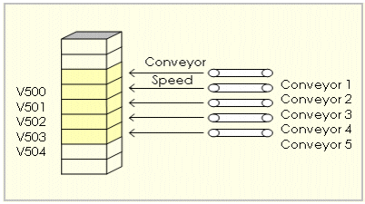
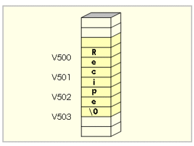
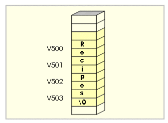

# Variable Tags (Теги змінних)

Тег змінної (Variable Tag) - це мітка, яку можна використовувати для посилання на поточне значення даних регістра пристрою введення-виведення за вказаною адресою.

Це має кілька переваг:

- Адреса в пристрої введення-виведення означується лише один раз. Якщо адреса змінюється, потрібно оновити лише означення тега змінної.
- Можна використовувати логічне та зрозуміле ім'я тега.
- У тому самому означенні можна масштабувати сирі дані до потрібного діапазону значень.

Теги змінних є фундаментальним компонентом значної частини функціональності Plant SCADA. Наприклад, теги змінних можна використовувати для:

- відображення виробничих даних на графічній сторінці (див. «Display Tags on a Page»);
- анімації об'єктів на графічній сторінці у відповідь на зміну значень тегів (див. «Configure Graphics Objects»);
- означення команд для керування устаткованням і процесами (див. «Interact with Graphics Pages at Runtime»);
- створення аварійних повідомлень, які контролюють теги змінних на предмет певних змін значень (див. «Alarms»);
- збереження даних тегів для трендів та аналізу (див. «Trends»).

Під час означення тега змінної необхідно задати йому ім'я тега (`Tag Name`) та вказати тип даних тега (`Tag Data Type`).

Найпоширенішими типами змінних, що підтримуються пристроями введення-виведення, є цифрові (`DIGITAL`) та цілочисельні (`INT`). Проте Plant SCADA також підтримує типи даних `REAL`, `STRING`, `BYTE`, `BCD`, `LONG` і `LONGBCD`.

Теги змінних також підтримують набір елементів тега (`Tag Elements`), які надають різні представлення даних тега. До них належать:

- розширені значення даних;
- інформація про перевірку якості;
- часові мітки.

Читання та запис елементів тега можна виконувати за допомогою розширень тегів (`Tag Extensions`).

Можна використовувати такі типи тегів змінних:

- Масиви (`Arrays`) дозволяють використовувати один тег змінної для представлення набору змінних, що зберігаються в послідовних регістрах пам'яті пристрою введення-виведення.
- Локальні змінні (`Local Variables`) дозволяють зберігати дані в пам'яті після запуску системи виконання.
- Обчислювані змінні (`Calculated Variables`) дозволяють формувати значення тега під час виконання як результат обчислення виразу Cicode.

Примітка. За допомогою Cicode можна створити сеанс перегляду тегів (tag browsing session) під час виконання. Див. розділ «Configure Tag Browsing».

## Імена тегів

Plant SCADA накладає певні обмеження на імена, які можна використовувати для тегів змінних:

- Імена тегів повинні відповідати визначеному синтаксису (див. «Tag Name Syntax»).
- Існує набір зарезервованих слів, яких слід уникати під час іменування тегів (див. «Reserved Words»).
- Не слід надавати тегу таке саме ім'я, як у функції Cicode, що використовується в проєкті або у включених до нього проєктах. Якщо тег має те саме ім'я, що й функція Cicode, та розміщується на графічній сторінці, під час компіляції виникне повідомлення про помилку.

На імена тегів змінних можна посилатися в проєкті як на рядкові значення, використовуючи такі формати:

- `<ім'я тега>`
- `<кластер>.<ім'я тега>` (використовується в багатокластерних системах).

Примітка. Якщо проєкт Plant SCADA використовує ієрархію устатковання, під час звернення до тега може знадобитися вказати його розташування в цій ієрархії. У посиланні на тег для позначення рівнів ієрархії використовується крапка (`.`), наприклад:

```
Plant.Line1.Pump.Tag1
```

Додаткову інформацію див. у розділі «Equipment Hierarchy».

### Синтаксис імен тегів

Теги Plant SCADA (теги змінних, аварійні теги та теги трендів) повинні відповідати таким правилам:

- Імена тегів нечутливі до регістру.
- Перший символ має бути:
  - літерою (`A-Z` або `a-z`), або
  - символом підкреслення (`_`).
- Усі наступні символи можуть бути:
  - літерами (`A-Z` або `a-z`);
  - цифрами (`0-9`);
  - символом зворотної косої риски (`\`);
  - символом підкреслення (`_`).

Використання будь-яких інших символів призведе до помилки компіляції.

Приклади:

- `_MyTag123` — коректне ім'я тега.
- `my\New\Tag` — коректне ім'я тега.
- `\NewTag\` — некоректне ім'я тега.

Імена тегів, що починаються з цифри (наприклад, `12TagName`), дозволені лише тоді, коли параметр INI:

```ini
[General]
TagStartDigit=1
```

увімкнений. За замовчуванням його значення дорівнює `0`.

Примітка. Для аварійних повідомлень (alarms) цим правилам має відповідати властивість `Alarm Tag`, але властивість `Alarm Name` може використовувати довільний текст і не обмежується цим синтаксисом.

### Практичний висновок

Допустимі:

```text
Motor1
_Motor1
Area1\Pump01
PLC_IO_001
```

Недопустимі:

```text
1Motor        (якщо TagStartDigit=0)
Motor-1       (- заборонений)
Motor.1       (. заборонена в імені тега)
Motor 1       (пробіл заборонений)
#Motor        (# заборонений)
```

Зверни увагу, що крапка (`.`) не входить до допустимого синтаксису імені тега. Вона використовується лише в посиланнях на тег для вказування кластера або рівнів ієрархії устатковання, наприклад:

```text
Cluster1.MotorRun
Plant.Line1.Pump01.Status
```

У цьому випадку крапка є частиною шляху до тега, а не самого імені тега.

### Структуровані імена тегів

Для отримання максимальної користі від таких засобів, як Genie та Super Genie, рекомендується використовувати наведене нижче правило іменування тегів. (Якщо у вашій системі вже використовується інша схема іменування, ви все одно можете використовувати Genie та Super Genie, що постачаються з Plant SCADA, модифікувавши потрібні Genie.)

Ім'я тега може містити до 79 символів. Для побудови єдиної системи іменування рекомендується розділити ім'я тега на секції, які описують характеристики тега, наприклад:

- область розташування тега;
- тип змінної;
- порядковий номер;
- специфічні атрибути.

Для системи Plant SCADA пропонується використовувати чотири основні секції в імені тега:

```text
Area_Type_Occurrence_Attribute
```

де:

- `Area` - область, зона або ділянка, до якої належить тег;
- `Type` - тип змінної або устатковання;
- `Occurrence` - номер або екземпляр об'єкта;
- `Attribute` - конкретний атрибут або параметр об'єкта.

### Зарезервовані слова

Під час конфігурування проєкту Plant SCADA не можна використовувати певні зарезервовані слова. Перед створенням імені для будь-якого елемента необхідно перевіряти наведені нижче списки.

### Імена тегів

Під час означення імені тега змінної не можна використовувати імена функцій Cicode та наведені нижче зарезервовані слова:

```text
&   *   **   -   /   +   <   <=   >=   <>   =   >

ACTION          AND             ANY_NUM         AREA
ARRAY           BOOL            CASE            CONFIGURATION
CONSTANT        DATE            DINT            DO
DUT             DWORD           ELSE            EN
END_CASE        END_CONFIGURATION END_FOR       END_IF
END_PROGRAM     END_VAR         END_WHILE       END
EXIT            FALSE           FOR             FUNCTION
IF              INT             ME              MOD
NOT             OF              OR              PROGRAM
REAL            REPEAT          STRING          TASK
TIME            TO              TRUE            UNTIL
VAR_EXTERNAL    VAR_GLOBAL      VAR_IN_OUT      VAR_INPUT
VAR_OUTPUT      WHILE           WORD            XOR
```

Примітка. Для імен аварійних тегів (`Alarm Tag`) існують додаткові зарезервовані слова, яких також необхідно уникати:

- `ServerStatus`
- `SummaryRecordId`
- `RDBTimeInDB`
- `CitectArchiveObject`

Якщо використати одне з цих слів як ім'я аварійного тега, під час компіляції проєкту буде виведено повідомлення про помилку.

------

### Імена кластерів

Під час означення імені кластера не можна використовувати такі самі зарезервовані слова:

```text
&   *   **   -   /   +   <   <=   >=   <>   =   >

ACTION          AND             ANY_NUM         AREA
ARRAY           BOOL            CASE            CONFIGURATION
CONSTANT        DATE            DINT            DO
DUT             DWORD           ELSE            EN
END_CASE        END_CONFIGURATION END_FOR       END_IF
END_PROGRAM     END_VAR         END_WHILE       END
EXIT            FALSE           FOR             FUNCTION
IF              INT             ME              MOD
NOT             OF              OR              PROGRAM
REAL            REPEAT          STRING          TASK
TIME            TO              TRUE            UNTIL
VAR_EXTERNAL    VAR_GLOBAL      VAR_IN_OUT      VAR_INPUT
VAR_OUTPUT      WHILE           WORD            XOR
```

------

### Імена устатковання

Під час означення імені устатковання не можна використовувати такі самі зарезервовані слова:

```text
&   *   **   -   /   +   <   <=   >=   <>   =   >

ACTION          AND             ANY_NUM         AREA
ARRAY           BOOL            CASE            CONFIGURATION
CONSTANT        DATE            DINT            DO
DUT             DWORD           ELSE            EN
END_CASE        END_CONFIGURATION END_FOR       END_IF
END_PROGRAM     END_VAR         END_WHILE       END
EXIT            FALSE           FOR             FUNCTION
IF              INT             ME              MOD
NOT             OF              OR              PROGRAM
REAL            REPEAT          STRING          TASK
TIME            TO              TRUE            UNTIL
VAR_EXTERNAL    VAR_GLOBAL      VAR_IN_OUT      VAR_INPUT
VAR_OUTPUT      WHILE           WORD            XOR
```

Примітка. Під час означення імені елемента (`Item Name`) існує додатковий набір зарезервованих слів, пов'язаних із синтаксисом розширень тегів (`Tag Extensions`):

- `field`
- `valid`
- `override`
- `overridemode`
- `controlmode`
- `status`
- `v`
- `vt`
- `q`
- `qt`
- `t`

Якщо використати будь-яке з цих слів, під час компіляції буде виведено повідомлення про помилку.

Примітка. Використання зарезервованого слова як імені може призвести до виникнення помилки компіляції.

### Типи даних тегів

Теги в Plant SCADA містять значення даних, які можуть бути означені одним із наведених нижче типів даних.

| Тип даних | Змінна                                                       | Розмір              | Допустимі значення                    |
| --------- | ------------------------------------------------------------ | ------------------- | ------------------------------------- |
| BCD       | Двійково-десяткове число (Binary-Coded Decimal)              | 2 байти             | від 0 до 9 999                        |
| BYTE      | Байт                                                         | 1 байт              | від 0 до 255                          |
| DIGITAL   | Цифрове значення                                             | 1 байт              | 0 або 1                               |
| INT       | Ціле число                                                   | 2 байти             | від -32 768 до 32 767                 |
| UINT      | Беззнакове ціле число                                        | 2 байти             | від 0 до 65 535                       |
| LONG      | Довге ціле число                                             | 4 байти             | від -2 147 483 648 до 2 147 483 647   |
| ULONG     | Беззнакове довге ціле число (лише для відображення на екрані; арифметичні операції не підтримуються) | 4 байти             | від 0 до 4 294 967 295                |
| LONGBCD   | Довге двійково-десяткове число                               | 4 байти             | від 0 до 99 999 999                   |
| REAL      | Число з плаваючою комою                                      | 4 байти             | від -3.4E38 до 3.4E38                 |
| STRING    | Рядок                                                        | максимум 256 байтів | ASCII (із завершальним символом NULL) |

Примітка. Непридатні для друку символи в рядкових тегах замінюються пробілами. Наприклад, рядок:

```text
[0x01, 0x41, 0x10, 0x42]
```

буде відображений як:

```text
"A B"
```

що дозволяє продовжити завантаження кешу.

Хоча числові змінні використовуються найчастіше, деякі пристрої введення-виведення також підтримують ASCII-рядки. Рядки можна використовувати для зберігання текстових даних, наприклад, отриманих від сканера штрихкодів.

Усі рядки в пристрої введення-виведення повинні завершуватися символом `NULL`, оскільки Plant SCADA використовує його для визначення кінця рядка. Якщо символ `NULL` відсутній, Plant SCADA буде читати та відображати додаткові символи, що знаходяться в пам'яті після фактичного кінця рядка.

Під час використання дискового пристрою введення-виведення (`Disk I/O Device`) також можна використовувати тип даних `STRING` для:

- зберігання рецептів;
- відображення інформації оператору.

Не всі пристрої введення-виведення підтримують рядки. Проте якщо пристрій підтримує цілочисельні типи даних, Plant SCADA може використовувати ці регістри для зберігання ASCII-рядків у пристрої.

Рядки Plant SCADA можуть зберігатися лише в суцільних блоках пам'яті (послідовних регістрах) і зберігаються як масив.

Змінна Cicode типу `INT` може використовуватися для зберігання тегів типів:

- `BCD`
- `BYTE`
- `DIGITAL`
- `INT`
- `UINT`
- `LONG`
- `ULONG`
- `LONGBCD`

Змінна Cicode типу `QUALITY` або `TIMESTAMP` може використовуватися для зберігання відповідно:

- інформації про якість тега (`Quality`);
- часової мітки тега (`Timestamp`).

Значення тегів можуть використовуватися разом із типами даних змінних Cicode (див. розділ «Declaring the Variable Data Type»).

## Елементи тегів

Тег змінної є представленням набору елементів даних. Кожен елемент надає доступ до певного представлення даних тега.

Кожен тег змінної може використовуватися самостійно або з посиланням на конкретний елемент для доступу до такої інформації:

| Елемент         | Опис                                                         |
| --------------- | ------------------------------------------------------------ |
| `.field`        | Елемент field, який представляє останні дані, отримані від пристрою. |
| `.valid`        | Елемент valid, який представляє останні дані з поля, що мали якість «Good». |
| `.override`     | Елемент override, який представляє перевизначене значення тега. |
| `.overridemode` | Режим перевизначення, який використовується для налаштування поведінки перевизначення тега. |
| `.controlmode`  | Режим керування, який використовується для налаштування режиму заборони керування тегом. |
| `.status`       | Елемент статусу тега, який відображає поточний стан тега.    |

Тег і кожен його елемент містять елементи доступу (items), які дозволяють отримати таку інформацію:

| Елемент доступу | Опис                                                         |
| --------------- | ------------------------------------------------------------ |
| `v`             | Значення (Value). Використовується для отримання поточного значення даних тега або елемента. |
| `vt`            | Часова мітка значення (Value Timestamp). Використовується для отримання часової мітки моменту останньої зміни значення. |
| `q`             | Якість (Quality). Використовується для отримання інформації про якість значення. |
| `qt`            | Часова мітка якості (Quality Timestamp). Використовується для отримання часової мітки моменту останньої зміни якості. |
| `t`             | Часова мітка (Timestamp). Надає часову мітку моменту останнього оновлення тега або елемента. |

Елемент якості (`q`) відрізняється від інших елементів тим, що надає кілька рівнів інформації. Докладніше див. розділ «The Quality Item».

Для звернення до елементів тегів у проєкті використовуються розширення тегів (`Tag Extensions`).

### Елемент Quality

Більшість даних, що містяться в тегу змінної, представлені елементом, який включає елементи доступу (`items`) **Value**, **ValueTimestamp**, **Quality**, **QualityTimestamp** та **Timestamp**.

За винятком елемента **Quality**, усі ці елементи доступу є простими значеннями. Проте елемент **Quality** містить декілька рівнів інформації.

Ці рівні інформації поділяються на такі категорії.

Перший рівень визначає загальний стан якості (*General Quality Values*).

| Ім'я мітки Cicode | Значення | Опис                                                         |
| ----------------- | -------- | ------------------------------------------------------------ |
| `QUAL_BAD`        | `0x00`   | Значення непридатне для використання з причин, указаних у полі підстатусу (*Substatus Bit Field*). |
| `QUAL_UNCR`       | `0x01`   | Якість значення є невизначеною з причин, указаних у полі підстатусу (*Substatus Bit Field*). |
| `QUAL_GOOD`       | `0x03`   | Якість значення є доброю (*Good*).                           |

До цих значень можна звертатися:

- з текстового об'єкта на графічній сторінці під час виконання;
- за допомогою функції Cicode `QualityGetPart`, передавши відповідне значення параметра `Part`.

Усередині кожного із цих значень якості міститься другий рівень інформації - **підстатус (substatus)**, а також третій рівень - **розширений підстатус (extended substatus)**.

До цих рівнів інформації також можна отримати доступ за допомогою функції Cicode `QualityGetPart`.


### Розширення тегів (Tag Extensions)

Розширення тегів дозволяють звертатися до елементів тега (`Tag Elements`). Вони забезпечують таку функціональність:

- надають доступ до інформації про якість та часові мітки, пов'язані зі значенням тега;
- надають розширені дані клієнтським компонентам Plant SCADA, таким як клієнт відображення, сервер трендів, сервер аварійних повідомлень, сервер звітів, Cicode та CtAPI;
- дозволяють застосовувати перевизначення (*override*) до тега та забороняти запис його значення;
- дозволяють відображати та архівувати значення тегів навіть тоді, коли їхня якість не є «Good»;
- забезпечують збереження значень тегів та реплікацію даних тегів.

Синтаксис посилання на тег із використанням розширень тегів:

```text
[Cluster.]Tag[.Element][.Item][[n]]
```

де:

| Частина   | Опис                                                         |
| --------- | ------------------------------------------------------------ |
| `Cluster` | Необов'язкова назва кластера.                                |
| `Tag`     | Ім'я тега або параметр Super Genie.                          |
| `Element` | Необов'язкова назва елемента. Якщо не вказана, потрібний елемент визначається під час виконання. |
| `Item`    | Необов'язкова назва елемента доступу (item). Якщо не вказана, використовується весь елемент. |
| `n`       | Необов'язковий індекс масиву, якщо тег означений як масив.   |

Індекс масиву розміщується наприкінці посилання:

```text
MyArray.v[n]
MyArray.Field[n]
MyArray.Field.v[n]
```

Для кожного масиву існує лише одна якість (`quality`) і одна часова мітка (`timestamp`), тому всі елементи масиву повертають однакові значення якості та часових міток.

Примітка. Під час використання розширень тегів слід враховувати вплив на мережевий трафік, оскільки передавання інформації про якість і часові мітки збільшує обсяг даних, що передаються між серверами.

### Способи доступу до даних тегів

Можна використовувати розширення тегів кількома способами.

Звернення лише за ім'ям тега:

```text
MyTag
```

(неявне посилання на тег)

У цьому випадку за замовчуванням використовується елемент `.field`, якщо тег не перебуває в одному з режимів перевизначення.

------

Звернення за ім'ям тега та елементом доступу:

```text
MyTag.q
```

(неявне посилання на тег)

Надає доступ до елемента доступу (`item`) тега з елемента `.field` або `.override`, залежно від поточного стану тега.

------

Звернення за ім'ям тега та елементом:

```text
MyTag.field
```

(явне посилання на тег)

Надає доступ до вказаного елемента тега.

------

Звернення за ім'ям тега, елементом та елементом доступу:

```text
MyTag.field.vt
```

(явне посилання на тег)

Надає доступ до конкретного елемента доступу (`item`) заданого елемента тега.

------

Подібним способом можна звертатися і до даних аварійних повідомлень. Див. розділ «Using Alarm Properties as Tags».

Примітка. Під час використання розширень тегів слід враховувати вплив на мережевий трафік, оскільки передавання інформації про якість і часові мітки збільшує обсяг даних, що передаються між серверами.

### Керування поведінкою розширень тегів

За замовчуванням посилання на тег без указання елемента повертає значення даних, якщо якість значення є доброю (*Good*), або повідомлення про помилку (`#BAD`, `#COM` тощо), якщо якість є поганою (*Bad*).

Для зміни цієї поведінки можна використовувати параметр:

```ini
[Page]
IgnoreValueQuality
```

Цей параметр також дозволяє автоматично змінювати колір фону текстових і числових графічних об'єктів залежно від зміни якості тега.

Поведінка розширень тегів керується кількома параметрами файлу `citect.ini`, описаними в довіднику параметрів (*Parameters Reference*). Для кожного такого параметра існує відповідний параметр у базі даних проєкту (`param.dbf`).

- Параметри `citect.ini` діють лише на конкретному комп'ютері.
- Параметри з бази даних проєкту застосовуються до всієї системи.

Примітка. За замовчуванням функція Cicode `TagSubscribe()` отримує «полегшені» (*lightweight*) значення тегів, які не містять інформації про якість та часові мітки значення.

Якщо підписка повинна отримувати часові мітки, аргумент `bLightweight` необхідно встановити в `0` (`FALSE`).

## Масиви

Масив - це набір змінних одного типу даних, які зберігаються в послідовних регістрах пам'яті пристрою введення-виведення.

Plant SCADA підтримує два типи масивів:

- числові масиви (*Numeric Arrays*);
- рядкові масиви (*String Arrays*).

### Числові масиви

Числові масиви корисні у випадках, коли кілька пристроїв або процесів виконують однакові функції. У такому разі можна запрограмувати пристрій введення-виведення так, щоб змінні, пов'язані з цими процесами, зберігалися в послідовних регістрах пам'яті.

У наведеному прикладі п'ять послідовних змінних (`V500`, `V501`, `V502`, `V503` і `V504`) зберігають швидкість п'яти конвеєрів.



Замість конфігурування п'яти окремих тегів змінних (по одному для кожного конвеєра) можна означити один тег як масив.

Щоб означити один тег змінної для масиву, необхідно вказати початкову адресу та додати до адреси розмір масиву (кількість послідовних адрес).

| Тег змінної    | Адреса  |
| -------------- | ------- |
| Conveyor_Speed | V500[5] |

У цьому випадку п'ять регістрів пам'яті представляються одним тегом змінної `Conveyor_Speed`.

------

### Рядкові масиви

Якщо використовується тип даних `STRING` Plant SCADA, необхідно означити масив цілих типів даних (`INT`).

Один регістр `INT` зберігає два символи рядка.

Для обчислення розміру масиву для рядкових даних використовується така формула:

```
Кількість елементів = (Кількість символів + 1) / 2
```

Останній елемент масиву завжди використовується для зберігання символу завершення рядка `'\0'` (*null character*), який позначає кінець рядка.

Для зберігання слова:

```text
Recipe
```

необхідно означити масив із чотирьох елементів:

| Тег змінної | Адреса  |
| ----------- | ------- |
| Recipe_Tag  | V500[4] |

У кожному регістрі зберігаються два символи:



| Регістр | Символи |
| ------- | ------- |
| V500    | R e     |
| V501    | c i     |
| V502    | p e     |
| V503    | \0      |

Після цього до всього рядка можна звертатися через ім'я тега:

```text
<Tag Name>
```

Наприклад:

| Тег змінної |
| ----------- |
| Recipe_Tag  |

------

Для зберігання слова:

```text
Recipes
```

також потрібен масив із чотирьох елементів.



Символи будуть розміщені таким чином:

| Регістр | Символи |
| ------- | ------- |
| V500    | R e     |
| V501    | c i     |
| V502    | p e     |
| V503    | s \0    |

Примітка. Якщо ваш пристрій введення-виведення підтримує власний рядковий тип даних, адресу необхідно задавати у форматі, визначеному відповідним драйвером пристрою введення-виведення.

## Локальні змінні

Локальні змінні дозволяють зберігати дані в пам'яті після запуску системи виконання (*runtime system*). Вони створюються щоразу під час запуску системи, тому не зберігають свої значення після її завершення.

Кожен процес Plant SCADA має власну копію локальних змінних, сконфігурованих у проєкті. Це корисно в ситуаціях, коли кожен процес повинен мати окрему копію відповідних даних.

Значення, записані в локальну змінну, доступні лише тому процесу, в якому вони були записані.

Локальні змінні можуть мати будь-який тип даних, підтримуваний Plant SCADA, включаючи двовимірні масиви.

## Обчислювані змінні

Обчислювана змінна (*Calculated Variable*) дозволяє:

- генерувати значення тега під час виконання як результат обчислення виразу Cicode;
- викликати внутрішню функцію Cicode як тег змінної.

Примітка. Обчислювані змінні обчислюються на сервері введення-виведення (*I/O Server*) лише тоді, коли існує підписка на цю обчислювану змінну.

Для обчислюваних змінних підтримуються такі типи даних:

- `INT`
- `LONG`
- `REAL`
- `DIGITAL`
- `STRING`

Для конфігурування обчислюваної змінної використовується тег змінної, який звертається до пристрою введення-виведення з протоколом `CICODE`.

Якщо поле Address містить коректний вираз Cicode, пристрій введення-виведення Cicode обчислює результат цього виразу та надає його як значення тега.

Примітка. Одна й та сама функція Cicode може повертати різні результати залежно від того, чи була вона викликана з процесу, події або через пристрій введення-виведення Cicode. Якщо функція використовується як адреса обчислюваної змінної та хоча б один із її аргументів має значення `#Bad`, функція поверне `#Bad`, навіть якщо сама функція виконалася коректно.

Примітка. Якщо вираз у полі Address читає або записує інший тег системи, обчислювана змінна враховується в загальній кількості точок (*point count*).

------

### Приклад 1

Проєкт Plant SCADA Example Project містить низку тегів для сторінки Steel Mill. Серед них є два теги, що визначають довжину та ширину рулону, який наразі завантажений на розмотувач.

| Ім'я тега        | Пристрій I/O  | Адреса | Тип даних | Одиниці   |
| ---------------- | ------------- | ------ | --------- | --------- |
| Entry_CoilLength | SteelMillDisk | R10    | REAL      | метри     |
| Entry_CoilWidth  | SteelMillDisk | R13    | REAL      | міліметри |

За допомогою обчислюваної змінної можна визначити площу сталевого листа, яка буде отримана з поточного рулону.

Для цього можна створити такий тег:

| Ім'я тега      | Пристрій I/O   | Адреса                                      | Тип даних | Одиниці |
| -------------- | -------------- | ------------------------------------------- | --------- | ------- |
| Entry_CoilArea | CicodeIODevice | Entry_CoilLength * (Entry_CoilWidth) / 1000 | REAL      | м²      |

Отримане значення можна використовувати для оцінювання виробничого потенціалу поточного рулону.

------

### Приклад 2

За допомогою обчислюваної змінної можна викликати функцію Cicode для діагностики та визначення стану пристрою введення-виведення.

| Ім'я тега                  | Пристрій I/O   | Адреса                                   | Тип даних |
| -------------------------- | -------------- | ---------------------------------------- | --------- |
| IOServer_Mixer_PM800_State | CicodeIODevice | IODeviceInfo("IOServer_Mixer_PM800", 10) | STRING    |

У цьому прикладі функція Cicode використовується для визначення стану вказаного міксера (наприклад, online або offline).

Примітка. Функції Cicode, що використовуються в обчислюваних змінних, повинні бути неблокувальними (*non-blocking*).

------

### Приклад 3

За допомогою обчислюваної змінної можна генерувати аварійне повідомлення при переході пристрою введення-виведення в автономний режим.

Для цього необхідно:

- створити тег змінної з обчислюваною змінною для визначення стану пристрою;
- створити розширене аварійне повідомлення (*advanced alarm*), вираз якого повертає `TRUE` при виникненні потрібного стану.

Тег змінної:

| Ім'я тега                  | Пристрій I/O | Адреса                                   | Тип даних |
| -------------------------- | ------------ | ---------------------------------------- | --------- |
| IOServer_Mixer_PM800_State | Mixer        | IODeviceInfo("IOServer_Mixer_PM800", 10) | STRING    |

Аварійне повідомлення:

| Alarm Tag                    | Пристрій I/O | Вираз                                       |
| ---------------------------- | ------------ | ------------------------------------------- |
| IOServer_Mixer_PM800_Offline | Mixer        | (StrToInt(IOServer_Mixer_PM800_State) = 16) |

або

```cicode
(StrToInt(IOServer_Mixer_PM800_State) = 32)
```

У цьому прикладі тег змінної обчислює стан міксера. Аварійне повідомлення спрацює, якщо значення дорівнює `16` (offline) або `32` (disabled).

------

### Приклад 4

За допомогою обчислюваної змінної можна виконувати математичні обчислення.

У цьому прикладі тег обчислює частку двох цілих чисел і повертає код помилки, якщо дільник дорівнює нулю.

| Ім'я тега        | Пристрій I/O   | Адреса      | Тип даних |
| ---------------- | -------------- | ----------- | --------- |
| Divide_Tag_Value | CicodeIODevice | Divide(4,9) | REAL      |

```cicode
REAL FUNCTION Divide(INT iDividend, INT iDivisor)

REAL iResult;

INT iError;

ErrSet(1);

iResult = iDividend / iDivisor;

iError = IsError();

ErrSet(0);

RETURN iResult;

END
```

## Збереження даних тегів (Tag Data Persistence)

Кожен пристрій введення-виведення має кеш даних тегів на своєму сервері введення-виведення (*I/O Server*). Цей кеш періодично зберігається на диск для підтримки останнього відомого значення (*Last Known Value, LKV*) кожного тега.

Це дозволяє ініціалізувати теги пристрою їхніми відповідними значеннями LKV після перезапуску пристрою.

Під час завантаження початкова збережена якість замінюється значенням якості `BadLastKnown`.

Файл кешу тегів зберігається у форматі XML DataSource Schema, що містить інформацію про значення, якість і часову мітку кожного тега.

За замовчуванням файл зберігається в каталозі даних Plant SCADA з таким ім'ям:

```text
<ClusterName>.<IOServerName>.<IODeviceName>.cache
```

Під час збереження файлу кешу спочатку створюється тимчасовий файл. Після успішного запису він перейменовується на основне ім'я файлу.

Це робиться для уникнення часткового оновлення основного файлу.

Якщо під час завантаження перевірка XML-схеми завершується невдало, увесь файл вважається некоректним і всі LKV тегів втрачаються.

Якщо ж у конкретному записі тега некоректними є значення, якість або часова мітка, такий запис просто ігнорується, а відповідна інформація записується в журнал.

Збереження даних налаштовується через властивості:

- `Persist`
- `Persist Period`
- `File Name`

(див. розділ «Add an I/O Device»).

------

### Мінімальна частота оновлення (Minimum Update Rate)

Пристрій введення-виведення може надсилати повідомлення про оновлення тегів клієнтам підписки після завершення визначеного інтервалу часу.

Це налаштовується через властивість `Min Update Rate`.

Для резервованих пристроїв (*redundant operation*) значення мінімальної частоти оновлення повинні відповідати таким правилам:

| Primary Device              | Standby Device                     | Результат компіляції |
| --------------------------- | ---------------------------------- | -------------------- |
| Порожньо (за замовчуванням) | Порожньо (за замовчуванням)        | OK                   |
| Порожньо (за замовчуванням) | Значення задане                    | Помилка              |
| Значення задане             | Порожньо (за замовчуванням)        | OK                   |
| Значення задане             | Таке саме значення, як у Primary   | OK                   |
| Значення задане             | Значення відрізняється від Primary | Помилка              |

------

### Період застарівання (Staleness Period)

Для значень тегів, отриманих від пристрою введення-виведення, можна задати період застарівання (*staleness period*).

Якщо клієнт підписки не отримує оновлення тега протягом цього часу, значення елемента тега вважається застарілим (*stale*).

У цьому випадку в підстатусі якості встановлюється:

```text
QUAL_EXT_STALE
```

Обробка періоду застарівання виконується на стороні клієнта з'єднання.

Період застарівання можна налаштувати кількома способами.

#### На сервері

Для конкретного пристрою введення-виведення можна встановити властивість:

```text
Staleness Period
```

(див. розділ «Add an I/O Device»).

Значення задається в секундах і означає максимальний час після останнього оновлення, після якого встановлюється стан `QUAL_EXT_STALE`.

Для резервованих пристроїв параметри `Staleness Period` повинні відповідати тим самим правилам, що й `Min Update Rate`.

#### Через параметр системи

На сервері або клієнті можна використовувати параметр:

```ini
[Client]
StalenessPeriod
```

Він задає кількість секунд після останнього оновлення, по закінченні яких значення вважається застарілим.

#### Через допуск застарівання

Лише на клієнті можна використовувати параметр:

```ini
[Client]
StalenessPeriodTolerance
```

Цей параметр задає інтервал перевірки застарілих значень як відсоток від загального періоду застарівання.

Типове значення:

```text
10%
```

Наприклад, якщо:

```text
StalenessPeriod = 600 секунд
```

то перевірка застарілих елементів тегів виконуватиметься кожні:

```text
60 секунд
```

(10% від 600 секунд).


## XML-схема джерела даних (XML DataSource Schema)

Наведена XML Schema (XSD) означає формат файлу кешу тегів (`*.cache`), який використовується механізмом збереження даних тегів Plant SCADA.

Основні компоненти схеми:

### Типи даних (DataType)

Атрибут `type` може приймати такі значення:

- Boolean
- SByte
- Byte
- Char
- Double
- Int16
- Int32
- Int64
- Single
- String
- UInt16
- UInt32
- UInt64
- Decimal
- DateTime

------

### Імена елементів тега (ElementName)

Елемент тега може бути одним із таких:

- `Field`
- `Valid`
- `Override`
- `OverrideMode`
- `ControlMode`
- `Status`

або порожнім значенням.

------

### Кореневий елемент

```xml
<datasource>
```

Містить два розділи:

```xml
<properties>
<tags>
```

------

### Properties

Колекція властивостей джерела даних.

```xml
<properties>
    <property name="..." type="...">...</property>
</properties>
```

Приклад:

```xml
<property name="Version" type="String">1.0</property>
```

------

### Tags

Колекція тегів.

```xml
<tags>
    <tag name="Tag1">
        ...
    </tag>
</tags>
```

Імена тегів повинні бути унікальними.

------

### TagElement

Кожен елемент тега містить:

```xml
<v>...</v>
<q>...</q>
<t>...</t>
<qt>...</qt>
<vt>...</vt>
```

де:

| Елемент | Призначення                       |
| ------- | --------------------------------- |
| v       | Значення                          |
| q       | Якість                            |
| t       | Час останнього оновлення елемента |
| qt      | Час останньої зміни якості        |
| vt      | Час останньої зміни значення      |

------

### Значення (Value)

Значення можуть бути скаляром або масивом.

```xml
<v type="Int32" size="1">
    <item>123</item>
</v>
```

або

```xml
<v type="String" size="3">
    <item>ABC</item>
    <item>DEF</item>
    <item>XYZ</item>
</v>
```

Атрибути:

| Атрибут | Опис                |
| ------- | ------------------- |
| type    | Тип даних           |
| size    | Кількість елементів |

------

### Якість (Quality)

Якість складається з двох частин:

```xml
<q>
    <generic>3</generic>
    <specific>0</specific>
</q>
```

де:

- `generic` - загальна якість (`QUAL_GOOD`, `QUAL_BAD`, `QUAL_UNCR`);
- `specific` - код підстатусу або розширеного підстатусу.

------

### Приклад запису одного тега

Приблизно так може виглядати запис у файлі кешу:

```xml
<tag name="MotorSpeed">

    <element name="Field">

        <v type="Int32" size="1">
            <item>1450</item>
        </v>

        <q>
            <generic>3</generic>
            <specific>0</specific>
        </q>

        <t>2026-06-08T12:00:00Z</t>

        <qt>2026-06-08T12:00:00Z</qt>

        <vt>2026-06-08T11:59:58Z</vt>

    </element>

</tag>
```

Тобто файл кешу фактично містить для кожного тега:

- значення (`v`);
- якість (`q`);
- час оновлення (`t`);
- час зміни якості (`qt`);
- час зміни значення (`vt`);

для елементів `Field`, `Valid`, `Override`, `OverrideMode`, `ControlMode` та `Status`.

## Конфігурування тегів змінних

У проєкті Plant SCADA можна конфігурувати такі типи змінних:

- Додати тег змінної (*Add a Variable Tag*)
- Додати обчислювану змінну (*Add a Calculated Variable*)
- Додати локальну змінну (*Add a Local Variable*)

## Посилання на теги змінних

Існує кілька способів звернення до інформації, яку надають змінні в системі Plant SCADA.

- Якщо набір змінних сконфігурований як масив, див. розділ «Refer to Array Elements».
- Якщо елементи тега сконфігуровані як розширення тегів (*Tag Extensions*), див. розділ «Refer to Tag Extensions».
- Для доступу до тега, пов'язаного з елементом устатковання, див. розділ «Use an 'Equipment.Item' Reference».
- Для перегляду списку тегів змінних під час виконання системи див. розділ «Configure Tag Browsing».

### Посилання на елементи масиву

Кожен елемент масиву визначається за допомогою індексу. Для отримання доступу до окремої змінної масиву необхідно вказати ім'я тега та індекс у такому форматі:

```text
<Tag Name>[Index]
```

Наприклад, щоб звернутися до третьої змінної масиву `Conveyor_Speed`, використовуйте такий синтаксис:

```text
Conveyor_Speed[2]
```

Індекс першого елемента масиву завжди дорівнює `0`.

Під час використання масивів слід враховувати таке:

- Не рекомендується створювати великі масиви, оскільки щоразу при зверненні до окремого елемента масиву Plant SCADA зчитує весь масив із пристрою введення-виведення. Для великих масивів це може призвести до зниження продуктивності системи.

- Розмір масиву повинен бути меншим за максимальну довжину запиту драйвера, який використовується для зв'язку з пристроєм введення-виведення. Для визначення максимальної довжини запиту зверніться до документації драйвера.

- Цифрові масиви необхідно означувати на 16-бітній межі. Plant SCADA округлює початок кожного цифрового масиву вниз до найближчої 16-бітної межі. Через це фактичні біти масиву можуть відрізнятися від очікуваних. Наприклад, якщо масив `Test` означений із початком на біті 35, Plant SCADA фактично почне його з біта 32. Відповідно, індексація також почнеться з біта 32: `Test[0]` посилатиметься на біт 32, а не на біт 35.

- Кожен окремий елемент масиву має власні значення для елементів `.field`, `.valid` та `.override`, але всі елементи масиву спільно використовують:

  - `.overridemode`
  - `.controlmode`
  - якість (`quality`)
  - часові мітки (`timestamps`)

  Читання якості або часової мітки для окремого елемента масиву повертає якість або часову мітку всього масиву.

  Запис значення в окремий елемент масиву змінює часові мітки та якість для всього масиву.

  Зміна режиму перевизначення (`overridemode`) або режиму керування (`controlmode`) для одного елемента змінює їх для всього масиву.

### Посилання на розширення тегів

Ви можете використовувати розширення тегів (*Tag Extensions*) для виконання таких дій:

- Читання значення тега (*Read a Tag Value*)
- Запис значення тега (*Write to a Tag Value*)
- Переведення тега в режим заборони керування (*Set a Tag to Control Inhibit Mode*)
- Переведення тега в режим перевизначення (*Set a Tag to Override Mode*)
- Визначення стану тега (*Determine Tag Status*)

#### Читання значення тега

Дані, отримані з поля, представлені елементами тега **Field** та **Valid**.

- Елемент **Field** представляє останні дані тега, отримані від пристрою.
- Елемент **Valid** представляє останні польові дані, які мали якість **Good**.

Примітка. Елемент тега **Valid** спочатку має погану якість (*Bad*). Його якість стане доброю лише після успішного завершення першого запиту читання для цього тега. Це відбудеться лише тоді, коли пристрій введення-виведення перебуває в режимі online і виконується одна з таких умов:

- увімкнене фонове опитування (*background polling*);
- на тег оформлена підписка (*subscription*);
- було виконано виклик `TagRead`.

Доступ до цих елементів здійснюється через кваліфіковане посилання на тег (ім'я тега разом з ім'ям елемента, наприклад `MyTag.Field`).

##### Елемент Field

| Синтаксис посилання | Тип даних Plant SCADA | Опис                                       |
| ------------------- | --------------------- | ------------------------------------------ |
| `TagName.Field`     | INT, REAL, STRING     | Неявне значення елемента Field             |
| `TagName.Field.V`   | INT, REAL, STRING     | Значення                                   |
| `TagName.Field.VT`  | TIMESTAMP             | Часова мітка останньої зміни значення      |
| `TagName.Field.Q`   | QUALITY               | Якість                                     |
| `TagName.Field.QT`  | TIMESTAMP             | Часова мітка останньої зміни якості        |
| `TagName.Field.T`   | TIMESTAMP             | Часова мітка останнього оновлення елемента |

##### Елемент Valid

| Синтаксис посилання | Тип даних Plant SCADA | Опис                                       |
| ------------------- | --------------------- | ------------------------------------------ |
| `TagName.Valid`     | INT, REAL, STRING     | Неявне значення елемента Valid             |
| `TagName.Valid.V`   | INT, REAL, STRING     | Значення                                   |
| `TagName.Valid.VT`  | TIMESTAMP             | Часова мітка останньої зміни значення      |
| `TagName.Valid.Q`   | QUALITY               | Якість                                     |
| `TagName.Valid.QT`  | TIMESTAMP             | Часова мітка останньої зміни якості        |
| `TagName.Valid.T`   | TIMESTAMP             | Часова мітка останнього оновлення елемента |

Якщо визначено, що значення тега є некоректним через несправність датчика або втрату зв'язку, значення тега може бути перевизначене (*overridden*).

Для зберігання перевизначеного значення використовується елемент тега **Override**.

Докладнішу інформацію див. у розділі «Set a Tag to Override Mode».

#### Запис значення тега

Елементи тега, які підтримують читання та запис, можуть бути змінені. Однак ці елементи можуть оновлюватися лише цілком; запис в окремий елемент доступу (*item*) не допускається.

У наведеній таблиці показано результат запису в різні елементи тега.

| Ім'я елемента                                 | Запис дозволено | Результат запису                                             |
| --------------------------------------------- | --------------- | ------------------------------------------------------------ |
| Не вказано (некваліфіковане посилання на тег) | Так             | Запис у елемент Field та передавання значення до пристрою введення-виведення. |
| Field                                         | Так             | Запис у елемент Field та передавання значення до пристрою введення-виведення. |
| Valid                                         | Ні              | Запис не буде успішним.                                      |
| Override                                      | Так             | Запис у елемент Override.                                    |
| OverrideMode                                  | Так             | Запис у елемент OverrideMode.                                |

Для доступних значень режиму перевизначення див. опис відповідних функцій.

Примітка. Якщо тег перебуває в режимі Override, некваліфіковане посилання на тег буде звертатися до елемента Override.

| Ім'я елемента | Запис дозволено | Результат запису             |
| ------------- | --------------- | ---------------------------- |
| ControlMode   | Так             | Запис у елемент ControlMode. |

Елемент `Value` для `ControlMode` може мати такі значення:

- `0` – режим заборони керування (*Control Inhibit Mode*) вимкнений.
- `1` – режим заборони керування (*Control Inhibit Mode*) увімкнений.

Примітка. Коли режим заборони керування увімкнений, запис в елемент Field заборонений.

| Ім'я елемента | Запис дозволено | Результат запису        |
| ------------- | --------------- | ----------------------- |
| Status        | Ні              | Запис не буде успішним. |

Якщо визначено, що значення тега є некоректним через несправність датчика або втрату зв'язку, значення тега може бути перевизначене (*overridden*).

Для зберігання перевизначеного значення використовується елемент тега **Override**.

Докладнішу інформацію див. у розділі «Set a Tag to Override Mode».

#### Переведення тега в режим заборони керування (Control Inhibit Mode)

⚠️ ВИКОНАННЯ ОПЕРАЦІЇ КЕРУВАННЯ, ЯКА ФАКТИЧНО НЕ ВІДБУВАЄТЬСЯ

Коли тег переведено в режим заборони керування (*Control Inhibit Mode*), запис значення в елемент **Field** забороняється. Якщо система налаштована так, що оператор не отримує жодної індикації про перебування тега в цьому режимі, він може вважати, що виконує операцію керування, хоча фактично вона не відбувається.

Налаштуйте систему таким чином, щоб вона надавала оператору візуальну індикацію того, що тег перебуває в режимі заборони керування.

Недотримання цих інструкцій може призвести до смерті, серйозних травм або пошкодження обладнання.

Для візуальної індикації режиму заборони керування можна виконати одне з таких налаштувань.

Налаштувати один із таких параметрів `Citect.ini`, щоб режим заборони керування відображався зміною кольору фону або накладанням штрихованого шаблону на числові, текстові та символьні графічні об'єкти:

```text
[Page]ControlInhibitDitheringColor
[Page]ControlInhibitDitheringDensity
[Page]ControlInhibitTextBackgroundColor
```

Після цього встановити параметр:

```text
[Page]IgnoreValueQuality
```

у значення `0` або `2`.

Або:

Використовувати значення елемента **ControlMode**:

- `0` – тег не перебуває в режимі заборони керування;
- `1` – тег перебуває в режимі заборони керування.

Або:

Використовувати біт **ControlInhibit** у статусі якості елемента **Field**:

- `1` – тег перебуває в режимі заборони керування;
- `0` – тег не перебуває в режимі заборони керування.

##### Control Mode

Режим заборони керування дозволяє заборонити запис в елемент тега **Field**. Переведення тега в режим заборони керування застосовується до всієї системи. Запис в елемент **Field** буде заборонено для всіх споживачів даних введення-виведення.

Режим заборони керування контролюється елементом **ControlMode**, описаним у таблиці нижче.

| Синтаксис посилання     | Тип даних Plant SCADA | Опис                           |
| ----------------------- | --------------------- | ------------------------------ |
| `TagName.ControlMode`   | INT                   | Значення елемента ControlMode. |
| `TagName.ControlMode.V` | INT                   | Значення.                      |

Допустимі значення:

- `0` – режим заборони керування вимкнений.
- `1` – режим заборони керування увімкнений.

Значення за замовчуванням: `0`.

| Синтаксис посилання      | Тип даних Plant SCADA | Опис                                                         |
| ------------------------ | --------------------- | ------------------------------------------------------------ |
| `TagName.ControlMode.VT` | TIMESTAMP             | Часова мітка останньої зміни значення.                       |
| `TagName.ControlMode.Q`  | QUALITY               | Якість елемента ControlMode.                                 |
| `TagName.ControlMode.QT` | TIMESTAMP             | Часова мітка останньої зміни якості.                         |
| `TagName.ControlMode.T`  | TIMESTAMP             | Час переведення тега в режим заборони керування або виходу з нього (після запуску системи дорівнює 0). |

Якість елемента **ControlMode** має значення `QUAL_GOOD`, якщо тег був переведений у режим заборони керування на основному сервері та ця інформація була реплікована на резервні сервери.

В іншому випадку загальний статус якості матиме значення `QUAL_UNCR`, а розширений підстатус матиме значення `QE_NOT_REPLICATED`, що вказує на те, що не всі резервні сервери поінформовані про перебування тега в режимі заборони керування.

Примітка. Якість тегів, на які посилаються через елементи доступу (`Tag1.V`, `Tag1.Field.T` тощо), завжди має стан **GOOD**, а їх часові мітки дорівнюють `0` (*INVALID TIMESTAMP*).

Тому такі посилання не дають жодної візуальної індикації поганої якості, помилок або зміни режиму обробки (наприклад, режиму заборони керування чи режиму перевизначення), незалежно від значення параметра `[Page]IgnoreValueQuality`.

### Переведення тега в режим перевизначення (Override Mode)

⚠️ ВИКОНАННЯ ОПЕРАЦІЇ КЕРУВАННЯ НА ОСНОВІ НЕДОСТОВІРНИХ ДАНИХ

Коли тег переведено в режим перевизначення (*Override Mode*), значення тега за замовчуванням стає рівним значенню елемента **Override**, а не значенню елемента **Field**. Якщо система налаштована так, що оператор не отримує жодної індикації про перебування тега в режимі перевизначення, він може помилково вважати, що бачить значення елемента **Field** (актуальні польові дані), і відповідно неправильно керувати технологічним процесом.

Налаштуйте систему таким чином, щоб вона надавала оператору візуальну індикацію того, що тег перебуває в режимі перевизначення.

Недотримання цих інструкцій може призвести до смерті, серйозних травм або пошкодження обладнання.

Для візуальної індикації режиму перевизначення можна виконати одне з таких налаштувань.

Налаштувати один із таких параметрів `Citect.ini`, щоб режим перевизначення відображався зміною кольору фону або накладанням штрихованого шаблону на числові, текстові та символьні графічні об'єкти:

```text
[Page]OverrideDitheringColor
[Page]OverrideDitheringDensity
[Page]OverrideTextBackgroundColor
```

Після цього встановити параметр:

```text
[Page]IgnoreValueQuality
```

у значення `0` або `2`.

Або:

Використовувати значення елемента **OverrideMode**:

- `0` – тег не перебуває в режимі перевизначення;
- `1`, `2`, `3`, `4` – тег перебуває в одному з режимів перевизначення.

Або:

Використовувати біт **Override** у статусі якості елемента за замовчуванням або елемента Override:

- `1` – тег перебуває в режимі перевизначення;
- `0` – тег не перебуває в режимі перевизначення.

------

#### Використання режиму перевизначення

Якщо визначено, що значення тега є некоректним через несправність датчика або втрату зв'язку, значення тега може бути перевизначене.

Для зберігання перевизначеного значення використовується елемент **Override**.

Тег можна перевести в режим **Override Mode**, після чого кожне некваліфіковане посилання на тег (наприклад, `MyTag`) у всіх споживачах даних введення-виведення (Control Client, Trend Server, Alarm Server тощо) буде повертати значення елемента **Override**.

Якість тега при цьому вказуватиме, що тег перебуває в режимі перевизначення.

Перевизначення керується двома елементами:

- **Override** — містить перевизначене значення;
- **OverrideMode** — визначає режим перевизначення.

------

#### Елемент Override

| Синтаксис посилання   | Тип даних Plant SCADA | Опис                                                         |
| --------------------- | --------------------- | ------------------------------------------------------------ |
| `TagName.Override`    | INT, REAL, STRING     | Неявне значення елемента Override                            |
| `TagName.Override.V`  | INT, REAL, STRING     | Значення                                                     |
| `TagName.Override.VT` | TIMESTAMP             | Часова мітка останньої зміни значення                        |
| `TagName.Override.Q`  | QUALITY               | Якість. Значення Override має якість Good, якщо не виходить за допустимі межі |
| `TagName.Override.QT` | TIMESTAMP             | Часова мітка останньої зміни якості                          |
| `TagName.Override.T`  | TIMESTAMP             | Часова мітка останнього оновлення елемента                   |

Примітка. Якість тегів, на які посилаються через елементи доступу (`Tag1.V`, `Tag1.Field.T` тощо), завжди має стан **GOOD**, а часові мітки завжди дорівнюють `0` (*INVALID TIMESTAMP*).

Тому такі посилання не дають жодної візуальної індикації поганої якості, помилок або зміни режиму обробки (наприклад, режиму заборони керування чи режиму перевизначення), незалежно від значення параметра `[Page]IgnoreValueQuality`.

------

#### Елемент OverrideMode

| Синтаксис посилання       | Тип даних Plant SCADA | Опис                                                         |
| ------------------------- | --------------------- | ------------------------------------------------------------ |
| `TagName.OverrideMode`    | INT                   | Значення елемента OverrideMode                               |
| `TagName.OverrideMode.V`  | INT                   | Значення режиму перевизначення                               |
| `TagName.OverrideMode.VT` | TIMESTAMP             | Часова мітка останньої зміни значення                        |
| `TagName.OverrideMode.Q`  | QUALITY               | Якість елемента OverrideMode                                 |
| `TagName.OverrideMode.QT` | TIMESTAMP             | Часова мітка останньої зміни якості                          |
| `TagName.OverrideMode.T`  | TIMESTAMP             | Час переведення тега в режим перевизначення або виходу з нього (після запуску системи дорівнює 0) |

Якість елемента **OverrideMode** має значення `QUAL_GOOD`, якщо тег був переведений у режим перевизначення на основному сервері та ця інформація була реплікована на резервні сервери.

В іншому випадку загальний статус якості матиме значення `QUAL_UNCR`, а розширений підстатус — `QE_NOT_REPLICATED`, що означає, що деякі резервні сервери не знають про факт перевизначення тега.

------

#### Режими перевизначення

| Значення OverrideMode | Опис                                                         |
| --------------------- | ------------------------------------------------------------ |
| `0`                   | Режим перевизначення вимкнений.                              |
| `1`                   | Статичний режим перевизначення. Початкове значення Override встановлюється рівним значенню елемента Field. |
| `2`                   | Статичний режим перевизначення. Початкове значення Override встановлюється рівним значенню елемента Valid. |
| `3`                   | Статичний режим перевизначення. Значення Override залишається рівним раніше встановленому значенню елемента Override. |
| `4`                   | Динамічний режим перевизначення. Значення Override постійно відстежує значення елемента Valid. Запис у значення елемента Override у цьому режимі заборонений. |

### Визначення стану тега (Determine Tag Status)

Елемент **Tag Status** використовується для представлення поточного стану тега.

Значення цього елемента змінюється лише в результаті операцій з тегом, які взаємодіють з фізичним пристроєм. Наприклад, запис в елемент **Field** впливає на елемент **Status**, тоді як запис в елемент **ControlMode** не впливає на нього.

Елемент **Tag Status** скидається після перезапуску сервера введення-виведення (*I/O Server*).

Значення елемента містить набір бітових прапорців.

Таблиця нижче описує елемент **Tag Status**.

| Синтаксис посилання | Тип даних Plant SCADA | Опис                          |
| ------------------- | --------------------- | ----------------------------- |
| `TagName.Status`    | INT                   | Значення елемента Tag Status. |
| `TagName.Status.V`  | INT                   | Значення.                     |

Набір бітових прапорців представляє такі стани:

- `0x1` — читання очікується (*Read Pending*).
- `0x2` — запис очікується (*Write Pending*).
- `0x4` — запис успішно виконано (*Write Successful*).
- `0x8` — запис завершився невдало (*Write Unsuccessful*).

Значення за замовчуванням: `0`.

| Синтаксис посилання | Тип даних Plant SCADA | Опис                                        |
| ------------------- | --------------------- | ------------------------------------------- |
| `TagName.Status.VT` | TIMESTAMP             | Часова мітка останньої зміни значення.      |
| `TagName.Status.Q`  | QUALITY               | Якість.                                     |
| `TagName.Status.QT` | TIMESTAMP             | Часова мітка останньої зміни якості.        |
| `TagName.Status.T`  | TIMESTAMP             | Часова мітка останнього оновлення елемента. |

### Використання посилання типу «Equipment.Item»

Для посилання на тег змінної можна використовувати запис виду `equipment.item` замість імені тега.

Наприклад, тип устатковання `Motor` містить елемент `FailStart`. Елемент `FailStart` містить означення тега змінної, пов'язаного з точкою введення-виведення фізичного двигуна.

Для звернення до цього тега можна використовувати:

```text
Motor.FailStart
```

замість імені тега.

(Докладніше див. розділ «Items».)

Для цього використовується такий синтаксис:

```text
[Cluster.]Equipment.Item[.ExtItem]
```

де:

| Компонент      | Опис                                                         |
| -------------- | ------------------------------------------------------------ |
| Cluster        | Ім'я кластера (необов'язково).                               |
| Equipment.Item | Замінник імені тега у вигляді посилання `equipment.item`.    |
| ExtItem        | Ім'я елемента розширення тега (*Tag Extension*), необов'язково. |

Якщо `ExtItem` не вказано, використовується значення властивості за замовчуванням.

Це означає, що можна:

- використовувати `equipment.item` замість тегів змінних у всіх полях виразів на графічних сторінках;
- використовувати `equipment.item` для посилання на теги змінних у підстановках Genie та Super Genie;
- використовувати `equipment.item` у полі значення для представлення тега змінної під час зв'язування підстановок Super Genie через метадані;
- передавати `equipment.item` у функції Cicode, де аргументом є ім'я тега змінної;
- передавати `equipment.item` у функції CTAPI, де аргументом є ім'я тега змінної.

⚠️ НЕПЕРЕДБАЧЕНА РОБОТА УСТАТКОВАННЯ

Якщо змінити ім'я устатковання (*Equipment Name*) або ім'я елемента устатковання (*Equipment Item*) для тега змінної та перезапустити сервер введення-виведення, ці зміни не будуть автоматично відображені в посиланнях типу `Equipment.Item`, які вже використовуються в системі.

Після зміни імені устатковання або елемента для тега необхідно перезапустити всі сервери та клієнти системи.

Недотримання цих інструкцій може призвести до смерті, серйозних травм або пошкодження обладнання.

Примітка. Аналогічним способом можна отримувати доступ і до даних аварійних сигналів. Див. розділ «Using Alarm Properties as Tags».

### Налаштування перегляду тегів (Tag Browsing)

Перегляд тегів (*Tag Browsing*) дозволяє під час виконання системи переглядати список тегів змінних, що належать певному джерелу даних, аналогічно до перегляду аварійних сигналів або трендів.

У Graphics Builder можна створити сторінку перегляду тегів, яка буде доступна оператору під час роботи системи.

Сторінка перегляду тегів може відображати оператору таку інформацію:

- будь-які властивості, доступні для тега змінної (див. «Add a Variable Tag»), включаючи нещодавно додане поле устатковання (*Equipment*);
- деякі поля, доступні через функції Cicode `TagInfo` та `TagInfoEx`;
- теги, що перебувають у режимі перевизначення (*Override Mode*);
- теги, що перебувають у режимі заборони керування (*Control Inhibit Mode*);
- кількість поточних підписок (*Number of current subscriptions*).

Перегляд тегів дозволяє переходити лише до рівня елементів тега, наприклад:

```text
.field
```

Перелік підтримуваних полів наведено в описі функції `TagBrowseOpen`.

Докладнішу інформацію про елементи та піделементи тега — значення (*Value*), якість (*Quality*) та часові мітки (*Timestamp*) — див. у розділі «Tag Extensions».
