[Людино-машинні інтерфейси](https://pupenasan.github.io/hmi/)  Автор і лектор: Олександр Пупена доц. кафедри [АКСТУ НУХТ](http://www.iasu-nuft.pp.ua/) 

# Лабораторна робота №1

**Тема. Середовище виконання** **SCADA/HMI.**

**Тривалість**: 4 акад. години (4 пари).

**Мета:** ознайомлення з можливостями середовищ виконання SCADA на базі AVEVA Plant SCADA 2023 R2 (раніше – Citect SCADA).  

**Цілі.** 

1. Навчитися налаштовувати, запускати, зупиняти, перезапускати середовище виконання AVEVA Plant SCADA 2023 R2. 

2. На прикладі демонстраційного проекту ознайомитися з основними можливостями середовища виконання: анімацією, тривоговими екранами, трендами та інш.

**Лабораторна установка**

- Апаратне забезпечення: ПК. 

- Програмне забезпечення: AVEVA Plant SCADA 2023 R2 (версія 8.50).

## Порядок виконання роботи 

**Увага!** Дана лабораторна робота потребує встановленого AVEVA Plant SCADA 2023 R2 (попередні версії продукту мали назви Citect SCADA та Vijeo Citect). Дистрибутив поширюється компанією AVEVA через її портал підтримки, уточніть у викладача, звідки його отримати. Образи дистрибутивів попередніх версій (Citect 2016-2018) можна завантажити [за посиланням](https://schneider-electric.app.box.com/s/lgd27nur1rin1hs4x822g8lr6tlr2y82/folder/91719058330). Також зверніть увагу, що у методичних рекомендаціях до лабораторних робіт використовуються терміни та інтерфейс англомовної локалізації Plant SCADA. 

## 1. Налаштування та запуск середовища виконання 

- [ ] Використовуючи помічник Computer Setup Wizard, налаштуйте середовище виконання на запуск проекту "Example". Порядок налаштування середовища виконання описаний в [Додатку 1](lab1a1.md).

- [ ] Запустіть середовище виконання Plant SCADA: меню "Пуск" -> "AVEVA Plant SCADA" -> "Plant SCADA Runtime". 

  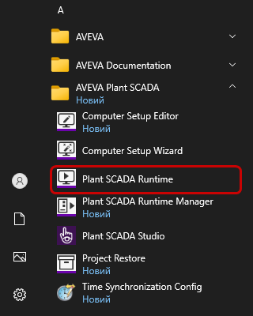

  Рис.1.1 Запуск виконавчої системи Plant SCADA

- [ ] Під час запуску з'являється вікно менеджера середовища виконання "Runtime Manager" та заставка "AVEVA Plant SCADA". За відсутності ліцензійного ключа з'явиться вікно з повідомленням "No protection key found. Press OK to run in Demo Mode?". Натисніть "OK" для запуску в демонстраційному режимі. 

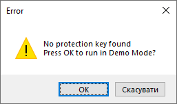

Рис.1.1а Запит на запуск у демонстраційному режимі

У демонстраційному режимі середовище виконання працює 15 хвилин (якщо є зовнішні драйвери), що достатньо для перевірки працездатності проекту. Проект "Example" не використовує зовнішніх змінних вводу/виводу, тому він буде працювати без обмежень. Після запуску в систему автоматично реєструється користувач "Systems Engineer" (його ім'я видно у правому верхньому куті вікна).

## 2. Зміна мови інтерфейсу та реєстрація користувача 

- [ ] Ознайомтеся зі структурою меню на правій бічній панелі (вкладка "Menu"), поступово розкриваючи його розділи (натисканням на "+"). Зверніть увагу, що поруч є також вкладка "Equipment" з ієрархією устатковання.
- [ ] Знайдіть пункт меню, який відповідає за налаштування ("Tools"), в якому знайдіть пункт "Language..." та подивіться, які мови інтерфейсу доступні у вікні "Select Language". Зверніть увагу на напис "Select language will log you in as Engineer", тобто вибір мови одночасно реєструє користувача Engineer. У роботі використовується англомовний інтерфейс "English (Default)", тому мову змінювати не потрібно (вікно можна закрити хрестиком). Надалі в роботі будуть використовуватися посилання на англомовні пункти меню.  

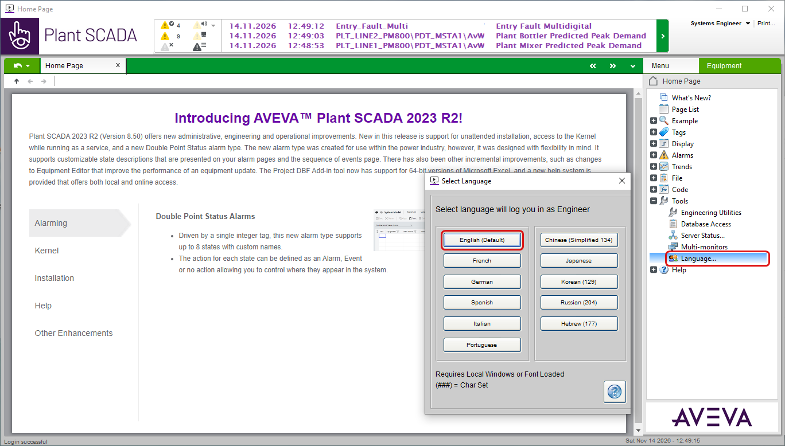

рис.1.2. Вікно зміни мови інтерфейсу

За замовченням, у виконавчій системі працює функція озвучування тривог. Якщо це Вас не влаштовує, зробіть наступну дію.

- [ ] Зайдіть в пункт меню "Alarms" -> "Simulate Alarms..." і у вікні "Simulate Alarms" натисніть на напис "Silence alarm sound" в нижній частині вікна. Після цього напис зміниться на "Re-enable Alarm Sound" (повторне натискання знову вмикає звук).  

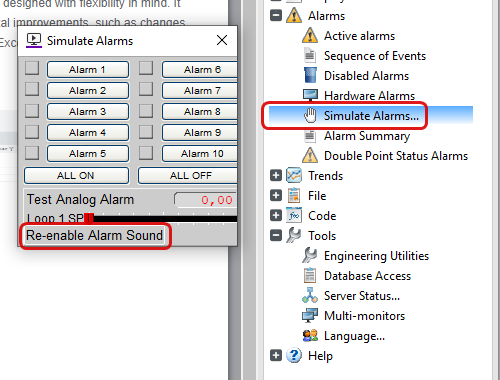

рис.1.3. Відключення озвучування тривог

- [ ] Зареєструйтеся під користувачем "Оператор" ("Worker"), як це показано на рис.1.4: клацніть на імені поточного користувача у правому верхньому куті вікна ("Systems Engineer ▾") та виберіть "Login Worker...". Ім'я користувача та пароль у вікні "Login Form" заповнюються автоматично, мова інтерфейсу ("Language") – English. Натисніть "OK", після чого ім'я користувача у правому верхньому куті зміниться на "Plant Worker". 

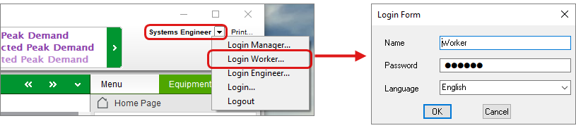

Рис.1.4 Вікна зміни користувача

## 3. Знайомство з можливостями графічного інтерфейсу 

- [ ] Поступово відкриваючи різні вікна, визначте які частини людино-машинного інтерфейсу залишаються завжди видимими. Занотуйте для звіту і визначте їх призначення. Зверніть увагу, що кожна відкрита сторінка відкривається в окремій вкладці у верхній частині вікна.

- [ ] У розділі меню "Example" відкрийте сторінку розливальної машини "Plant Bottler". 
- [ ] Спробуйте покерувати у ручному режимі двигуном мішалки: клацніть на двигуні мішалки, у вікні керування "Bottler_Tank1_Agi" переведіть двигун у ручний режим кнопкою "Manual" та зупиніть/запустіть його кнопками "STOP"/"Start". Зверніть увагу на спосіб реалізації панелі керування двигуном. 

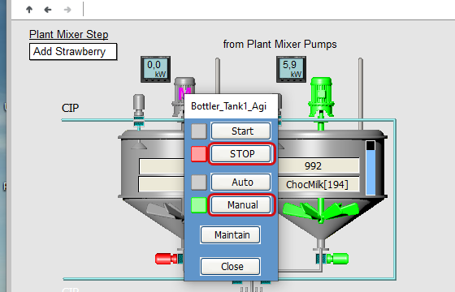

 Рис.1.5 Керування мішалкою

- [ ] Знайдіть елемент керування швидкістю руху пляшок (значення у % біля конвеєра в нижній частині сторінки) та змініть швидкість до 25%: клацніть на значенні та виберіть у меню пункт "Override 25%". Пункт "Scheduled" повертає швидкість, задану за розкладом. 

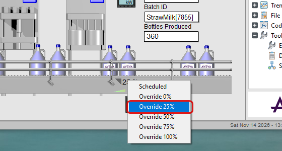

 Рис.1.5а Зміна швидкості руху пляшок

- [ ] Підійдіть критично до реалізації інтерфейсу сторінки і подумайте, якої інформації вам не вистачає і яка є зайвою.

- [ ] Відкрийте сторінку "Display" – "Operator Input" (заголовок сторінки "Keyboard & Mouse Input"). Знайдіть елементи з наступними способами вводу/зміни значення (зверніть увагу, що введення тексту та значення працює без попадання курсору в поле для вводу: достатньо навести вказівник миші на значення, набрати нове значення на клавіатурі та натиснути Enter): 

- зміна дискретного значення кнопкою перемикання;
- введення текстового значення;
- введення числового значення шляхом набору з клавіатури;
- введення числового значення шляхом набору з віртуальної клавіатури Plant SCADA (вікно "Number Pad" відкривається подвійним кліком на числовому значенні, рис.1.5б); 
- зміна значення повзунками (вертикальними, горизонтальними і круговими);
- зміна значень переміщенням по 2-м осям;
- зміна значення переміщенням елемента числового відображення;

При введенні числового та текстового значення спробуйте також вводити дуже великі числа. Опис можливостей сторінки можна переглянути, натиснувши "Help" на панелі інструментів сторінки.

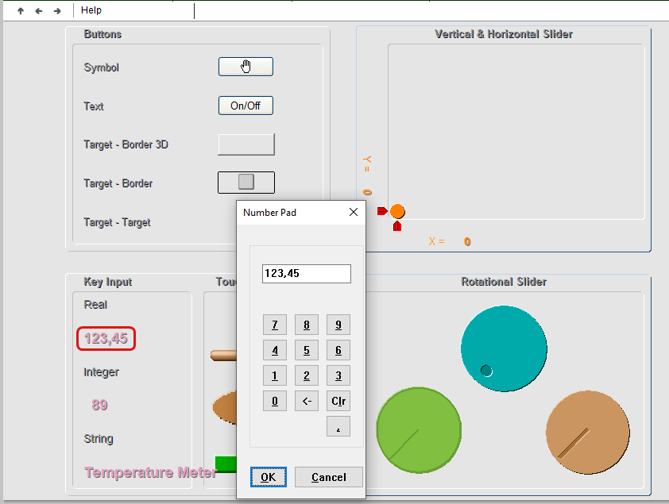

 Рис.1.5б Введення числового значення з віртуальної клавіатури

## 4.Робота з компонентами 

- [ ] Відкрийте сторінку "Display" – "Genies". Натисніть кнопку "Test Genies" і знайдіть елементи з наступними способами вводу/зміни/відображення значення:

- анімація зміною зображення, в тому числі багато-кадрового;
- анімація зміна тексту;
- анімація зміни кольору;

- [ ] Відкрийте сторінку "Display" – "Groups". Увімкніть режим демонстрації кнопкою "Run Demo" і дочекайтеся поки вона закінчиться. 
- [ ] Використовуючи різні типи повзунків ("Boom", "Claw", "Claw Tip", "Cable", "Boom Extent", "Position") покеруйте краном. Зверніть увагу на групові операції в анімації.

- [ ] Відкрийте сторінку "Display" – "Objects" (заголовок сторінки "Dynamic Objects Display"). Використовуючи повзунки, змінюйте: габарити, розміщення по вертикалі та горизонталі, кут повороту об’єктів, градієнт кольору. Зверніть увагу на "множинність" анімації (декілька анімацій для того ж об'єкту). Кнопка "Reset" повертає об'єкти у початковий стан. 
- [ ] Використовуючи кнопку "Hide", спробуйте анімацію видимості.

- [ ] Відкрийте сторінку "Display" – "ActiveX". Натисніть кнопку "Auto" для демонстрації роботи індикаторів.
- [ ] У ручному режимі (кнопка "Manual") спробуйте змінювати значення.

## 5.Налаштування регуляторів 

- [ ] Відкрийте сторінку "Display" - "Loops". Ознайомтеся зі змістом сторінки і можливостями, які вона надає. Панель керування контуром (вікно "PID Loop") відкривається кліком на вимірюваному значенні (наприклад, на термометрі) або через контекстне меню (правий клік) на назві контуру в дереві "Loops" -> "PID Loop".
- [ ] Для одного з контурів (Loop), наприклад "Temperature", змініть значення виходу (OP) в значення 50% (поле під шкалою 0…100%: наведіть на нього вказівник миші, наберіть 50 та натисніть Enter). Дочекайтеся, коли плинне значення (PV) добереться до усталеного значення. 

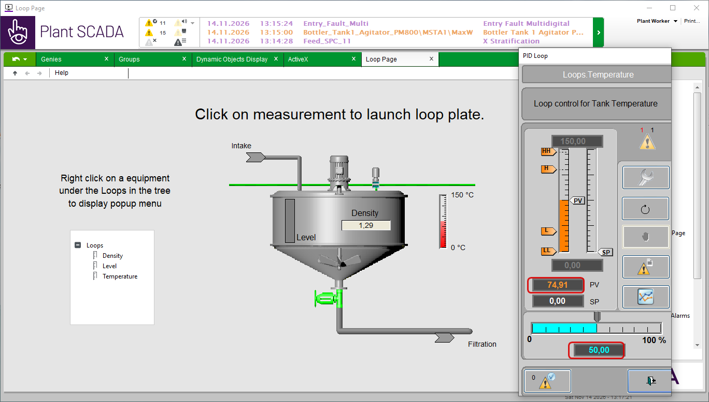

 Рис.1.6 Налаштування регулятору

- [ ] Переведіть контур в автоматичний режим (призначення кнопок вказується контекстними підказками: "Tune", "Automatic Mode", "Manual Mode", "Sequence of Events", "Display Trends"). Виставте значення уставки (SP) приблизно ¾ від розміру шкали (для контуру Temperature шкала 0…150).
- [ ] Інші два контури (Level та Density) також переведіть в автоматичний режим і виставте значення приблизно ¾ від розміру їх шкали.

- [ ] Змініть коефіцієнти ПІД-регулятора ("Gain", "Integral", "Derivative") на одному з контурів, використовуючи кнопку "Tune" (вікно "Loop Tuning").
- [ ] Для одного з контурів відкрийте тренди реального часу кнопкою "Display Trends" (вікно "Process Analyst"). Подивіться як змінювалися значення. **Зробіть копію екрану для звіту.** 

## 6.Тренди реального часу 

- [ ] Відкрийте сторінку "Example" - "Steel Mill". 
- [ ] Проаналізуйте трендовий графік, визначте за що відповідає кожна крива (підписи кривих та їх значення відображаються у мітках курсору справа від графіка). 
- [ ] На верхній частині графіку у вигляді кольорових позначок показаний час виникнення тривог, спостерігаючи за ним проаналізуйте що значить кожна позначка і що значить її колір. 
- [ ] Зафіксуйте що значить колір тривог для звіту. 

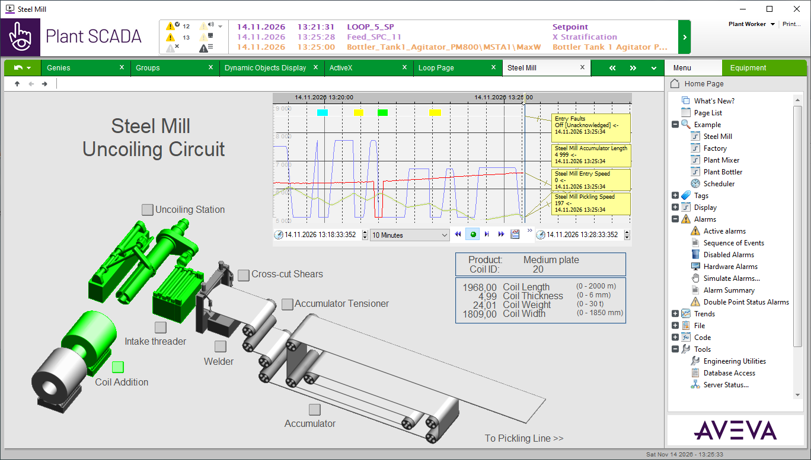

 Рис.1.7. Перегляд трендів реального часу

## 7.Активні тривоги

- [ ] Перевірте чи усі тривоги активовані (в експлуатації). Для цього зайдіть у розділ "Alarms" -> "Disabled Alarms" і подивіться чи є в списку якісь заблоковані тривоги.
- [ ] Якщо є заблоковані тривоги, зареєструйтеся в системі виконання під користувачем "Інженер" ("Login Engineer...") і натисніть "Enable Page" (що значить зняти блокування з усіх заблокованих тривог на сторінці). Потім знову зареєструйтеся в системі виконання під користувачем "Оператор" ("Login Worker...").

- [ ] Відкрийте сторінку "Alarms" – "Active alarms". 
- [ ] Для можливості зміни стану тривог відкрийте вікно "Alarms" – "Simulate Alarms...".
- [ ] Змінюючи стан тривог (кнопки "Alarm 1", "Alarm 2" і т.д.), прослідкуйте як вони себе ведуть у списку активних тривог та на панелі останніх тривог у верхній частині вікна (видимій на всіх сторінках). Зверніть увагу на наявність повідомлень у списку активних тривог при їх зникненні. Занотуйте для звіту поведінку тривог. 

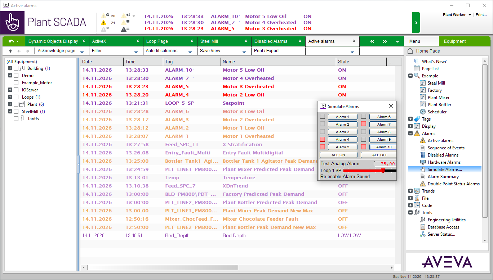

 Рис.1.8. Робота зі списком активних тривог

- [ ] Проаналізуйте зміст контекстного меню (правий клік) одного з повідомлень тривог в списку. Зверніть увагу на пункти, які там недоступні. 
- [ ] Зареєструйтеся в системі виконання під користувачем "Інженер" ("Login Engineer..."). Проаналізуйте зміст контекстного меню.   

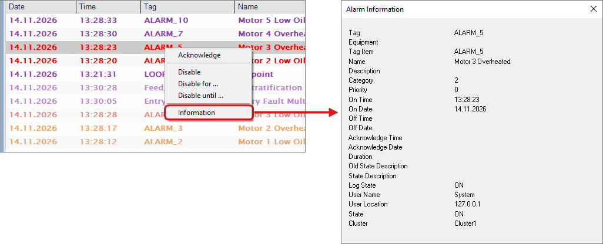

 Рис.1.9. Контекстне меню тривог та вікно "Alarm Information"

- [ ] Користуючись контекстним меню, викличте вікно з властивостями ("Information") однієї з тривог (надалі "експериментальна") і зробіть копію екрану для аналізу і звіту. 
- [ ] Для однієї з інших тривог виберіть пункт контекстного меню "Acknowledge". Аналогічну операцію можна зробити через панель останніх тривог.
- [ ] За допомогою вікна "Simulate Alarms" зробіть, щоб тільки "експериментальна" тривога була активною. 
- [ ] Натисніть кнопку "Acknowledge page" на панелі інструментів сторінки, що значить підтвердити усі тривоги на сторінці.  
- [ ] Зверніть увагу на те, які повідомлення залишилися на сторінці активних тривог. Подивіться властивості тривоги, зробіть копію екрану і, порівнюючи з попереднім, зробіть аналіз того, що змінилося.  

## 8.Блокування тривоги

- [ ] За допомогою вікна "Alarms" – "Simulate Alarms..." активуйте перші три тривоги ("Alarm 1" … "Alarm 3"). 
- [ ] Виділіть їх у списку активних тривог (натискаючи з клавішею Ctrl) та через команду контекстного меню "Disable" заблокуйте.

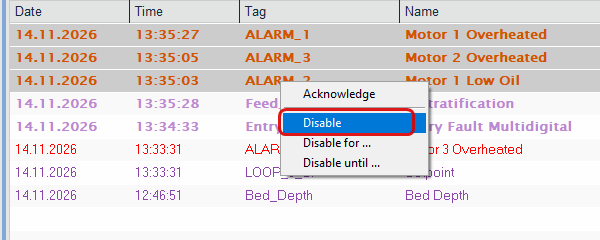

 Рис.1.10. Блокування тривог

- [ ] Тепер ці тривоги виведені з експлуатації і не будуть відслідковуватися системою (зверніть увагу на лічильник заблокованих тривог на панелі останніх тривог). Для їх активації зайдіть у розділ "Alarms" -> "Disabled Alarms" і натисніть "Enable Page" (що значить зняти блокування з усіх заблокованих тривог).

## 9.Фільтрування та налаштування списку тривог

- [ ] Користуючись командою "ALL ON" у вікні "Alarms" – "Simulate Alarms..." увімкніть усі тривоги.
- [ ] Забезпечте також спрацювання тривоги для `LOOP_1_SP` (перемістіть повзунок "Loop 1 SP" у вікні "Simulate Alarms" до максимуму). 
- [ ] Перейдіть на сторінку активних тривог. Використовуючи налаштування фільтру для сторінки, зробіть відображення тільки тривог, що мають стан "ON": кнопка "Filter..." на панелі інструментів -> вікно "Active Alarm Filter" -> вкладка "Advanced" -> виберіть поле "State", оператор "=", введіть значення "ON" -> "Add" -> "OK".

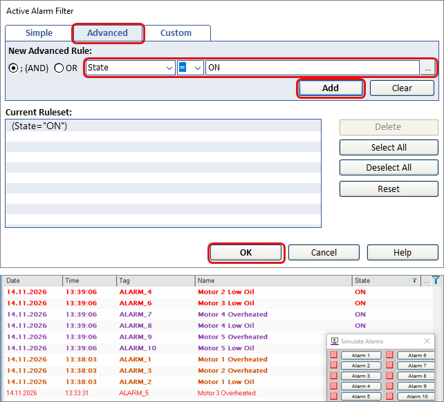

 Рис.1.11. Фільтрування списку тривог

- [ ] Перегляньте, які тривоги залишилися в списку (про наявність фільтра сигналізує значок лійки в заголовку таблиці), після чого скиньте налаштування фільтрації: знову відкрийте вікно "Filter...", виділіть правила кнопкою "Select All", видаліть їх кнопкою "Delete" і натисніть "OK".
- [ ] Добавте у список активних тривог поля (колонки) "Category" та "Equipment": клацніть правою кнопкою миші на заголовку колонки та виберіть "Insert Column" -> "Category" (аналогічно "Equipment"). Видалити колонку можна командою "Remove Column".

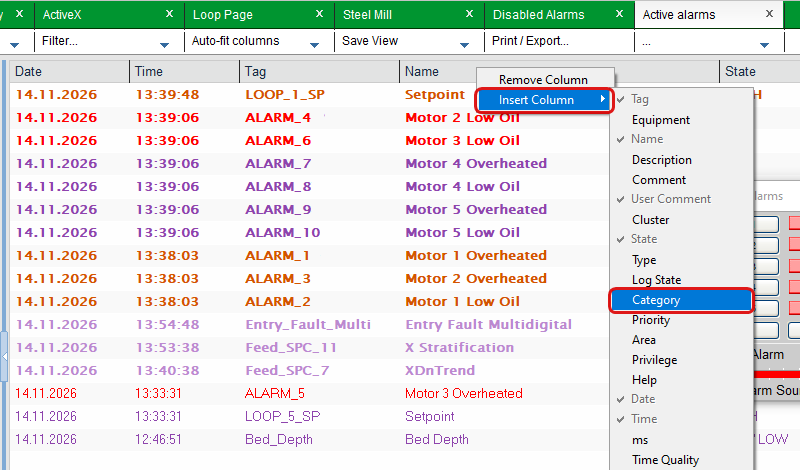

 Рис.1.12. Керування колонками

## 10.Зведення тривог

- [ ] Перейдіть на сторінку "Alarms" – "Alarm Summary".
- [ ] Подивіться яка інформація і в якому вигляді доступна для даного зведення. За необхідності використовуйте вікно імітації тривог.
- [ ] Занотуйте для звіту основні особливості вікна зведення. 

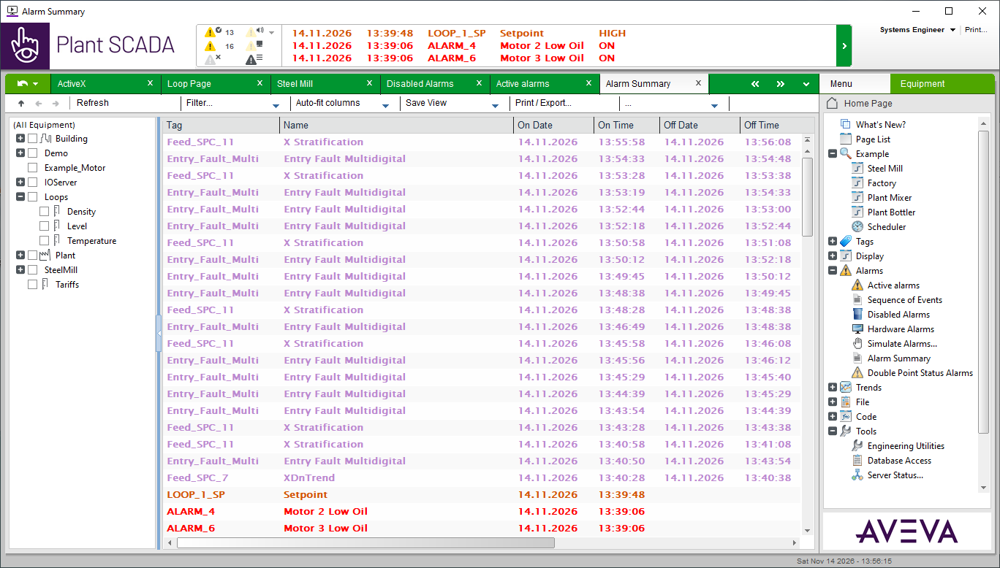

 Рис.1.13. Сторінка зведення тривог

## 11.Вікно журналу тривог та подій (SOE)

- [ ] Перейдіть на сторінку журналу тривог та подій "Alarms" -> "Sequence of Events" (SOE). 
- [ ] Подивіться чим принципово відрізняється цей журнал від сторінки зведення тривог.
- [ ] Проаналізуйте усі можливості, які надає журнал тривог та подій.

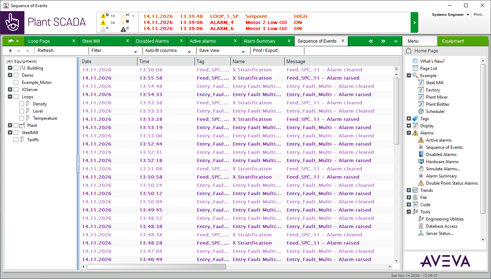

 Рис.1.14. Сторінка журналу подій та тривог (SOE)

## 12.Фільтрація з використанням вікна устатковання

- [ ] Відкрийте вікно активних тривог. Зробіть, щоб усі тривоги у вікні імітації тривог були включені.
- [ ] Подивіться властивість "Equipment" (устатковання) для тривог.
- [ ] Знайдіть це устатковання на лівій бічній панелі в ієрархічному дереві. Зверніть увагу на цифри в дужках біля устатковання. Виясніть що вони значать і зробіть нотатки для звіту. 

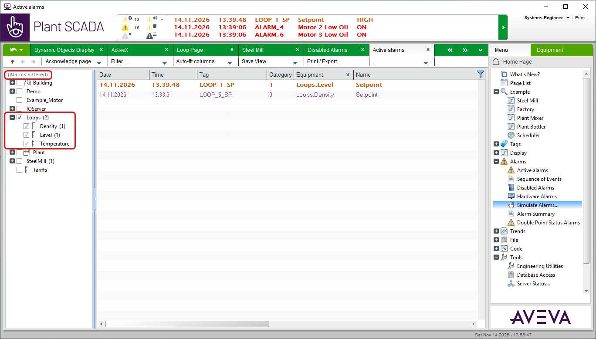

 Рис.1.15. Фільтрування списку тривог за устаткованням

- [ ] На панелі устатковання виставіть опцію у квадраті біля Loops. У списку тривог повинні залишитися тільки ті тривоги, які стосуються цього устатковання (фільтрування списку за устаткованням, над деревом з'явиться напис "(Alarms Filtered)").
- [ ] Виставіть опції і для іншого устатковання, в яких є тривоги. 
- [ ] Зніміть усі опції.
- [ ] Відкрийте вікно журналу тривог і подій (SOE), подивіться як там працює фільтрація за устаткованням.

## 13.Історичні тренди - демонстрація

- [ ] Перейдіть на сторінку "Trends" – "Process Analyst Demo".  
- [ ] Запустіть демонстрацію трендів, натиснувши кнопку "Play Demo" (▶) в головній панелі інструментів (рис.1.16) трендового переглядача (Process Analyst). 

 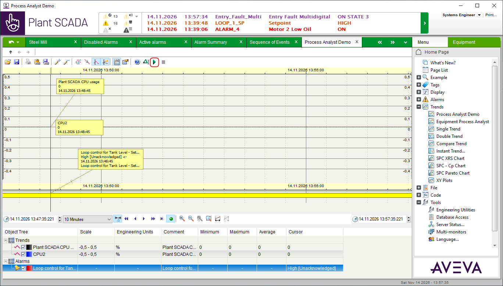

Рис.1.16 Вікно демонстрації тренду

- [ ] Поступово будуть переключатися різні тренди (біля 5-ти видів), щоб показати основні можливості переглядача трендів. Подивіться які варіанти відображення трендів доступні у виконавчій системі Plant SCADA і як змінюється легенда та її зміст. При цьому зверніть увагу на:

- нижню частину екрану, в якій знаходяться підписи до трендових і тривогових кривих з їх значеннями (легенда тренду, "Object Tree");
- верхню частину, де рисуються криві трендів та/або станів тривог;
- на головну панель інструментів над трендами (під час демонстрації на ній залишаються лише кнопки "Difference Cursor", "Play Demo" та "Stop Demo");
- на панель інструментів навігації під трендами

- [ ] Зупиніть демонстрацію кнопкою "Stop Demo" (■).

## 14. Основні команди переглядача трендів

- [ ] Відкрийте сторінку "Display" - "Loops". 
- [ ] Проконтролюйте, щоб контур Level був у автоматичному режимі. Змініть уставку контуру рівня Level приблизно на 25% від плинного значення. 
- [ ] Перейдіть на сторінку "Trends" - "Single Trend". 
- [ ] Зробіть видимим курсор за допомогою кнопки "Show/Hide Cursor" на верхній панелі інструментів (призначення кнопок вказується контекстними підказками). Переведіть курсор в зону перехідного процесу, перетягуючи мишею маркер курсору на верхній шкалі часу (якщо тягнути мишею безпосередньо область графіка, зміститься сам графік у часі). 

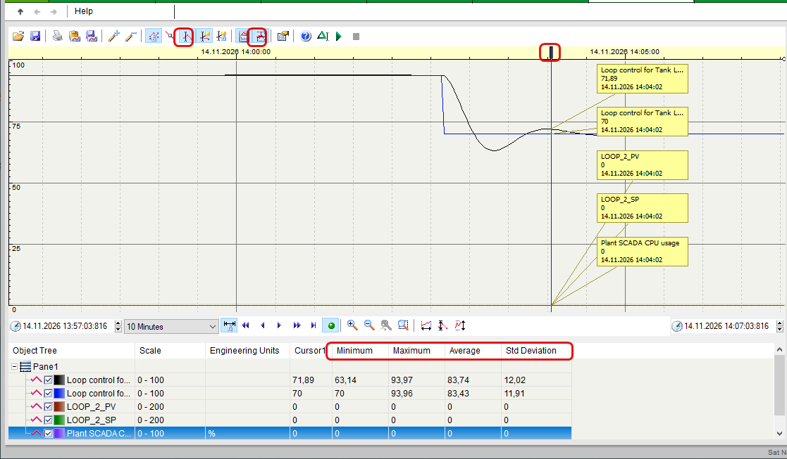

Рис.1.17. Використання курсору та трендової статистики

- [ ] За допомогою команди головної панелі інструментів активуйте трендову статистику ("Show/Hide Trend Statistics"), у легенді з'являться колонки "Minimum", "Maximum", "Average" та "Std Deviation". Подивіться які значення змінних були в точці хвилини від початку перехідного процесу та проаналізуйте інформацію зі статистичних даних. 
- [ ] **Зробіть копію екрану для звіту.**

- [ ] Користуючись панеллю інструментів навігації, кнопками "Back One Span" та "Back Half a Span" подивіться якими були значення одразу після початку запуску виконавчої системи. 
- [ ] Знайдіть на панелі інструментів навігації поля введення початкового моменту часу ("Start Time"), кінцевого моменту часу ("End Time"), зміни діапазону відображення ("Time Span") та налаштуйте відображення тренду за весь період роботи на лабораторному занятті. Згадайте, з яких причин змінювалися ці значення. 
- [ ] За допомогою кнопки "Toggle Auto-Scrolling" активуйте режим автопрокрутки тренду (кнопка "Synchronise to Now" переміщує тренд до поточного моменту часу). 

- [ ] Проексперементуйте та визначте призначення усіх команд для масштабування ("Zoom in 50%", "Zoom out 50%", "Undo Last Zoom", "Toggle Box Zoom", "Edit Span", "Autoscale vertical axis for Analog pens", "Edit Vertical Scale").

## 15. Добавлення та видалення кривих на тренд

- [ ] Скориставшись командою головної панелі інструментів "Add Pens", добавте в переглядач трендів криві LOOP_4_PV, LOOP_4_SP, LOOP_4_OP (контур Temperature) та аналогічно LOOP_5_PV, LOOP_5_SP, LOOP_5_OP (контур Density):
  - на панелі натисніть кнопку з зображенням олівця з `+` ("Add Pens")
  - у вікні "Add New Pen(s)" (рис.1.18) треба вибрати тип ("Type") "Trends", ввести в полі "Tag" значення \*loop\* для зменшення кількості виведення результатів пошуку і натиснути кнопку "Search"
  - після чого з вікна результатів пошуку ("Search Results") вибрати потрібні змінні та подвійним кліком (або кнопкою "Add") добавити їх у список вибраних елементів ("Selected Items")
  - після вибору змінних клікнути на "OK".   

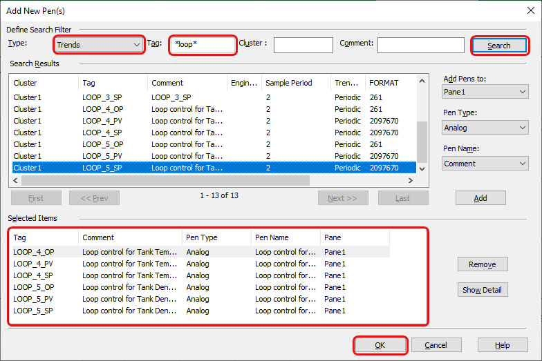  

Рис.1.18 Вікно добавлення нових кривих 

- [ ] Використовуючи кнопку "Remove Pen" (олівець з `-`), видаліть з переглядача усі криві, окрім *LOOP* (для видалення криву треба попередньо виділити в легенді тренду)

- [ ] Скориставшись командою головної панелі інструментів "Add Pens", добавте в переглядач декілька кривих зі змінними реального часу (тип "Variable Tags"). 
- [ ] Подивіться також інші можливості трендових переглядачів. 

## 16. Збереження та використання налаштувань переглядача трендів 

- [ ] Збережіть вибрані налаштування у файл з назвою "TrendsIvanenkoIvan.pav" (в назві мають бути ваші ім'я і прізвище на латиниці без пробілів), використовуючи команду "Save View" з головної панелі інструментів. Вікно збереження "Save Process Analyst View" відкриває папку "Local", що відповідає папці проекту "C:\ProgramData\AVEVA Plant SCADA 2023 R2\User\Example\Analyst Views".
- [ ] Поступово відкриваючи кілька файлів \*.pav командою "Load View", подивіться збережені в них налаштування.

## 17.Тривоги в переглядачі трендів 

- [ ] За допомогою вікна "Alarms" – "Simulate Alarms..." та списку активних тривог включіть кілька тривог, підтвердіть (квітуйте) їх та відключіть.
- [ ] Відкрийте сторінку "Trends" - "Single Trend" та у переглядачі трендів відкрийте командою "Load View" налаштування "alarms.pav".
- [ ] Проаналізуйте як графічно відображаються стани тривог. Подумайте які переваги це може дати в комбінації з відображенням трендів.
- [ ] Зробіть копії екранів та зробіть примітки для звіту та захисту.

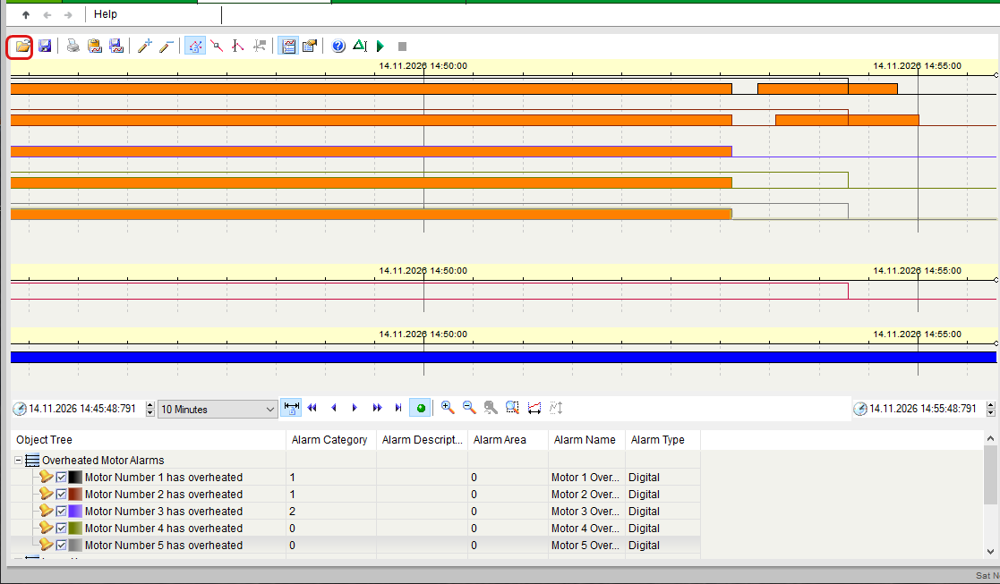

Рис.1.19 Відображення тривог у переглядачі трендів.

## 18.Перегляд журналів та звітів

- [ ] У меню "File" подивіться протокол дій оператора ("Operator Log") та звіти ("Report", "HTML Report"). 

- [ ] Завершіть роботу системи командою "Shutdown" з розділу "Control" сторінки "Engineering Utilities" меню "Tools" та підтвердіть завершення кнопкою "Yes - Close" (команда "Shutdown" є також у меню "Help"). 

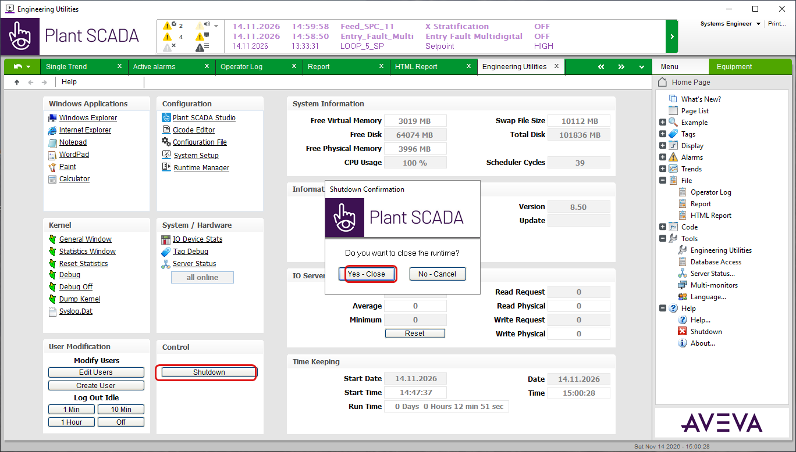

Рис.1.20 Завершення роботи середовища виконання

## Порядок прийому роботи 

Викладач перевіряє вибірково виконання пунктів лабораторної роботи. Нижче наведена методика перевірки (орієнтовно, вибірково):

1. Покажіть способи вводу дискретного, аналогового, текстового значення. 

2. Покажіть способи відображення дискретного, аналогового, текстового значення. 

3. Покажіть властивість тривоги та прокоментуйте поля.

4. Застосуйте фільтр по часу, по типу, по устаткованню для тривог. 

5. Перевірка прав доступу до дій відповідно до зареєстрованого користувача.

6. Покажіть як тривоги блокуються та розблокуються.

7. Відобразіть тренд зміни значень контурів регулювання (LOOPs) за весь час лабораторної роботи.

8. Покажіть тренди з відображенням стану тривог. Прокоментуйте зовнішній вигляд тривог.

9. Покажіть скриншоти трендів за весь період лабораторної роботи, покажіть коли були зміни завдань на які значення, тривоги (виникли, підтвердження, зникли);

## Питання до захисту 

1. Як організовано меню в проекті Example? Як організовані команди керування в меню на сторінках? 
2. Поясніть призначення меню верхнього рівня в проекті Example.
3. За допомогою яких елементів в проекті Example оператор швидко може побачити стан усієї системи?
6. Де і для чого в проекті Example використовується анімація миготіння?
7. Розкажіть яку інформацію Ви можете отримати зі сторінки "Plant Bottler". Які елементи використовуються для відображення стану та керування?
8. Які елементи вводу/зміни значення використовуються в проекті Example?
9. Які елементи відображення значення/стану використовуються в проекті Example?
10. Які елементи відображення в проекті Example, на вашу думку, є найбільш інформаційними? Які прийоми людино-машинного інтерфейсу в проекті варто б було змінити відповідно до сучасних стандартів. Обґрунтуйте свою відповідь.
11. Які засоби в проекті Example використовуються для відображення оператору імені та призначення того параметру, який відображається, або проводиться зміна?
12. Як в проекті Example на графіку (переглядачі) трендів показують різні типи тривог?
13. Які інструменти для перегляду тривог (активних, журналів тривог та ін.) та керування їх станом задіяні в проекті Example?
14. Як дізнатися про перелік активних тривог в даний момент часу? Чи доступна ця інформація перед очима у оператора завжди?
15. Як повідомлення тривог розрізняються за станом, пріоритетністю відображення?
16. Як дізнатися детальну інформацію про потрібну тривогу? Прокоментуйте, яка інформація доступна оператору?
17. Як ведуть себе повідомлення в списку активних тривог при зміні їх стану? Коли тривоги зникають з цього списку?
18. Розкажіть навіщо потрібно підтвердження (квітування) тривоги? Як це робиться в проекті Example? Як видно чи тривога була підтвердженою?
19. Розкажіть навіщо потрібно блокування (виведення з експлуатації) тривог? Як це робиться в проекті Example? Де видно перелік заблокованих тривог? Як можна повернути тривоги до експлуатації (деблокувати)?
20. Де і як можна дізнатися коли тривога виникла, зникла, була підтвердженою чи блокованою (виведеною з експлуатації)?
21. Навіщо потрібні фільтри в переглядачах тривоги? За якими полями тривоги в проекті Example можна застосовувати фільтри?
22. Яка інформація і в якій формі доступна в зведенні тривог ("Alarm Summary")? Чим зведення тривог відрізняється від списку активних тривог?
21. Розкажіть про функції журналу тривог та подій (SOE).
22. Для чого призначені трендові переглядачі? Яку інформацію може відображати трендовий переглядач у Plant SCADA? 
23. Для чого потрібна легенда трендів? Яка інформація там доступна для відображення?
24. Розкажіть про призначення курсору на трендових переглядачах.
25. Назвіть елементи навігації та масштабування для трендів та розкажіть їх призначення.
26. Які можливості надає трендовий переглядач у Plant SCADA?
27. Розкажіть яким чином можна у Plant SCADA зберігати налаштування трендового переглядача і навіщо це може знадобитися.
28. Розкажіть яким чином відображаються тривоги в переглядачі трендів. Яку перевагу може мати такий спосіб відображення над класичним (в списку активних тривог)? 
29. Які обмеження для різних користувачів (акаунтів) Ви побачили в проекті Example. 
30. Поясніть відмінність середовища розробки та середовища виконання SCADA/HMI. Яке саме середовище потрібне для роботи АРМу оператору на підприємстві?
31. Поясніть що таке проект SCADA/HMI? Чим відрізняється вихідний проект від скомпільованого і коли підприємству необхідні обидва варіанти проектів?
32. Від чого залежить вартість середовища виконання SCADA/HMI?
33. Які типові функції надають програми SCADA/HMI?
