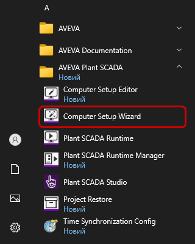
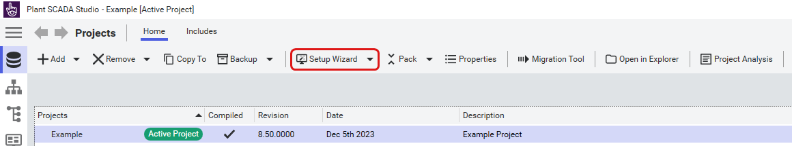
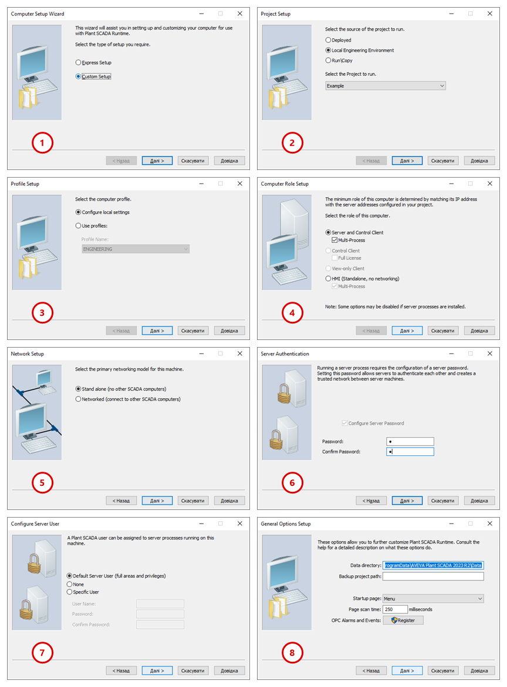

[До лабораторної роботи 1](lab1.md)

## Додаток 1.1. Налаштування середовища виконання та файл Citect.ini 

Середовище виконання (Runtime система) – це, по суті, виконавчий файл (або файли) Citect32.exe, який може виконувати проект, створений та скомпільований у середовищі розробки AVEVA Plant SCADA (Plant SCADA Studio). При запуску середовище виконання повинно знати про те, який саме проект необхідно запустити, а також з якими налаштуваннями (наприклад, де зберігати файли для трендів та тривог, якою буде стартова сторінка і т.д.). Назва та місце розміщення проекту, а також інші налаштування зберігаються в ***параметрах*** Plant SCADA, які на кожному комп’ютері зберігаються в файлі "Citect.ini". Розміщення файлу "Citect.ini" залежить від версії та операційної системи, наприклад для AVEVA Plant SCADA 2023 R2 це розміщення буде "C:\ProgramData\AVEVA Plant SCADA 2023 R2\Config".

"Citect.ini" є типовим текстовим ini-файлом, який містить розділи, назви та значення параметрів. Для його зміни можна користуватися будь-яким текстовим редактором або спеціалізованою утилітою "Computer Setup Editor", що поставляється разом з Plant SCADA. У будь-якому з цих варіантів користувач повинен володіти достатньо великою кількістю знань, тому для спрощення налаштування основних параметрів виконавчої системи краще користуватися помічником налаштування комп’ютера "Computer Setup Wizard", який доступний з меню "Пуск" Windows (папка "AVEVA Plant SCADA", рис.Д1.1) або з середовища розробки Plant SCADA Studio (розділ "Projects", кнопка "Setup Wizard", рис.Д1.2).  

 

рис.Д1.1. Запуск помічника Computer Setup Wizard з меню "Пуск"

Рис.Д1.2. Запуск помічника з Plant SCADA Studio

Тут не будемо пояснювати усі налаштування, вони будуть поступово описані в інших лабораторних роботах. Для мінімального налаштування запуску проекту "Example" необхідно в помічнику налаштування комп’ютера вказати наступні значення параметрів (рис.Д1.3):

- у першому вікні "Computer Setup Wizard" (1) необхідно вибрати "Custom Setup" (індивідуальне налаштування) для подальшого відображення максимальної кількості налаштовуваних параметрів;
- у вікні "Project Setup" (2) вибрати джерело проекту "Local Engineering Environment" і проект, що буде виконувати виконавча система, наприклад "Example"; проект до цього повинен бути скомпільований; для заново інстальованих систем проект "Example" вже скомпільований;
- у вікні "Profile Setup" (3) можна вказати профіль з проекту ("Use profiles"), в якому вказуються усі налаштування для даного ПК, або налаштувати ці параметри окремо через відповідні пункти файлу Citect.ini ("Configure local settings");
- у вікні "Computer Role Setup" (4) вибрати роль "Server and Control Client" та можна виставити опцію "Multi-Process", тоді кожна частина проекту (кожен сервер і клієнт) буде запускатися у вигляді окремого процесу ОС (окремий Citect32.exe); у цій версії з'явилася також роль "HMI (Standalone, no networking)" для автономних систем без мережі;
- у вікні "Network Setup" (5) необхідно вибрати опцію "Stand alone (no other SCADA computers)", тоді середовище виконання буде запускатися в режимі відсутності зв’язку з іншими середовищами виконання Plant SCADA; якщо в даному вікні вибрати опцію "Networked", то середовище виконання без ліцензійного ключа буде запускатися тільки на декілька секунд;
- в усіх інших вікнах налаштування (Report Server Properties Setup, Trend Server Properties Setup, CPU Setup, Events Setup, Startup Functions Setup, Cluster Connections Setup, Security Setup) у більшості випадків і для даної лабораторної роботи треба залишити значення за замовченням; 
- у вікні "Server Authentication" (6) необхідно один раз вказати пароль доступу серверів один до одного (поля "Password" та "Confirm Password");
- у вікні "Configure Server User" (7) залиште "Default Server User (full areas and privileges)" – від імені цього користувача будуть працювати серверні процеси;
- у вікні "General Options Setup" (8) можна вказати папку розміщення історичних даних ("Data directory") та стартову сторінку ("Startup page"); для налаштування проекту "Example" залиште ці налаштування без змін; 
- на останній сторінці "Computer Setup" ("Your computer setup is complete") необхідно натиснути "Готово" ("Finish"), для внесення змін у файл Citect.ini.      

Зверніть увагу, що підписи кнопок майстра ("Далі", "Назад", "Скасувати", "Готово") відображаються мовою операційної системи Windows, а не мовою Plant SCADA.

Рис.Д1.3. Основні налаштування виконавчої системи за допомогою помічника

**Примітка.** При першому запуску Plant SCADA Studio пропонує оновити (upgrade) проекти до поточної версії та відновлює приклади проектів з архівів у папці "C:\ProgramData\AVEVA Plant SCADA 2023 R2\Data" (Example.ctz, ExampleSA.ctz). Якщо після цього в переліку проектів (розділ "Projects") немає проекту "Example", його можна відновити з архіву Example.ctz командою "Backup" ▾ → "Restore" на панелі інструментів розділу "Projects".

