[Людино-машинні інтерфейси](https://pupenasan.github.io/hmi/)  Автор і лектор: Олександр Пупена доц. кафедри [АКСТУ НУХТ](http://www.iasu-nuft.pp.ua/) 

# Лабораторна робота №2

**Тема. Розробка бази даних реального часу** **SCADA/HMI.** 

**Тривалість**: 8 акад. годин (4 пари).

**Мета:** ознайомлення з основними можливостями середовища розробки AVEVA Plant SCADA (раніше – Citect SCADA) та опанування роботи зі змінними.  

**Завдання для виконання роботи**

**Цілі.** 

1. Навчитися створювати, видаляти, архівувати та відновлювати проект Plant SCADA. 

2. Навчитися налаштовувати підсистему збору та обробки даних реального часу Plant SCADA. 

3. Навчитися створювати, редагувати та налагоджувати базові елементи SCADA/HMI Plant SCADA.

4. Навчитися створювати та редагувати змінні теги Plant SCADA, використовуючи вбудовані редактори.

5. Створити частину проекту зі змінними тегами.   

**Лабораторна установка**

- Апаратне забезпечення: ПК. 

- Програмне забезпечення: Unity Pro (EcoStruxure Control Expert) V>=7.0 (методичні вказівки перевірені на Unity Pro XL 11.1), AVEVA Plant SCADA 2023 R2.

**Примітки щодо відео: представлені в роботі відеоматеріали є студентською інтерпретацією лабораторної роботи, носять ознайомчий характер, записані в попередній версії Citect SCADA з російськомовним інтерфейсом і можуть містити помилки!** 

## Порядок виконання роботи 

Перед виконанням роботи ознайомтеся з усіма додатками до лабораторної роботи:

- [Додаток 2.1. Короткі відомості про організацію проектів у Plant SCADA](lab2a1.md)
- [Додаток 2.2. Налаштування змінних тегів у Plant SCADA](lab2a2.md)

## 1. Запуск проекту для ПЛК та ознайомлення з завданням

- [ ] Виконайте пункти з розділів 2, 3 та 4, що наведені в [Описі завдання для виконання на лабораторних роботах з дисципліни людино-машинні інтерфейси для Citect](task.md) 
- [ ] Ознайомтеся з іншими розділами опису завдання. 

**Увага!** [Опис завдання для виконання на лабораторних роботах з дисципліни людино-машинні інтерфейси для Citect](task.md) є документом, за яким виконуються усі лабораторні роботи по Plant SCADA!

## 2. Створення проекту Plant SCADA 

- [ ] Запустіть середовище розробки Plant SCADA Studio (меню "Пуск" -> "AVEVA Plant SCADA" -> "Plant SCADA Studio", рис.2.1).

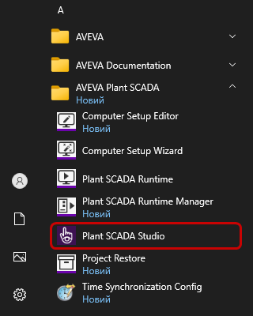

  Рис.2.1. Запуск середовища розробки Plant SCADA Studio

- [ ] Проконтролюйте відкриття двох редакторів: "Plant SCADA Studio" (надалі  ***Провідник*** ) та "Graphics Builder" (надалі  ***графічний редактор***). Графічний редактор може бути відкритий у згорнутому вигляді (на панелі задач Windows).

- [ ] У провіднику створіть новий проект: розділ "Projects" (верхня іконка на лівій панелі) -> вкладка "Home" -> "Add" -> "New Project..." (рис.2.2):
  - У полі "Name" вкажіть своє прізвище в англійській транслітерації, наприклад `HMIPupena`. Зверніть увагу, що назва проекту не повинна містити кириличних літер, пробілів і повинна починатися з літери. 
  - У полі "Description" вкажіть прізвище та номер групи. 
  - Шлях розміщення ("Location") залиште за замовченням. 
  - Для спрощення створення проекту виставте опцію "Create project based on starter project". 
  - У налаштуваннях вибору початкового проекту ("Starter project selection" -> "Project") вкажіть шаблон, що найбільше підходить до типу вашого монітору. Якщо проект виконується в лабораторії А532, виберіть шаблон "SxW_Style_1_HD768_titlebar". 
  - Натисніть кнопку "ОК" для закінчення створення проекту.  

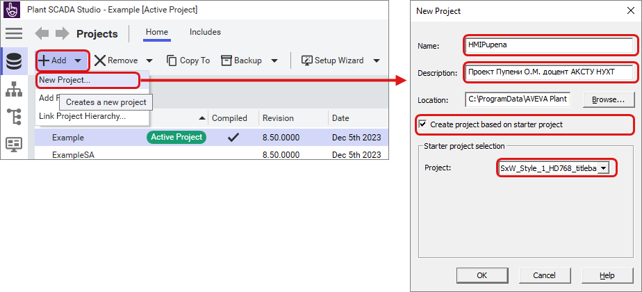

Рис.2.2 Створення нового проекту 

- [ ] Знайдіть створений проект в списку проектів провідника. Натисніть на кнопку "Make Active" у рядку проекту (вибрати як активний). Після цього біля назви проекту з'явиться позначка "Active Project", а в заголовку вікна – "[Active Project]". 

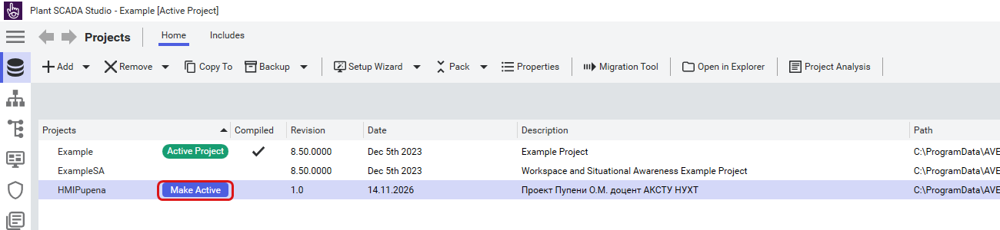

Рис.2.3 Вибір активного проекту для редагування 

<iframe width="560" height="315" src="https://www.youtube.com/embed/cfmWUYAG2rw" title="YouTube video player" frameborder="0" allow="accelerometer; autoplay; clipboard-write; encrypted-media; gyroscope; picture-in-picture" allowfullscreen></iframe>

## 3. Навігація по проекту 

Завдяки виставленій опції створення проекту на базі початкового автоматично будуть створені: кластер, сервери, пристрої вводу/виводу, основні сторінки, меню, роль Адміністратора, файл Cicode. 

- [ ] Уважно прочитайте [додаток 2.1 Короткі відомості про організацію проектів у Plant SCADA](lab2a1.md). 
- [ ] Перейдіть до розділу "Topology" (рис.2.4):
  - Подивіться на вкладці "Computers", які серверні компоненти створені у Вашому проекті (кластер "Cluster1" з серверами IOServer1, AlarmServer1, TrendServer1, ReportServer1 на комп'ютері "StandaloneServer"). Кожен сервер відповідає за свою функцію обробки. За збір даних відповідає IOServer1.   
  - Подивіться на вкладці "I/O Devices", які пристрої I/O створені у Вашому проекті. За замовченням пристрій `Internal` відповідає за внутрішні теги серверу (які не зв'язані з зовнішнім джерелом даних, властивість "Memory" = TRUE), а `Cicode` – для розрахункових тегів.  

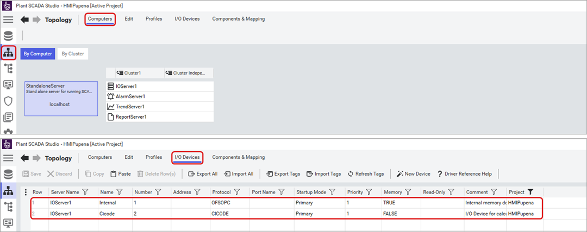

Рис.2.4 Топологія новоствореного проекту 

- [ ] Перейдіть до розділу "Visualization" (рис.2.5):
  - Подивіться на вкладці "Menu Configuration", які меню створені у Вашому проекті. Реалізація меню розглядається у іншій лабораторній роботі. За замовченням меню надає базові можливості для навігації проекту в середовищі виконання.
  - Подивіться на вкладці "Pages", які сторінки створилися в проекті. У Plant SCADA Studio на цій вкладці відображаються також приховані (системні) сторінки, назви яких починаються з "!". 

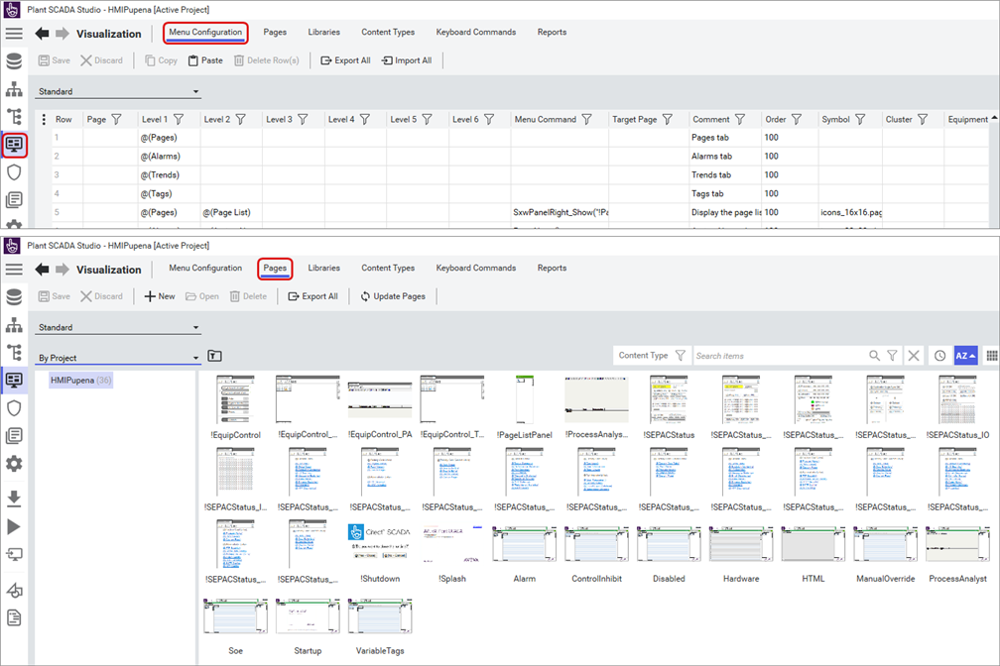

Рис.2.5 Меню та сторінки новоствореного проекту 

- [ ] У графічному редакторі виставте опцію відображення прихованих (системних) сторінок: "Tools" -> "Options..." -> "List system pages" (рис.2.6). Ця опція впливає на перелік сторінок у вікнах відкриття сторінок графічного редактора.  

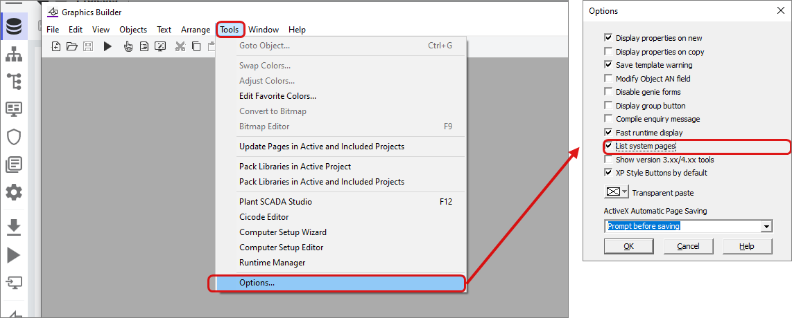

Рис.2.6 Налаштування відображення прихованих сторінок 

- [ ] У провіднику відкрийте розділ "Security" і на вкладці "Roles" знайдіть роль "Administrators". Ролі використовуються в налаштуваннях користувачів, які будуть розглядатися в одній із лабораторних робіт.

Також за замовченням створюються деякі інші об'єкти, які будуть розглянуті у інших лабораторних роботах.    

- [ ] Перейдіть в розділ "Projects" -> "Includes". Подивіться які проекти включені за замовченням (SxW_Style_Include та Library_Equipment).
- [ ] У провіднику Windows відкрийте директорію, в якій знаходиться Ваш проект. Для цього можна перейти в розділ провідника Plant SCADA "Projects" -> "Home" і натиснути "Open in Explorer". Перегляньте в якій директорії знаходяться файли і які розширення мають.

<iframe width="560" height="315" src="https://www.youtube.com/embed/NULVmvsWO7E" title="YouTube video player" frameborder="0" allow="accelerometer; autoplay; clipboard-write; encrypted-media; gyroscope; picture-in-picture" allowfullscreen></iframe>

## 4. Компілювання та запуск проекту 

- [ ] Скомпілюйте активний проект кнопкою "Compile the active project" на лівій панелі провідника (або комбінацією клавіш ALT+F10).

 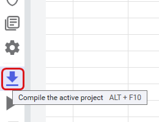

Рис.2.7 Компілювання активного проекту

- [ ] Компілювання повинно пройти успішно. Результати компіляції відображаються у панелі "Compile Messages" в нижній частині провідника: при успішній компіляції з'являється зелена смуга "Compilation Succeeded", при помилках – червона смуга з переліком помилок.

- [ ] Якщо проект скомпілювався, перейдіть до виконання наступного пункту, якщо ні – за допомогою викладача виправте помилки.

**Примітка.** Якщо під час компіляції з'являється вікно з повідомленням `ctcmp32 /I"...citect.ini" "HMIPupena" Cannot Find File`, це означає, що провідник не може знайти компілятор. У цьому випадку додайте папку "C:\Program Files (x86)\AVEVA Plant SCADA\Bin" до системної змінної середовища PATH і перезапустіть Plant SCADA Studio.

Перед тим, як запустити новий проект необхідно налаштувати середовище виконання. Для цього використовується майстер, який Ви запускали на минулій лабораторній роботі.   

- [ ] Запустіть майстер налаштування комп'ютера ("Projects" -> "Home" -> "Setup Wizard"), налаштуйте систему для запуску вашого проекту, аналогічно, як це робилося в [лабораторній роботі №1](lab1a1.md) (у вікні "Project Setup" має бути вибраний Ваш проект).  

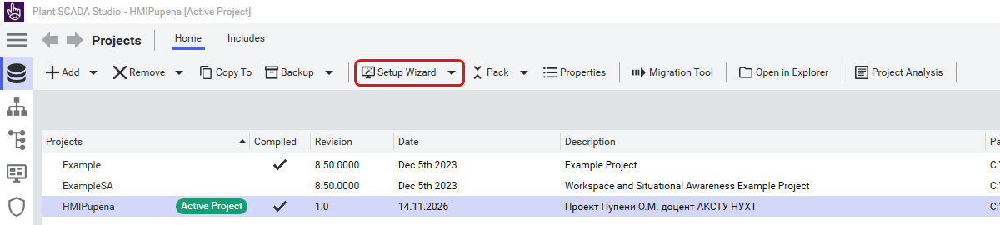

Рис.2.8 Запуск майстра налаштування комп'ютера

- [ ] Запустіть проект на виконання кнопкою "Run" (трикутник) на лівій панелі провідника.

Навіть в новоствореному проекті є готові сторінки для перегляду.

- [ ] Перегляньте структуру меню (розділи "Pages", "Alarms", "Trends", "Tags"), та відкрийте кілька сторінок для перевірки роботи меню.
- [ ] Завершіть роботу середовища виконання (для новоствореного проекту достатньо закрити вікно середовища виконання).

<iframe width="560" height="315" src="https://www.youtube.com/embed/yAg_-MUCWlo" title="YouTube video player" frameborder="0" allow="accelerometer; autoplay; clipboard-write; encrypted-media; gyroscope; picture-in-picture" allowfullscreen></iframe>

## 5. Конфігурування пристрою вводу/виводу 

- [ ] Детально ознайомтеся з розділом "7. Вимоги до системи SCADA/HMI. Вимоги до комунікаційного обміну" [Завдання](task.md). 

- [ ] Для налаштування комунікаційного зв’язку через пристрій вводу/виводу запустіть майстер "Device Communications Wizard": розділ "Topology" -> вкладка "I/O Devices" -> кнопка "New Device" (рис.2.9).

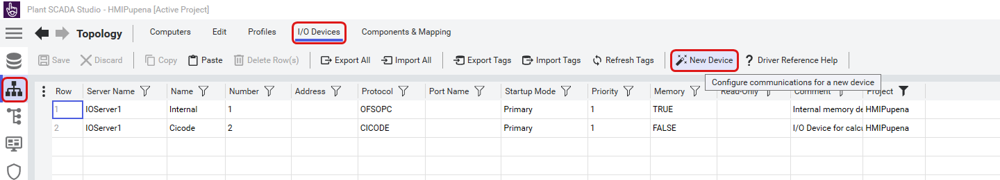

Рис.2.9 Запуск майстра налаштування пристрою вводу/виводу

- [ ] На рис.2.10 для кожного пункту показано зовнішній вигляд вікон, налаштуйте наступні налаштування: 

(1) у стартовому вікні перевірте, що вибраний Ваш проект і натисніть "Далі"; 

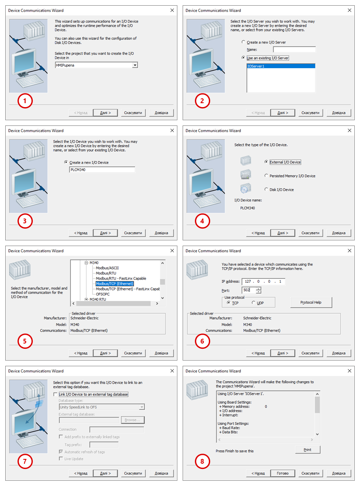

 Рис.2.10. Вікна помічника налаштування комунікацій 

(2) у вікні вибору серверу вводу/виводу виберіть "Use an existing I/O Server" -> "IOServer1" – назва серверу вводу/виводу, який буде використовуватися для роботи з пристроями вводу/виводу; зверніть увагу, що **у Вашому проекті повинен бути тільки один сервер вводу/виводу**, оскільки він вже існує – просто виберіть його зі списку;  

(3) у вікні створення пристрою вводу/виводу ("Create a new I/O Device") введіть назву пристрою, наприклад "PLCM340"; зверніть увагу, що назва повинна містити тільки літери латинського алфавіту, починатися з літери, не містити пробілів і також інших службових символів (може містити "_");  

(4) у вікні вибору типу пристрою вкажіть "External I/O Device", так як створені в його межах змінні мають за джерело даних змінні зовнішнього пристрою вводу/виводу;

(5) у вікні вибору моделі пристрою та протоколу вкажіть у розділі "Schneider-Electric" -> "M340" -> "Modbus/TCP (Ethernet)";

(6) у вікні налаштування параметрів TCP/IP вкажіть IP адресу М340, або комп’ютера на якому знаходиться імітатор Unity PRO; якщо імітатор Unity PRO виконується на тому самому ПК що і виконавча система Plant SCADA, тут необхідно вписати 127.0.0.1; порт ("Port") – 502, протокол ("Use protocol") – TCP;

(7) вікно означення зовнішньої БД тегів ("Link I/O Device to an external tag database") дає можливість підключити або імпортувати зовнішній файл, в якому знаходиться база даних змінних тегів вводу/виводу, що у багатьох випадках скорочує час створення та налагодження проекту; механізми імпорту/експорту на даному етапі використовуватися не будуть, тому у цьому вікні нічого не вказуйте, просто натисніть "Далі";       

(8) у вікні завершення майстра передивіться перелік того, що він буде створювати і натисніть "Готово". 

Зверніть увагу, що **для зміни налаштувань існуючих пристроїв вводу/виводу майстер налаштування запускати не потрібно**, бо кожного разу у результаті запуску будуть створюватися нові записи в базі даних проекту!   

- [ ] Перевірте результати роботи майстра, переглянувши наступні розділи проекту через провідник (рис.2.11):

- "Topology" -> "I/O Devices"
- "Topology" -> "Components & Mapping" -> "Boards" (модулі)
- "Topology" -> "Components & Mapping" -> "Ports" (порти)

- [ ] Подивіться скільки є записів у кожному розділі, які поля заповнені, як забезпечується ієрархія вкладеності `Boards (модулі) -> Ports (порти) -> I/O Devices (пристрої вводу/виводу)`

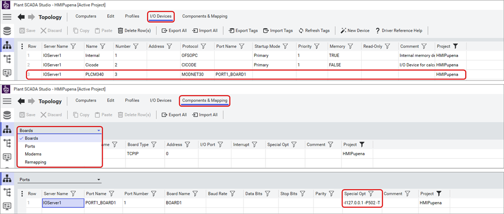

 Рис.2.11. Налаштування пристроїв

- [ ] Зверніть увагу, де налаштовуються параметри комунікацій IP та TCP порт, які були задані в майстрі (поле "Special Opt" порту: `-I127.0.0.1 -P502 -T`). Це може здатися не логічним з точки зору ієрархії, тому для налаштування кожного окремого типу драйверу варто спочатку читати документацію ("Driver Reference Help").   

<iframe width="560" height="315" src="https://www.youtube.com/embed/8e0S1MM_O3Q" title="YouTube video player" frameborder="0" allow="accelerometer; autoplay; clipboard-write; encrypted-media; gyroscope; picture-in-picture" allowfullscreen></iframe>

## 6. Створення перших тегів

У нових версіях Plant SCADA (починаючи з Citect 2016) є табличні редактори, які можна налаштувати під свої потреби.

- [ ] Відкрийте редактор тегів: розділ "System Model" -> вкладка "Variables". Налаштуйте (виставте опціями в меню, що відкривається кнопкою `⋮` зліва від заголовків колонок), щоб в редакторі відображалися тільки ті колонки, які показані на рис.2.12: Tag Name, I/O Device, Data Type, Address, Comment, Eng Units, Format, Raw Zero Scale, Raw Full Scale, Eng Zero Scale, Eng Full Scale.  

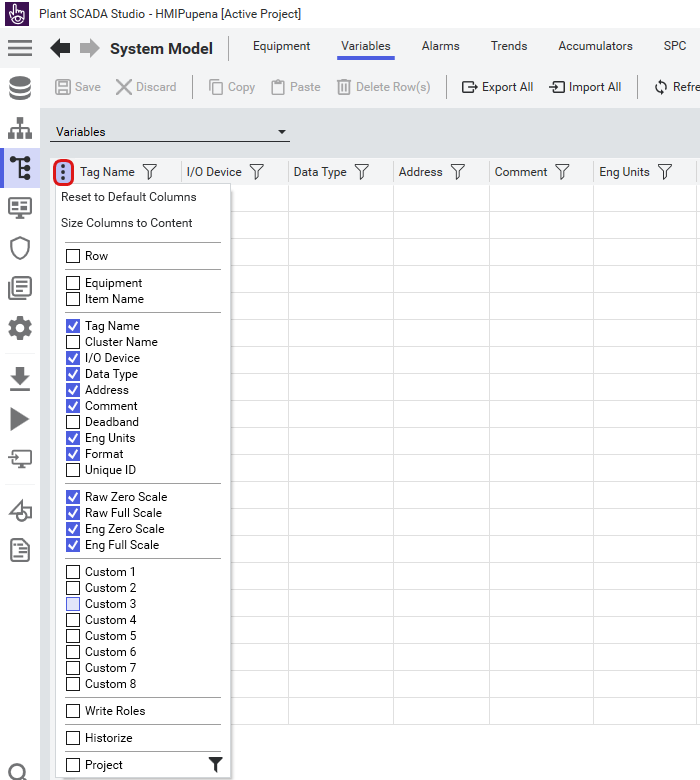

 Рис.2.12. Налаштування табличного редактору тегів

- [ ] Створіть два змінних теги: один аналоговий (див. перший запис таблиці 1 [завдання](task.md)) та один дискретний (див. перший запис таблиці 2 файлу завдання). Рекомендується імена тегам давати такі самі як в проекті Unity PRO. На рис.2.13 показані поля записів для цих змінних. 

| Tag Name (Имя тега) | Data Type | I/O Device | Address  | Comment                     | Raw Zero Scale | Raw Full Scale | Eng Zero Scale | Eng Full Scale | Eng Units | Format |
| -------- | ---------- | ---------- | ------ | ------------------------------- | ------------ | ------------- | ----------------- | ------------------ | ------- | ------ |
| T1_LT1   | INT        | PLCM340    | %MW100 | Рівень T1                       | 0            | 10000         | 0                 | 100                | %       | ##.#   |
| D1_LSH   | DIGITAL    | PLCM340    | %M0    | Сигналізатор верхнього рівня D1 |              |               |                   |                    |         |        |

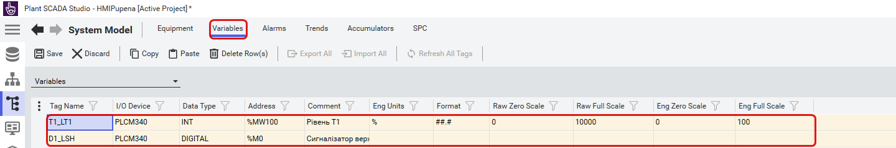

Рис.2.13. Створення змінних

- [ ] Натисніть "Save" на панелі інструментів редактора. Незбережені записи підсвічуються жовтим кольором.

- [ ] Скомпілюйте проект. Перевірте наявність помилок та попереджень, якщо таких не виявлено – перейдіть до наступного пункту, інакше – виправте помилки. 

<iframe width="560" height="315" src="https://www.youtube.com/embed/6zX22KzJma0" title="YouTube video player" frameborder="0" allow="accelerometer; autoplay; clipboard-write; encrypted-media; gyroscope; picture-in-picture" allowfullscreen></iframe>

## 7. Виведення перших тегів на мнемосхему

- [ ] Відкрийте сторінку Startup: розділ "Visualization" -> вкладка "Pages" -> виділіть сторінку "Startup" -> кнопка "Open" (рис.2.14). Сторінка відкриється у графічному редакторі.

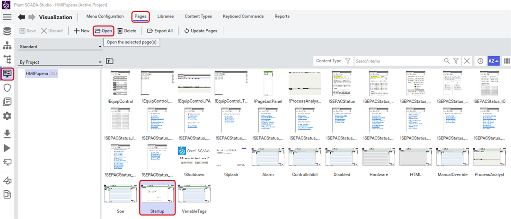

Рис.2.14. Відкриття сторінки Startup 

- [ ] Видаліть рисунок з демо ("AVEVA Plant SCADA ..."), що розміщений на мнемосхемі: виділіть його мишею та виберіть меню "Edit" -> "Delete".
- [ ] Відкрийте вікно властивостей сторінки (контекстне меню на вільному місці сторінки -> "Page Properties..."), на вкладці "Appearance" змініть колір фону ("Page color") на сірий як це показано на рис.2.15. Після цього натисніть "Ok".

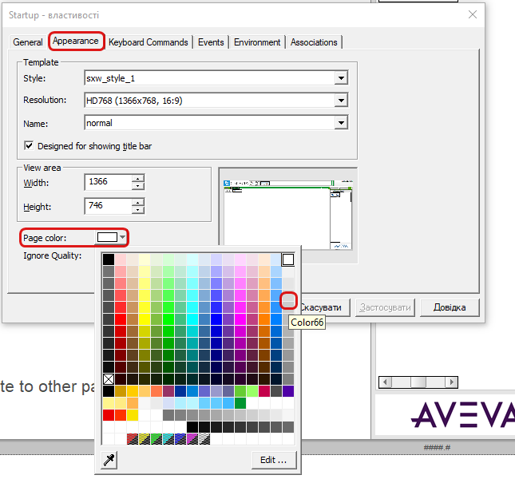

Рис.2.15 Зміна фону сторінки

- [ ] Видаліть зайві елементи, що залишились на мнемосхемі. Для виділення усіх елементів можна використати меню "Edit" -> "Select All" (CTRL+A), після чого "Edit" -> "Delete".  
- [ ] Перейдіть в Plant SCADA Studio і змініть режим прив'язки за замовченням до тегів замість устатковання: кнопка "Options" на лівій панелі провідника -> зніміть опцію "Display equipment items when populating tag list" (рис.2.16). 

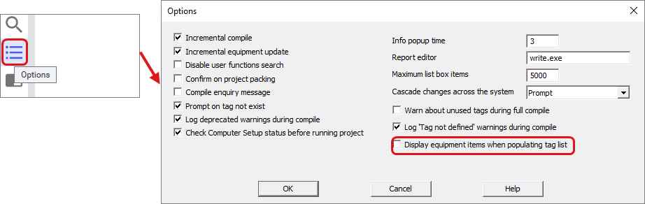

Рис.2.16 Налаштування прив'язки до тегів 

- [ ] Перейдіть в редактор графіки, розмістіть на сторінці 4 графічні елементи, як це зображено на рис.2.17, користуючись описаними нижче (під рисунком) процедурами:

1. текстові написи "Рівень Т1" та "Сигналізатор верхнього рівня"
2. джини для відображення та зміни значень змінних `T1_LT1` та `D1_LSH`. 

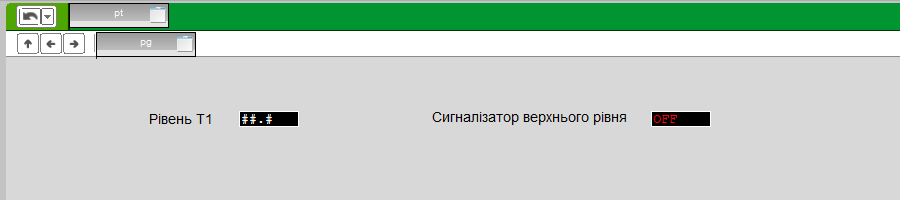

Рис.2.17. Зовнішній вигляд сторінки у режимі розробки

Текстові поля створюються з використанням елементу "Text", що вибирається з палітри інструментів (рис.2.18, кнопка "A") або з меню графічного редактору "Objects" -> "Text". Зверніть увагу, що **перед розміщенням на сторінці текстового елементу в ньому необхідно набрати текст**. Змінити текст вже розміщеного елемента можна у вікні його властивостей (подвійний клік) на вкладці "Appearance" -> "General" у полі "Text".

Для відображення та зміни значення числової змінної скористуйтесь джином "Parameter_2" з бібліотеки "keyentry" (меню "Edit" -> "Paste Genie..." або клавіша F11). Джин – це графічний бібліотечний елемент з вбудованою анімацією. Для прив’язки змінної до анімації, після вставки джина з'явиться вікно прив’язки ("Genie - Parameter with Border"), де в полі "Tag" треба буде вказати змінну. Для відображення та зміни значення дискретної змінної, скористуйтесь джином "on_off_toggle2" з бібліотеки "keyentry". Вставлений джин з'являється у верхньому лівому куті сторінки, після чого його треба перетягнути мишею на потрібне місце. 

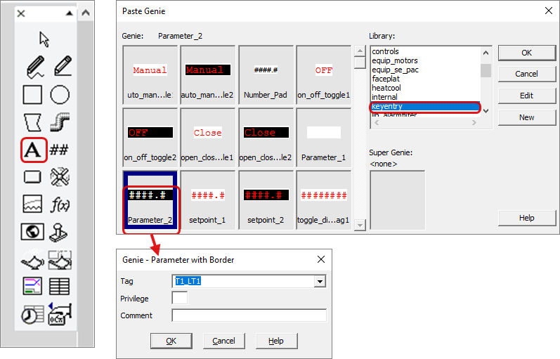

Рис.2.18 Створення графічних елементів

- [ ] Після усіх дій збережіть сторінку у графічному редакторі через меню "File" -> "Save"   

З деталями налаштування основних графічних можливостей Plant SCADA Ви ознайомитеся у наступних лабораторних роботах. 

<iframe width="560" height="315" src="https://www.youtube.com/embed/zNuUCUaY8Ic" title="YouTube video player" frameborder="0" allow="accelerometer; autoplay; clipboard-write; encrypted-media; gyroscope; picture-in-picture" allowfullscreen></iframe>

## 8. Створення користувача

- [ ] У провіднику в розділі "Security" -> "Users" створіть користувача "admin" з роллю "Administrators" (рис.2.19): у першому порожньому рядку таблиці вкажіть "User Name" = admin, "Full Name" = Administrator, у полі "Roles" виберіть зі списку "Administrators". Пароль задається у вікні "Set Password", яке відкривається при редагуванні поля "Password" або кнопкою "Change..." на панелі властивостей. Задайте нескладний пароль, щоб Ви запам'ятали. 
- [ ] Збережіть зміни ("Save")

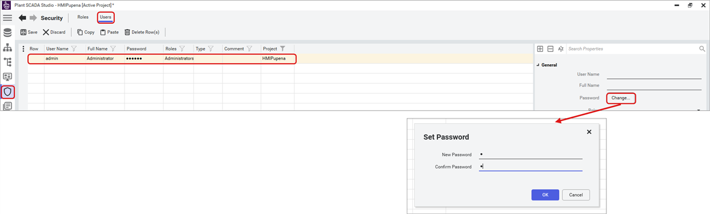

 Рис.2.19 Створення користувача

<iframe width="560" height="315" src="https://www.youtube.com/embed/h5t3sZIzzCY" title="YouTube video player" frameborder="0" allow="accelerometer; autoplay; clipboard-write; encrypted-media; gyroscope; picture-in-picture" allowfullscreen></iframe>

## 9. Запуск і перевірка роботи

- [ ] Скомпілюйте проект. Перевірте наявність помилок та попереджень, якщо таких не виявлено – перейдіть до наступного пункту, інакше – виправте помилки.
- [ ] Завантажте в імітатор ПЛК і запустіть на виконання проект Unity PRO, відповідно до того, як це описано в пункті 2 [завдання](task.md). 
- [ ] Запустіть на виконання скомпільований проект Plant SCADA.

**Увага!** Замість кириличного тексту може з'явитися нечитабельний текст (рис.2.20). Це пов'язано з тим, що за замовченням не виставлена правильна кодова сторінка. Щоб цього позбутися, необхідно встановити в Citect.ini кириличну кодову сторінку за замовченням, що буде розглядатися пізніше в даній лабораторній роботі (п.14).         

- [ ] Зареєструйте користувача "admin" в системі для можливості проведення усіх операцій: "Login..." у правому верхньому куті вікна -> вікно "Login Form" (рис.2.20). Після реєстрації замість "Login..." відображається ім'я користувача ("Administrator"). 

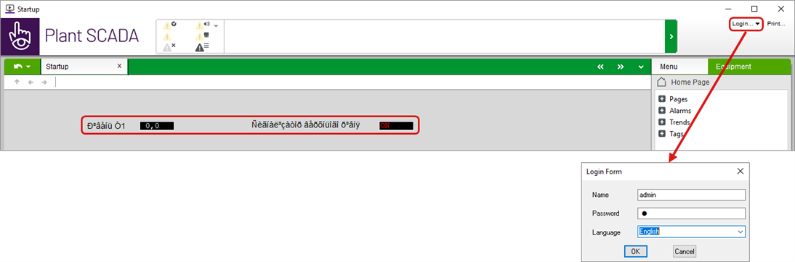

Рис.2.20 Реєстрація користувача в системі

- [ ] Перевірте чи відображаються значення змінних в середовищі виконання. Якщо замість них відображаються написи "#COM" чи "#BAD" – це значить, що є проблеми у зв’язку з контролером (або імітатором Unity PRO) і необхідно їх вирішувати за допомогою викладача. У іншому випадку – переходьте до наступного пункту.  

- [ ] Використовуючи операторські екрани в Unity PRO, перейдіть в режим форсування змінної датчика рівня `T1_LT1` (`AIFRC[0]`) та сигналізатора `D1_LSH` (`DIFRC[12]`) на операторському екрані "Tanks" (для можливості керування з операторського екрану має бути увімкнений режим "Services" -> "Enable Variable Modification" (F7)). Деталі режимів форсування описані у файлі [Завдання](task.md) та перевірялися на початку лабораторної роботи. 
- [ ] У режимі форсування змініть значення в середовищі Plant SCADA для цих змінних. Перевірте чи відповідає це таким саме значенням в Unity PRO (рис.2.20а). Зверніть увагу на масштабування `T1_LT1` (значення 45,0 % в Plant SCADA відповідає значенню 4500 в ПЛК). Якщо усі зміни відбуваються коректно – переходьте до наступного пункту.

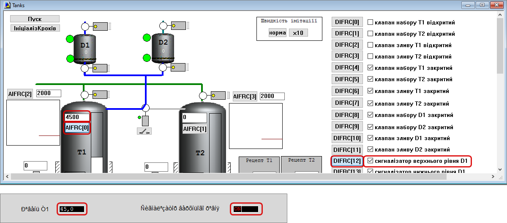

Рис.2.20а Перевірка зв'язку з імітатором ПЛК у режимі форсування

- [ ] Закрийте середовище виконання.

<iframe width="560" height="315" src="https://www.youtube.com/embed/Th9MwYDOnhY" title="YouTube video player" frameborder="0" allow="accelerometer; autoplay; clipboard-write; encrypted-media; gyroscope; picture-in-picture" allowfullscreen></iframe>

## 10. Створення резервної копії

- [ ] Зробіть резервну копію проекту, як це показано на рис.2.21: "Projects" -> "Home" -> "Backup" -> вікно "Backup Project". Розміщення файлу резервної копії ("Backup file") зручно робити на робочому столі.
- [ ] Після процедури створення (повідомлення "Backup Complete") знайдіть файл резервної копії з розширенням ctz. 

Необхідно періодично робити резервні копії. Це дасть можливість у випадку непередбачуваних змін в проекті відновити стару версію. Також це є самим простим і безпечним механізмом перенесення проекту з одного комп’ютера на інший.    

 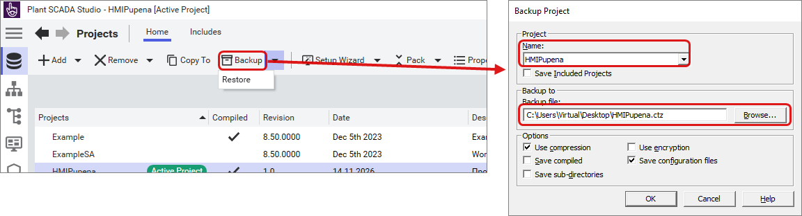

Рис.2.21 Створення резервної копії проекту

- [ ] Відновіть резервну копію проекту в новий проект з таким саме ім’ям, але з суфіксом "Rest" (рис.2.22): "Backup" ▾ -> "Restore" -> у вікні "Restore Project" вкажіть файл резервної копії, у розділі "To" виберіть "New project" та вкажіть назву (наприклад, "HMIPupenaRest"). Перед відновленням необхідно підтвердити пропозицію середовища Plant SCADA на створення нової папки проекту ("Do you wish to create the directory ...?").    

Відновлення проекту можна робити і в існуючий проект ("Current project"), але тоді файли існуючого проекту будуть замінені файлами резервної копії. Необхідно дуже уважно ставитися до процедури створення та відновлення резервної копії проекту. 

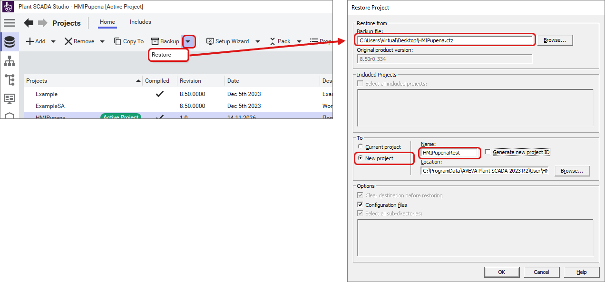

Рис.2.22 Відновлення резервної копії проекту

- [ ] Видаліть проект з суфіксом "Rest" (той, який створився у результаті відновлення в попередньому пункті): виділіть його у списку проектів, "Remove" ▾ -> "Delete Project" та підтвердіть видалення кнопкою "OK" (рис.2.22а). Будьте уважні – видалення проекту не можна скасувати!

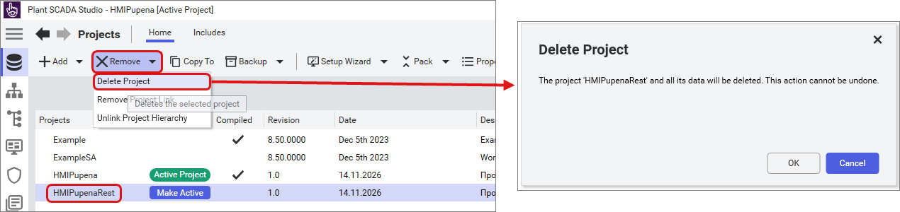

Рис.2.22а Видалення проекту

**Увага! Кожного разу по завершенню заняття створюйте резервні копії та забирайте їх з собою, для збереження проекту!**

<iframe width="560" height="315" src="https://www.youtube.com/embed/OGUXa6D092c" title="YouTube video player" frameborder="0" allow="accelerometer; autoplay; clipboard-write; encrypted-media; gyroscope; picture-in-picture" allowfullscreen></iframe>

## 11. Добавлення тегів скалярних типів

Табличний редактор Plant SCADA дозволяє вставляти дані в табличному вигляді, скопійовані з інших редакторів, наприклад Excel. Це зручно при підготовці даних і значно прискорює процес розроблення. 

- [ ] Завантажте та відкрийте [таблицю зі змінними](https://docs.google.com/spreadsheets/d/1PPKSlxMoOP-Fjb1KPU559eIJL7-qr5sb/edit?usp=sharing&ouid=111751208742846482260&rtpof=true&sd=true), або відкрийте її на гугл диску
- [ ] Скопіюйте вміст таблиці в буфер обміну (крім рядка T1_LT1, який вже є в проекті)
- [ ] Вставте скопійовані дані в таблицю тегів (виділіть першу клітинку першого порожнього рядка і натисніть CTRL+V). 
- [ ] Зверніть увагу, щоб послідовність колонок співпадала з наведеною на рис.2.23 (Tag Name, Data Type, I/O Device, Address, Comment, Raw Zero Scale, Raw Full Scale, Eng Zero Scale, Eng Full Scale, Eng Units, Format). Якщо це не так, перед вставленням змініть послідовність, шляхом перетягування заголовків колонок.

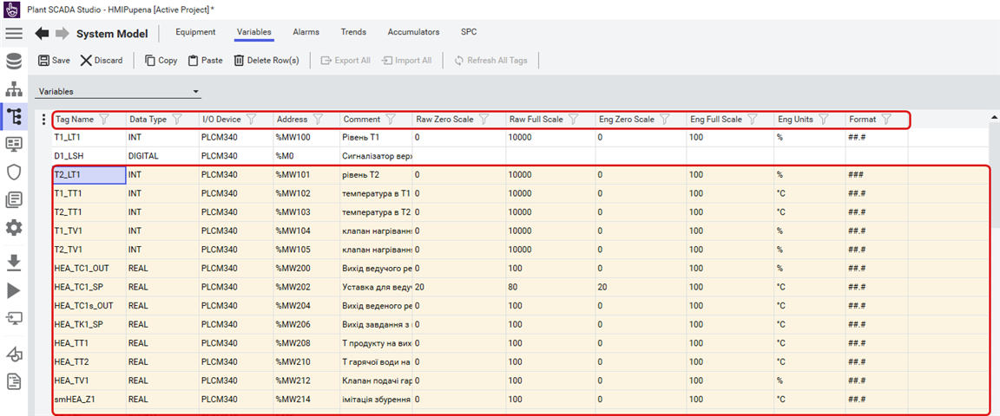

Рис.2.23 Вставлення даних в таблицю тегів

- [ ] Збережіть та скомпілюйте проект. Якщо компіляція пройшла успішно – перейдіть до наступного пункту. 

<iframe width="560" height="315" src="https://www.youtube.com/embed/00DkdcqXVZI" title="YouTube video player" frameborder="0" allow="accelerometer; autoplay; clipboard-write; encrypted-media; gyroscope; picture-in-picture" allowfullscreen></iframe>

## 12. Робота в середовищі виконання зі спеціальним вікном тегів

При створенні проекту автоматично створюються сторінки для перевірки та модифікації тегів. 

- [ ] Запустіть середовище виконання.
- [ ] Перейдіть на сторінку `Tags -> All Variable Tags` (заголовок сторінки "Variable Tags"). Для відображення (оновлення) значень натисніть кнопку "Refresh" на панелі інструментів сторінки – дані в таблиці автоматично не оновлюються. 
- [ ] Подивіться які можливості для перегляду тегів доступні. Для прокручування списку тегів користуйтеся смугою прокрутки праворуч від таблиці (колесо миші та клавіатура в цій таблиці не працюють).

За замовченням сторінка не дає можливості змінювати значення змінної: у контекстному меню тегу пункт "Set Value..." недоступний. Для того, щоб активувати таку можливість, необхідно налаштувати для неї привілеї, якими повинен володіти користувач.

- [ ] У графічному редакторі відкрийте сторінку "VariableTags": "File" -> "Open..." -> на вкладці "Page" виберіть "VariableTags" (рис.2.24)

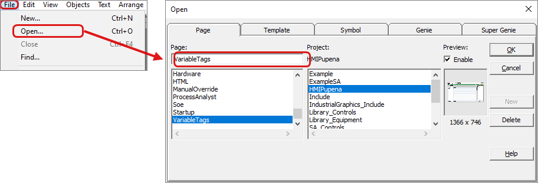

Рис.2.24 Відкриття сторінки з тегами

- [ ] Зробіть подвійний клік по таблиці тегів на сторінці (джин "Data Browse") і у полі "Privilege" вкажіть привілею 1 (рис.2.25). Збережіть сторінку. 

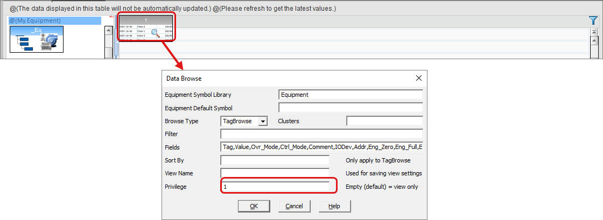

Рис.2.25 Зміна налаштувань сторінки з тегами

- [ ] Скомпілюйте проект. Його можна скомпілювати як з Plant SCADA Studio, так і з графічного редактору ("File" -> "Compile").
- [ ] Якщо Ви не зупиняли середовище виконання, то після компіляції нові сторінки можна просто відкрити повторно. Якщо середовище було зупинено – запустіть його заново.
- [ ] Зареєструйтеся в системі як користувач "admin".
- [ ] На сторінці "All Variable Tags" змініть значення змінної "T_SB1": контекстне меню тегу -> "Set Value..." -> у вікні "Input" введіть нове значення та натисніть "OK" (рис.2.26). Натисніть "Refresh" для перевірки нового значення.

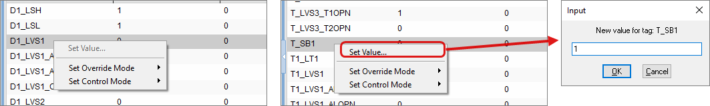

Рис.2.26 Зміна значення тегу (зліва – без привілеїв, праворуч – користувач admin)

<iframe width="560" height="315" src="https://www.youtube.com/embed/xfoGXh98nFM" title="YouTube video player" frameborder="0" allow="accelerometer; autoplay; clipboard-write; encrypted-media; gyroscope; picture-in-picture" allowfullscreen></iframe>

## 13. Теги типу масив

- [ ] Уважно прочитайте [додаток 2.2](lab2a2.md). 
- [ ] Добавте змінну-масив HEA_TT1_SP відповідно до налаштувань таблиці 1 файлу [Завдання](task.md). Для створення такої змінної в полі адреси після означення початкової адреси в квадратних дужках пишеться кількість елементів. У завданні масив означений в проекті Unity PRO з діапазоном від 0 до 5, отже кількість елементів задається рівною 6 (`%MW220[6]`). Загальний вигляд налаштувань масиву показаний на рис.2.27.   

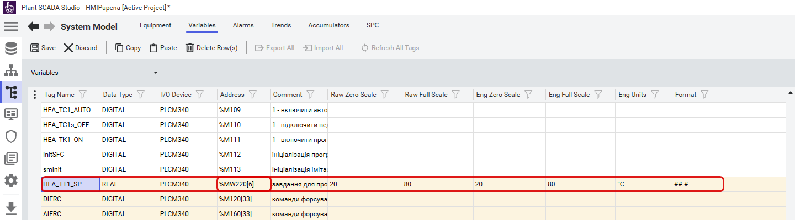

Рис.2.27. Налаштування змінної масиву

- [ ] Збережіть і скомпілюйте проект. При вдалому результаті компілювання переходьте далі. 

- [ ] Аналогічним чином добавте змінні `DIFRC` (`%M120[33]`) та `AIFRC` (`%M160[33]`) з таблиці 2 файлу [Завдання](task.md) (рис.2.28). Скомпілюйте проект. При вдалому результаті компілювання переходьте далі.

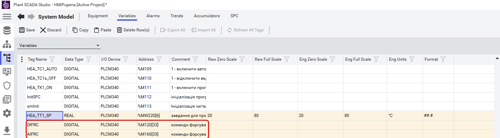

Рис.2.28. Налаштування дискретних змінних масиву

<iframe width="560" height="315" src="https://www.youtube.com/embed/BUX0CEjilL4" title="YouTube video player" frameborder="0" allow="accelerometer; autoplay; clipboard-write; encrypted-media; gyroscope; picture-in-picture" allowfullscreen></iframe>

## 14. Налаштування кодової сторінки за замовченням

Цей пункт треба виконувати, якщо в середовищі виконання не відображаються кириличні шрифти. 

- [ ] З меню "Пуск" ("AVEVA Plant SCADA" -> "Computer Setup Editor") або з графічного редактора ("Tools" -> "Computer Setup Editor") запустіть редактор параметрів Computer Setup Editor (рис.2.29).

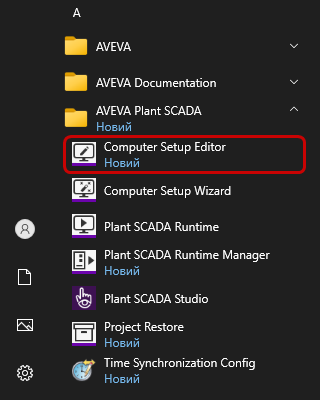

 Рис.2.29 Запуск редактора Computer Setup Editor

Computer Setup Editor дає можливість змінювати параметри в Citect.ini. Права частина вікна редактора містить довідку по параметрах.

- [ ] У правій частині редактора у полі "Search" задайте слово `Language` для пошуку параметрів, пов'язаних з мовою. Натисніть значок пошуку або Enter. У вікні результатів пошуку виберіть `Language Parameters` (рис.2.30).  

 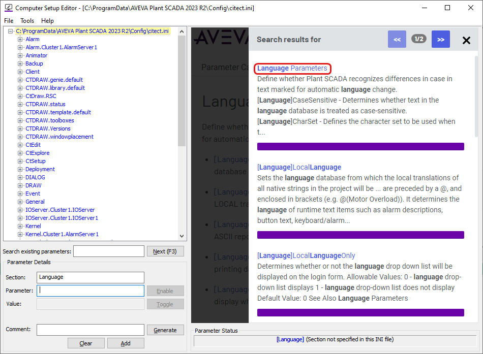

 Рис.2.30 Вікно пошуку параметрів

- [ ] У списку параметрів виберіть `[Language]CharSet` – поля "Section" та "Parameter" у розділі "Parameter Details" заповняться автоматично. Вкажіть в полі "Value" значення 204 (кирилиця) і натисніть "Add" (рис.2.31). Параметр з'явиться в дереві ліворуч (розділ Language -> CharSet = 204).  
- [ ] Збережіть налаштування через меню "File" -> "Save" (або підтвердіть збереження при закритті редактора).

 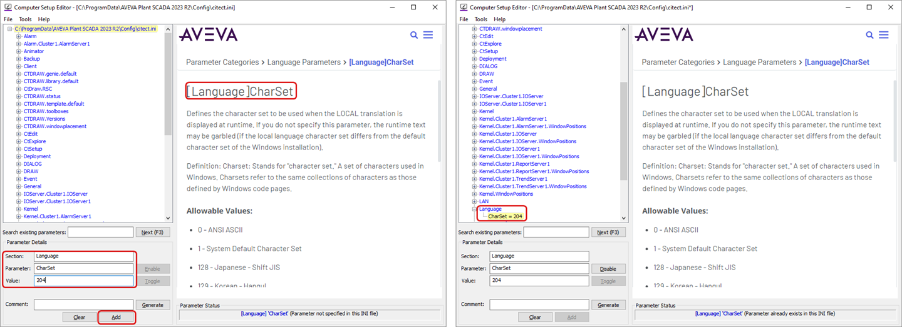

 Рис.2.31 Налаштування кодової сторінки 

- [ ] Запустіть або перезапустіть проект на виконання. Перевірте, що кириличний текст відображається вірно без реєстрації користувача.

<iframe width="560" height="315" src="https://www.youtube.com/embed/slydTi7lKwg" title="YouTube video player" frameborder="0" allow="accelerometer; autoplay; clipboard-write; encrypted-media; gyroscope; picture-in-picture" allowfullscreen></iframe>

## 15. Функція TagDebug

Для перевірки працездатності змінних тегів можна скористатися спеціалізованою функцією Cicode "TagDebug", яка викликає вікно перегляду та зміни значення вибраних змінних. 

- [ ] У графічному редакторі відкрийте сторінку "Startup". 
- [ ] У довільному місці розмістіть кнопку (інструмент "Button" на палітрі інструментів) з написом "Перевірка змінних", який вказується у властивостях "Appearance" -> "General" -> "Text" (рис.2.32). 
- [ ] На вкладці "Input" -> "Touch" в розділі "Action" активуйте опцію "Up", а в поле "Up command" впишіть `TagDebug()`. 
- [ ] Збережіть сторінку, скомпілюйте проект, та у випадку вдалої компіляції перейдіть до наступного пункту.  

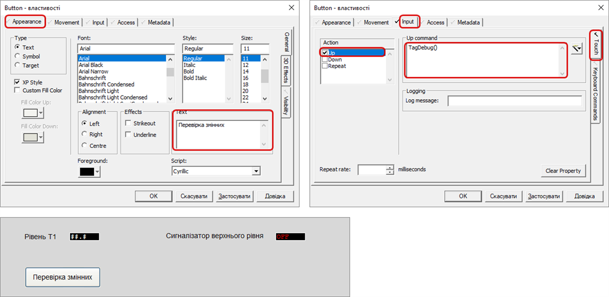

 Рис.2.32 Налаштування кнопки для виклику вікна перевірки змінних

- [ ] Запустіть або перезапустіть проект на виконання. Якщо середовище виконання вже було запущене до компіляції, повністю закрийте його і запустіть знову.

- [ ] У Unity PRO зніміть заздалегідь усі форсування. 
- [ ] Натиснувши на кнопку "Перевірка змінних", викличте вікно-форму читання/запису "TagDebug" (рис.2.33). Виберіть у списку змінну T_SB1 ("Запуск процесу приготування") та прочитайте її значення кнопкою "Read". Змініть значення на 1 та запишіть його в контролер кнопкою "Write". Подивіться чи запустилася програма приготування продукту в імітаторі контролера. Якщо так, перейдіть далі.

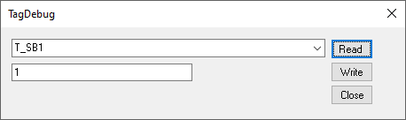

 Рис.2.33 Вікно читання/запису змінної, що викликається функцією `TagDebug()`

- [ ] За допомогою вікна TagDebug перевірте відповідність значення аналогових змінних в Plant SCADA до змінних в ПЛК з урахуванням масштабу. 
- [ ] Також вибірково перевірте 3 дискретних змінних. За необхідності, модифікуйте проект, щоб всі змінні були налаштовані згідно завдання.

<iframe width="560" height="315" src="https://www.youtube.com/embed/WoUSnp4qTS0" title="YouTube video player" frameborder="0" allow="accelerometer; autoplay; clipboard-write; encrypted-media; gyroscope; picture-in-picture" allowfullscreen></iframe>

## 16. Добавлення та перевірка роботи структурних змінних

У проект необхідно добавити структурні змінні, що вказані в таблицях 3-8 з файлу [Завдання](task.md). Враховуючи, що назва змінних не може містити крапку ".", у якості розділового знаку варто використовувати символ нижнього підкреслення "_". Надалі назва тегів буде мати вирішальне значення для автоматизації розробки людино-машинного інтерфейсу, тому ми рекомендуємо Вам використовувати імена з таблиці 2.1  

Таблиця 2.1. Рекомендовані назви змінних тегів відповідно до полів структури

| **Назва змінної в ПЛК** | **Рекомендована назва в** Plant SCADA | **Призначення**                                              |
| ----------------------- | -------------------------------------- | ------------------------------------------------------------ |
| Dozator1.CV             | D1_LC_CV                               | плинна кількість доз  D1                                     |
| Dozator1.PV             | D1_LC_PV                               | задана кількість доз D1                                      |
| Dozator1.START          | D1_LC_START                            | запуск дозування D1                                          |
| Dozator2.CV             | D2_LC_CV                               | плинна кількість доз D2                                      |
| Dozator2.PV             | D2_LC_PV                               | задана кількість доз D2                                      |
| Dozator2.START          | D2_LC_START                            | запуск дозування D2                                          |
| TC1_PARA.pv_inf         | HEA_TC1_PVINF                          | обмеження по мінімуму  вхідної величини завдання TC1         |
| TC1_PARA.pv_sup         | HEA_TC1_PVSUP                          | обмеження по максимуму  вхідної величини завдання TC1        |
| TC1_PARA.out_inf        | HEA_TC1_OUTINF                         | обмеження по мінімуму  вихідної величини блоку TC1           |
| TC1_PARA.out_sup        | HEA_TC1_OUTSUP                         | обмеження по максимуму  вихідної величини блоку TC1          |
| TC1_PARA.kp             | HEA_TC1_KP                             | Коефіцієнт пропорційності TC1                                |
| TC1_PARA.ti             | HEA_TC1_TI                             | Час інтегрування TC1                                         |
| TC1_PARA.dband          | HEA_TC1_DBAND                          | Зона нечутливості TC1                                        |
| TC1_PARA.outbias        | HEA_TC1_OUTBIAS                        | зміщення виходу регулятора  в П-режимі функціонування (при ti=0s) TC1 |
| TC1s_PARA.pv_inf        | HEA_TC1s_PVINF                         | обмеження по мінімуму  вхідної величини завдання TC1s        |
| TC1s_PARA .pv_sup       | HEA_TC1s_PVSUP                         | обмеження по максимуму  вхідної величини завдання TC1s       |
| TC1s_PARA .out_inf      | HEA_TC1s_OUTINF                        | обмеження по мінімуму  вихідної величини блоку TC1s          |
| TC1s_PARA .out_sup      | HEA_TC1s_OUTSUP                        | обмеження по максимуму  вихідної величини блоку TC1s         |
| TC1s_PARA .kp           | HEA_TC1s_KP                            | Коефіцієнт пропорційності TC1s                               |
| TC1s_PARA .ti           | HEA_TC1s_TI                            | Час інтегрування TC1s                                        |
| TC1s_PARA .dband        | HEA_TC1s_DBAND                         | Зона нечутливості TC1s                                       |
| TC1s_PARA .outbias      | HEA_TC1s_OUTBIAS                       | зміщення виходу регулятора  в П-режимі функціонування (при ti=0s) TC1s |
| Recipe1.D1Count         | T1_KS_D1CNT_SP                         | рецепт Т1: кількість  доз з дозатору D1                      |
| Recipe1.D2Count         | T1_KS_D2CNT_SP                         | рецепт Т1: кількість  доз з дозатору D2                      |
| Recipe1.T_SP            | T1_KS_TT1_SP                           | рецепт Т1: значення  температури нагрівання                  |
| Recipe1.Delay           | T1_KS_DEL_SP                           | рецепт Т1: заданий час  витримки                             |
| Recipe2.D1Count         | T2_KS_D1CNT_SP                         | рецепт Т2: кількість доз з дозатору D1                       |
| Recipe2.D2Count         | T2_KS_D2CNT_SP                         | рецепт Т2: кількість доз з дозатору D2                       |
| Recipe2.T_SP            | T2_KS_TT1_SP                           | рецепт Т2: значення температури нагрівання                   |
| Recipe2.Delay           | T2_KS_DEL_SP                           | рецепт Т2: заданий час витримки                              |

Уважно прочитайте [додаток 2.2](lab2a2.md), щоб вірно налаштувати ці змінні. Необхідно врахувати:

- наявність типу BOOL в структурах, які в Plant SCADA мають тип DIGITAL, та правильну їх адресацію (наприклад, `%MW112.0`) 
- необхідність приведення типу TIME до формату Plant SCADA (ULONG), та правильне їх масштабування (мс -> с: Raw Zero Scale = 0, Raw Full Scale = 3600000, Eng Zero Scale = 0, Eng Full Scale = 3600) 

- [ ] Самостійно добавте усі структуровані змінні з таб.2.1 в проект. Для швидкості створення можна скористатися табличним редактором MS Excel або Google Sheet:
  - скопіювати змінні з таблиці 2.1 в табличний редактор, а також з таблиць 3-8 з файлу [Завдання](task.md). 
  - скопіювати колонку "Рекомендована назва в Plant SCADA" в редактор тегів в колонку "Tag Name"
  - скопіювати колонку "Призначення" в редактор тегів в поле "Comment"
  - скопіювати адреси з таблиць 3-8 з файлу [Завдання](task.md) або з табличного редактору
  - вірно вибрати потрібний тип змінних та налаштувати інші поля (масштабування, одиниці вимірювання)
- [ ] Збережіть та скомпілюйте проект. 
- [ ] При компіляції можуть виникнути помилки `Address on bad boundary (E2060)` (рис.2.34). Дізнайтеся що це за помилка та виправте її, як описано в [додатку 2.2](lab2a2.md) 
- [ ] Якщо з'являються інші помилки, подвійним кліком на рядку помилки в панелі "Compile Messages" можна перейти до джерела помилки і виправити її.  

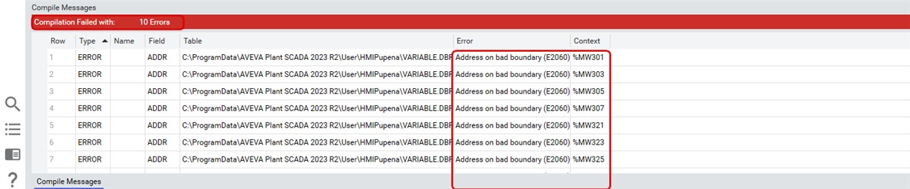

 Рис.2.34 Помилки компілювання

- [ ] Після виправлення усіх помилок запустіть на виконання проект. 
- [ ] За допомогою вікна TagDebug перевірте відповідність значень полів типу TIME структурних змінних ПЛК до змінних Plant SCADA (наприклад, `HEA_TC1_TI` = 10 відповідає значенню `TC1_PARA.ti` = t#10s в ПЛК). 

- [ ] За необхідності модифікуйте проект так, щоб всі змінні були налаштовані згідно завдання.

- [ ] **Зробіть резервну копію проекту, скопіюйте її на змінний носій. У випадку роботи в лабораторії – покажіть викладачу, і з його відома видаліть свій проект з провідника проектів.**      

<iframe width="560" height="315" src="https://www.youtube.com/embed/jmCniCyEVD0" title="YouTube video player" frameborder="0" allow="accelerometer; autoplay; clipboard-write; encrypted-media; gyroscope; picture-in-picture" allowfullscreen></iframe>

## Питання до захисту 

1. Поясніть відмінність понять середовища розробки та середовища виконання SCADA/HMI. Яке саме середовище потрібне для роботи АРМу оператору на підприємстві?
2. Поясніть що таке проект SCADA/HMI? Чим відрізняється вихідний проект від скомпільованого і коли підприємству необхідні обидва варіанти проектів?
3. Від чого залежить вартість середовища виконання SCADA/HMI?
4. Які типові функції надають програми SCADA/HMI?
5. Що таке база даних реального часу? 
6. Поясніть, що таке тег SCADA? Що може бути джерелом даних для тега?
7. Поясніть що таке відмітка часу і показник достовірності тегу?
8. Розкажіть про призначення основних редакторів Plant SCADA.
9. Чому у включених проектах з'явився проект "SxW_Style_Include"? Чи міг там з'явитися інший проект? На що це впливає? 
10. Що собою представляє проект Plant SCADA з точки зору файлової системи Windows?
11. Як середовище розробки Plant SCADA дізнається де знаходяться проекти на комп'ютері? 
12. Як середовище виконання Plant SCADA дізнається де знаходяться файли режиму виконання на комп'ютері? 
13. Як можна дізнатися про розміщення папки проекту середовища розробки?
14. Для чого потрібен Plant SCADA Studio? Розкажіть про можливості, які Ви використовували в цій лабораторній роботі. 
15. Поясніть для чого потрібна компіляція проекту. Які ситуації можливі при компіляції проекту? Як дізнатися про помилки компіляції?
16. Яке призначення майстра налаштування комунікацій? Які зміни в проект вносить майстер? Чи можна створити ці записи в проекті самостійно? Обґрунтуйте необхідність використання цього майстра.
17. Що і де необхідно змінити в існуючому проекті, щоб вказати іншу IP адресу ПЛК?  
18. Навіщо потрібно створювати резервну копію проекту? Розкажіть основні процедури створення та відновлення резервної копії проекту.
19. Яке призначення змінних тегів ("Variables")? Розкажіть про призначення основних властивостей, які налаштовуються в Plant SCADA при створенні цих змінних.
20. Яке призначення локальних змінних ("Local Variables")? Чим локальні змінні принципово відрізняються від змінних тегів?
21. Які типи даних для змінних є у Plant SCADA? Розкажіть про відповідність цих типів основним типам даних в IEC 61131, зокрема у Unity PRO. Як у Plant SCADA налаштувати змінну, яка буде відображати секунди зі змінної ПЛК типу TIME?
22. Розкажіть про означення адреси в Plant SCADA для змінних з пристроїв, підключених через драйвер MODNET30. Які правила адресації BOOL/EBOOL, що прив’язані до комірок %MW?
23. Розкажіть про означення адреси в Plant SCADA для змінних з пристроїв, підключених через драйвер MODNET30. Які правила адресації DINT/UDINT, що прив’язані до комірок %MW?
24. Як у Plant SCADA налаштовуються масиви? Як звертатися в проекті до елементів масивів?
25. Які Ви знаєте засоби Plant SCADA для читання та запису користувачем будь-яких змінних в системі?   

