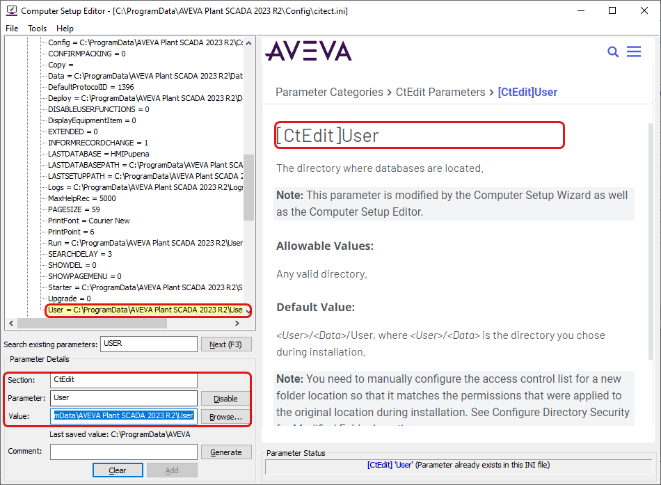
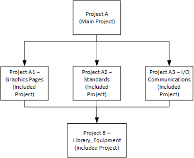
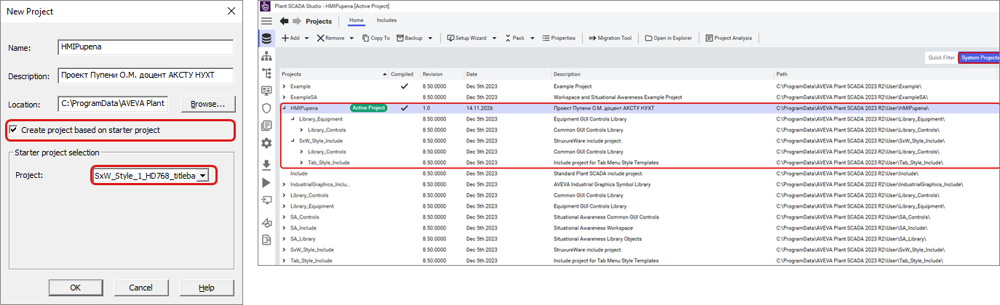
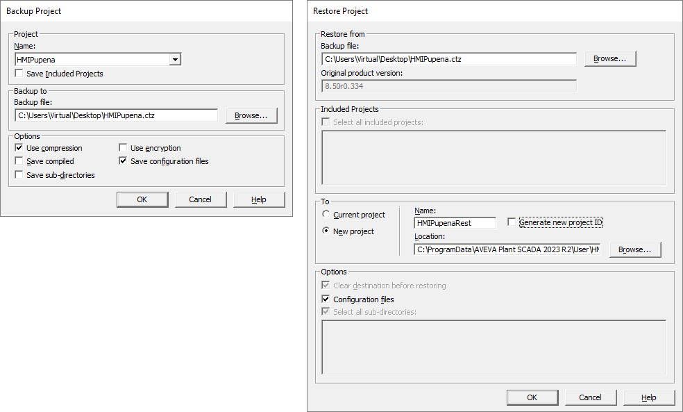
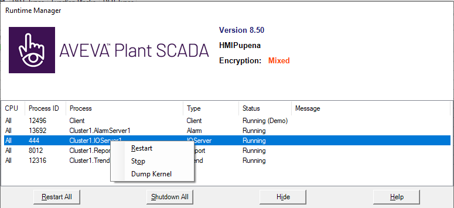

[Людино-машинні інтерфейси](https://pupenasan.github.io/hmi/)  Автор і лектор: Олександр Пупена доц. кафедри [АКСТУ НУХТ](http://www.iasu-nuft.pp.ua/) 

# Додаток 2.1. Короткі відомості про організацію проектів у Plant SCADA

Цей матеріал взятий з посібника [Розроблення людино-машинних інтерфейсів та систем збирання даних з використанням програмних засобів SCADA/HMI](https://www.fb.asu.in.ua/kniga-scada-hmi) та адаптований до версії AVEVA Plant SCADA 2023 R2 (попередні назви продукту – Vijeo Citect, Citect SCADA). 

## Основні компоненти середовищ розроблення та виконання 

AVEVA Plant SCADA включає в себе комплект ПЗ середовища розроблення і комплект середовища виконання. При інсталяції вибирається, що саме необхідно встановити. На робочій станції оператора та серверах SCADA необхідне тільки ПЗ комплекту середовища виконання, а на інженерній робочій станції потрібні обидва комплекти. 

Проект середовища розроблення Plant SCADA – це набір різноманітних файлів, які розміщуються в папці проекту. Для їх редагування передбачено кілька окремих редакторів, для версії AVEVA Plant SCADA 2023 R2 це:

‒    Plant SCADA Studio – для створення і налаштовування логічної частини проекту (у ранніх версіях – Citect Studio, Citect Explorer, Project Editor); 

‒    Graphics Builder – для створення і редагування графічних сторінок, а також бібліотечних елементів;

‒    Cicode Editor – редактор файлів мов Cicode та VBA;

‒    Computer Setup Editor – редактор файлу з параметрами citect.ini;

‒    Equipment Editor – редактор устатковання.

Таким чином, щоб створювати або редагувати проект, необхідно запустити Plant SCADA Studio, а він автоматично відкриє редактор Graphics Builder. Додатково також у наявності є помічники (Wizard), які в інтерактивному режимі допомагають створювати чи налаштовувати проектні дані. Основним редактором є Plant SCADA Studio, який є навігатором по проектах і дає змогу не тільки редагувати логічну частину проекту, а й переходити на інші розділи проекту та відкривати відповідні редактори. 

Середовище виконання представлене одним основним файлом Citect32.exe, який виконує стартовий проект, але може виконуватися в кількох екземплярах (процесах) для кожного сервера і клієнтів. Для керування середовищем виконання є Runtime Manager, за допомогою якого запускають, зупиняють і перезапускають проекти.

Практично усі редактори та середовище виконання орієнтуються на параметри проекту та системи Plant SCADA. ***Параметр*** – це поіменована змінна середовища, за допомогою якої можна змінювати налаштування середовища розроблення та середовища виконання. Параметри можуть бути частиною проекту (Project Database Parameters, розділ "Setup" -> "Parameters" у Plant SCADA Studio) або стосуватися конкретного комп’ютера, де запускається Plant SCADA (Citect.ini File Parameters). Перші стосуються тільки поведінки конкретного проекту в середовищі виконання і їх конфігурують у відповідному розділі проекту. Параметри, які записані в Citect.ini, стосуються як середовища розроблення, так і виконання, і мають найвищий пріоритет.

Параметр має ім’я та значення і є частиною якоїсь секції. Параметрами можуть користуватися система Plant SCADA (умовно називатимемо системні параметри), драйвери введення/виведення (параметри драйверу) або розробник для власних цілей (користувацькі параметри). Системні та драйверні параметри мають наперед визначені імена та набір значень у певних секціях. Якщо їх не задавати, вони матимуть значення за замовчуванням.      

Файл Citect.ini є типовим текстовим ini-файлом, який містить розділи, назви та значення параметрів. За замовчуванням він інсталюється в папку "C:\ProgramData\AVEVA Plant SCADA 2023 R2\Config". Для його зміни можна користуватися будь-яким текстовим редактором або спеціалізованою утилітою Computer Setup Editor, що поставляється разом з Plant SCADA. На рис. 2.4 показаний зовнішній вигляд цього редактору. Ліворуч у вигляді дерева показані секції та параметри файлу, знизу – поля редагування вибраного параметра ("Parameter Details"), праворуч – довідка по параметрах з можливістю пошуку. Редактор дає можливість знайти наперед визначені параметри і за необхідності їх змінити. Якщо параметра у файлі немає, то вважається, що він має значення за замовченням. 

При запуску Plant SCADA Studio він повинен дізнатися про розміщення папок з файлами середовища розроблення. Шлях до папки з проектними даними вказано в параметрі [CtEdit]User (див. рис. 2.4), за замовченням це "C:\ProgramData\AVEVA Plant SCADA 2023 R2\User". Там знаходиться файл MASTER.DBF, який вказує на проекти, що будуть видимі в редакторі. Слід сказати, що проект може знаходитися в папці User, але якщо його немає в MASTER.DBF, він не буде видимий в Plant SCADA Studio. Проект може бути підключений або відключений через добавлення/видалення посилання на проект в Plant SCADA Studio ("Add" -> "Add Project Link...", "Remove" -> "Remove Project Link").

Середовище виконання – це, по суті, виконавчий файл (або файли) Citect32.exe, який може виконувати проект, створений та скомпільований у середовищі розроблення Plant SCADA. При запуску середовище виконання повинно знати про те, який саме проект необхідно запустити, а також з якими налаштуваннями (наприклад, де зберігати файли для трендів та тривог, якою буде стартова сторінка і т. д.). Назва та розміщення проекту зберігаються в параметрі [CtEdit]Run в Citect.ini. Параметр "Run" змінюється при налаштуванні комп'ютера помічником або при запуску проекту з Plant SCADA Studio. 

Як видно, для налаштування параметрів середовища розроблення і виконання розробник повинен володіти достатньо великою кількістю знань. Для спрощення налаштування основних параметрів виконавчої системи краще користуватися помічником налаштування комп’ютера Computer Setup Wizard. Цей помічник в інтерактивному режимі налаштовує найнеобхідніші параметри для середовища виконання. Редактор параметрів та помічник налаштування комп’ютера доступні як з меню Windows, так і з Plant SCADA Studio та Graphics Builder (меню "Tools").   

*Рис.2.4.* Редактор Citect.ini (Computer Setup Editor), параметр [CtEdit]User

Роботи в Plant SCADA передбачають такі основні проектні діяльності.

- розроблення: конфігурування проектів, означення топології, створення системної моделі, створення графічних сторінок, налаштування захисту системи;
- налагодження: компілювання та налагодження проекту на інженерній робочій станції;
- введення в дію: розгортання проекту на реальній системі.

## Розроблення проекту

Усе, що створюється і конфігурується в середовищі розроблення Plant SCADA, зберігається в проекті. Це можуть бути графічні сторінки, теги, тривоги, налаштування комунікацій, скрипти і т.ін. Усі необхідні файли для середовища розроблення зберігаються в одній папці. Після компіляції в цю саму папку переміщуються і файли для виконання. Властивості проекту ("Projects" -> "Properties") дають змогу змінювати його версію, що може допомогти при контролі версій.

Інтегроване середовище розроблення Plant SCADA Studio дає можливість відкривати та редагувати кілька проектів. Plant SCADA передбачає механізм включення одних проектів в інші. Це механізм, при якому кілька проектів (Included Projects) включаються в один загальний проект. Тобто розроблення кожного проекту ведеться індивідуально, а основний проект може включати ці проекти шляхом посилання на них. При компілюванні основного проекту будуть компілюватися і файли виконання включених проектів, і вони будуть перенесені в папку основного проекту. Перелік включених проектів редагується в розділі "Projects" -> "Includes".

Механізм включення проектів дає змогу:

- розбити один великий проект на кілька частин, наприклад за принципом: система (основний проект) – підсистеми (включені проекти); кожен із включених проектів може редагуватися і налагоджуватися окремими розробниками як у той самий час, так і в різні моменти часу, основний проект буде слугувати для їх об’єднання на верхньому рівні;
- використовувати у включених проектах шаблони та бібліотечні елементи, які можна таким чином переносити між різними проектами.   

*Рис. 2.5*. Включення проектів

Окремим типом включених проектів є системні проекти (System Projects). Це проекти, що постачаються разом з Plant SCADA (Include, Library_Controls, Library_Equipment, SxW_Style_Include, Tab_Style_Include, SA_Include та ін.), які передбачені для включення в інші проекти для перенесення туди шаблонів та бібліотек відповідно до обраного стилю. Системні проекти за замовченням не відображаються в переліку Plant SCADA Studio, щоб розробник випадково не міг змінити їх. Для активації їх відображення є відповідна кнопка "System Projects" над списком проектів. 

При створенні нового проекту вибирається стиль проекту (див. рис. 2.6). Вибір стилю вказує редактору, які саме системні проекти треба включити в новий проект. Розробник також може вибрати два варіанти створення нового проекту в Plant SCADA Studio (див. рис. 2.6): 

- пустий проект (знята опція "Create project based on starter project"): проект не буде містити жодного компоненту і навіть не зможе компілюватися;
- на базі початкового проекту (опція "Create project based on starter project"): передбачає створення базового набору компонентів (серверів, пристроїв введення/виведення, сторінок, ролей тощо) на основі стилю початкового проекту.

*Рис. 2.6.* Включення системних проектів при створенні стартового проекту

Наприклад, у результаті вибору стартового проекту SxW_Style_1_HD768_titlebar в новий проект HMIPupena буде включено два системні проекти: SxW_Style_Include та Library_Equipment (див. рис. 2.6). Ці проекти, у свою чергу, включатимуть у себе інші системні проекти (Library_Controls, Tab_Style_Include, Include). 

Для редагування проекту в Plant SCADA Studio його необхідно зробити активним ("Make Active"). Після створення проекту типово проводиться конфігурування серверів, введення/виведення, добавлення тегів, розроблення графічної частини і т. п. (див. наступні розділи посібника). Усі зміни в проекті приводять до зміни проектних файлів. Для Plant SCADA Studio більшість даних зберігається у файлах *.dbf. Табличні редактори Plant SCADA Studio мають функції експорту та імпорту ("Export All", "Import All"), що дає змогу редагувати дані, наприклад, в Excel. Видалення записів у редакторі не приводить до їх вилучення з бази даних, а тільки до відповідної помітки в ній. Тому інколи необхідно робити пакування через відповідний пункт меню проекту ("Projects" -> "Pack"), яке видалить усі помічені для цього записи.   

Для перенесення проекту на інший ПК або збереження плинної версії Plant SCADA Studio надає можливість створити резервну архівну копію проекту. Резервна копія – це архів *.ctz, який включає усі необхідні файли проекту. Створювати та відновлювати резервну копію можна як в Plant SCADA Studio ("Projects" -> "Backup", "Backup" ▾ -> "Restore"), так і через меню Windows ("AVEVA Plant SCADA" -> "Project Restore"), що дає можливість робити ці операції на робочій станції оператора, на якій не встановлено середовище розроблення. У налаштуваннях майстра можна вибрати проект, який необхідно архівувати, місце розміщення архіву, та різноманітні опції (рис. 2.7). Відновлювати проект можна в папку активного проекту ("Current project") або в нову ("New project").  

*Рис. 2.7.* Створення резервної копії проекту та відновлення 

## Виконання та налагодження проекту

Для перевірки працездатності проекту його необхідно скомпілювати через відповідний пункт меню. Результати компіляції виводяться в панель "Compile Messages", де можуть з'явитися повідомлення:

- помилки (Error): компіляція завершена, але проект не може бути запущений на виконання до їх виправлення;
- критичні помилки (Fatal): компіляція не завершилася через критичну помилку;
- попередження (Warning): компіляція завершена з помилками, але проект може бути виконаний.  

В опціях Plant SCADA Studio ("Options") можна задати режим інкрементної компіляції ("Incremental compile"), при якій буде проводитися компіляція тільки змінених файлів.

Компілювання приводить до створення файлів виконання, серед яких є база даних режиму виконання (RDB, runtime databases), на які перетворюються конфігураційні таблиці. 

Після компілювання проекту його необхідно запустити на виконання для перевірки та налагодження. Запуск виконання можна проводити як із середовища розроблення Plant SCADA Studio, так і з меню програм Windows ("Plant SCADA Runtime"). У першому випадку попередньо буде зроблено компілювання проекту, якщо в цьому є необхідність, і проект буде вибраний як стартовий. В обох випадках буде запущений стартовий проект (шлях вказаний у параметрі [CtEdit]Run файлу Citect.ini).

Для керування середовищем виконання в Plant SCADA є спеціальний менеджер (Runtime Manager), який дозволяє запускати, зупиняти, контролювати стан та перезапускати процеси середовища виконання (рис. 2.8). Менеджер запускається автоматично при запуску середовища виконання, його вікно можна відкрити через контекстне меню піктограми в області сповіщень панелі задач Windows або з меню "Пуск" ("Plant SCADA Runtime Manager"). Враховуючи, що Plant SCADA може виконуватися в кількох процесах, кожен з них може керуватися окремо (контекстне меню процесу: "Restart", "Stop", "Dump Kernel"). 

*Рис. 2.8*. Вікно менеджера середовища виконання

Для перевірки та зміни тегів в Plant SCADA є шаблон DataBrowse (сторінки "Tags" -> "All Variable Tags" у проектах на базі стартових проектів), який виводить значення усіх тегів у вигляді таблиці. Крім того, є функції TagDebug та TagDebugForm, які виводять вікна читання/записування значень тегів.

Теги введення/виведення беруть значення з I/O Device, для яких, виставивши властивість Memory в значення TRUE, можна вказати на необхідність "відключення" від зовнішнього джерела. Цей механізм можна використовувати при налагодженні для тимчасового відключення від джерела.

Для налагодження необхідно збирати та аналізувати діагностичну інформацію. Ця інформація може бути отримана такими чином:

- файли журналів: файли з повідомленнями про помилки роботи Plant SCADA;
- апаратні тривоги: тривоги середовища виконання, що показують системні помилки. 

Цю інформацію можна аналізувати безпосередньо (журнали зберігаються в папці Logs, наприклад, "C:\ProgramData\AVEVA Plant SCADA 2023 R2\Logs") або з використанням спеціального інструмента Kernel. Kernel (надалі "Ядро") може виконувати низькорівневу діагностику та налагодження, аналіз середовища виконання. Він може відображати структури даних нижнього рівня, бази даних реального часу, статистику, мережний трафік, трафік введення/виведення тощо. Детальніше про ядро можна прочитати в посібнику.   

## Введення в дію

Файли проекту виконання для Plant SCADA задаються в Citect.ini параметром [CtEdit]Run. Після компіляції проекту на інженерній робочій станції шлях розміщення автоматично вказує на папку з файлами проекту режиму розроблення. Для встановлення параметру Run на цільовому комп’ютері рекомендується використовувати Computer Setup Wizard. Папку проекту виконання бажано розміщувати за тим самим шляхом, де розміщуються включені проекти, тобто в [CtEdit]User. Перед цим необхідно туди якимось способом переписати файли з інженерної станції. Після компіляції та налагодження проекту на інженерній робочій станції файли середовища виконання можна передати на цільову систему кількома способами:

- ручне копіювання файлів в директорію запуску;
- через створення резервної копії (Backup) та її відновлення (Project Restore);
- використовуючи автоматичну передачу файлів з інженерної станції на сервер проектів, налаштувавши параметри [CtEdit]Run та [CtEdit]Copy;
- використовуючи функціональність системи розгортання Deployment (рекомендований варіант);
- зробивши директорію середовища виконання доступною з мережі та скопіювавши туди файли (не рекомендується для серверних компонентів середовища виконання).

Перший варіант є класичним для всіх SCADA/HMI, але незручний і може використовуватися тоді, коли інші варіанти недоступні. Альтернативним близьким варіантом є створення резервної копії з опцією включення скомпільованих файлів ("Save compiled") та відновлення через майстер, який доступний у меню програм Windows. Зрештою, цей варіант має ті самі результати – копіювання файлів з однієї системи в іншу. 

Останній варіант передбачає, що папка проекту виконання відкрита для доступу з мережі і файли туди можна переписати. Цей варіант можна використовувати для клієнтських станцій. 

Для мережних архітектур можна використовувати функціональність автоматичного копіювання файлів з папки, вказаної параметром [CtEdit]Copy. Якщо цей параметр містить посилання на директорію, середовище виконання періодично перевірятиме її на наявність файлів, відмітка часу для яких не збігається з однойменними файлами в папці [CtEdit]Run (навіть якщо вони будуть старіші). Якщо такі файли мають місце бути, вони будуть скопійовані в директорію Run із заміною попередніх файлів. Таким чином, на одному з ПК в мережі може бути відкрита для мережного доступу папка з найсвіжішим проектом, куди розробник копіюватиме файли виконання. Усі робочі станції із середовищем виконання будуть посилатися на неї через параметр Copy. Слід зауважити, що для коректної роботи слід робити мережний доступ до всієї папки User на файловому сервері і завантажувати туди всі необхідні включені проекти. Таким чином, при необхідності додаткових проектів вони також будуть завантажені на цільову станцію автоматично.

Наразі в Plant SCADA для пересилання файлів виконання та їх запуску рекомендується використовувати механізм розгортання (Deployment) – поширення проектів з одного місця на всі необхідні робочі станції та перезапуск середовища виконання. Детальніше про розгортання можна прочитати в посібнику та довідці Plant SCADA.  
