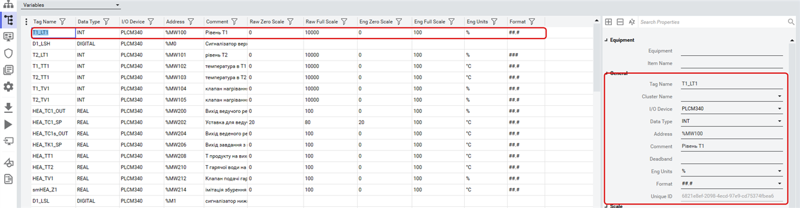
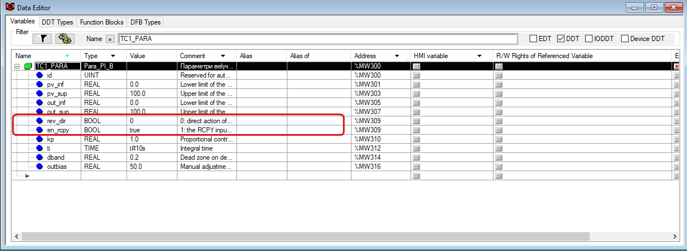
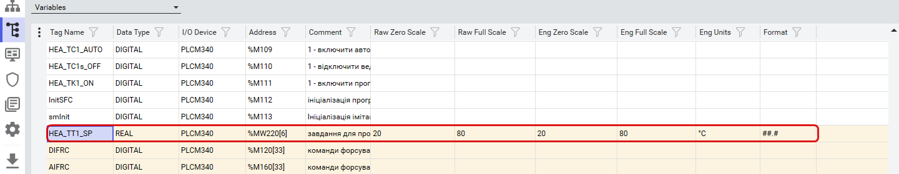
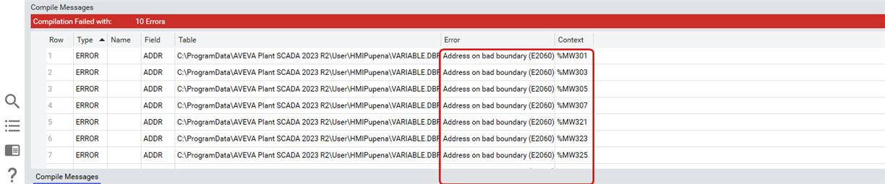
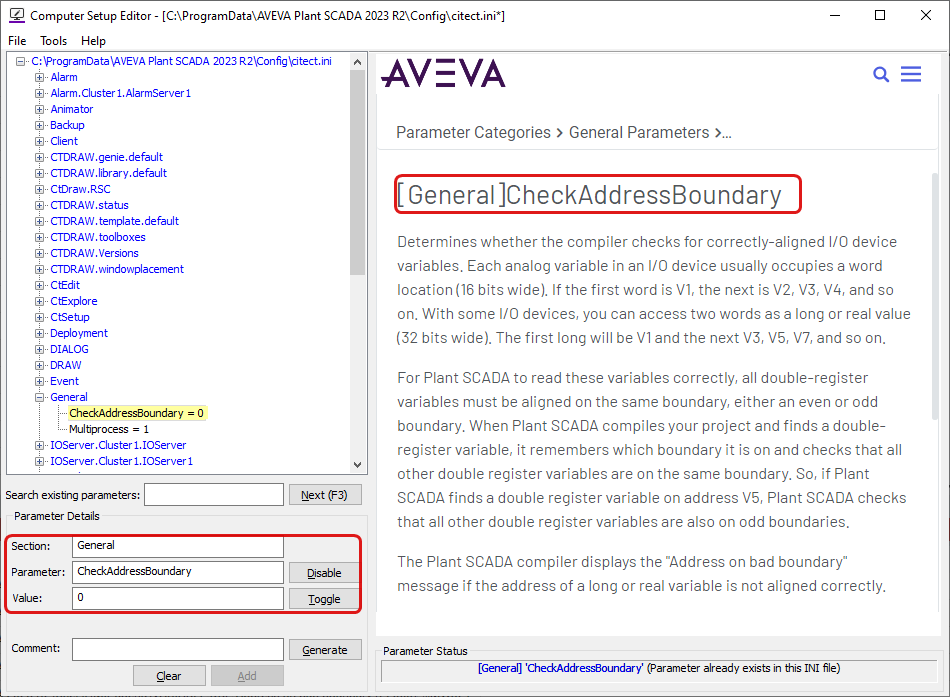

[Людино-машинні інтерфейси](https://pupenasan.github.io/hmi/)  Автор і лектор: Олександр Пупена доц. кафедри [АКСТУ НУХТ](http://www.iasu-nuft.pp.ua/) 

# Додаток 2.2. Налаштування змінних тегів у Plant SCADA 

Конфігурування змінних розглянемо на прикладі AVEVA Plant SCADA 2023 R2 (у попередніх версіях Citect SCADA все аналогічно). Усі теги (змінні) у Plant SCADA поділяються на ***змінні теги*** ("Variables", раніше "Variable Tags") та ***локальні змінні*** ("Local Variables"). 

Змінні теги потребують означення зовнішнього джерела даних, наприклад контролера. Вони представляють копію (додатково перетворену та оброблену) змінних на ***пристроях вводу/виводу*** ("I/O Devices"). Пристрої вводу/виводу у свою чергу належать **серверу вводу/виводу**, тому ці змінні обробляються саме в цій частині виконавчої системи. Інші складові виконавчої системи, по суті, звертаються до цих змінних для читання та запису. Таким чином, одна і та сама змінна доступна в багатьох місцях виконавчої системи. Змінні попередньо обробляються шляхом масштабування, аналізу якості (достовірності) та мають додаткові налаштування для відображення за замовченням. Кількість змінних тегів є показником інформаційної складності проекту та впливає на вартість ліцензії середовища виконання. Це є причиною "економії тегів", яка приводить до різного роду хитрощів розробників, упакування бітів в слова, буферний обмін, тощо.   

На відміну від змінних тегів, **локальні змінні** не є частиною серверу вводу/виводу. Ці змінні належать клієнтам (наприклад графічній підсистемі), тому у кожного клієнта своя копія цих змінних. Оскільки у змінних немає зовнішнього джерела, ніякого перетворення, означення адреси для них не потрібно. Кількість локальних змінних не впливає на вартість ліцензії.  

Пристрої введення/виведення мають властивість Memory, виставивши яку в TRUE, можна вказати на необхідність "відключення" від зовнішнього джерела. У цьому випадку змінні будуть внутрішніми серверними. Цей механізм можна використовувати як для формування внутрішніх серверних тегів, так і тимчасового відключення від джерела задля налагодження.           

Змінні теги редагуються в Plant SCADA Studio в розділі "System Model" -> "Variables". Для кожного змінного тегу необхідно вказати ім'я ("Tag Name"), тип ("Data Type"), назву пристрою, з якого змінна зчитується та записується ("I/O Device"), адресу ("Address"), а також інші опційні властивості (рис.Д2.2.1). Усі властивості вибраного тегу показуються також на панелі властивостей праворуч від таблиці.  

Рис. Д2.2.1. Основні поля налаштування змінного тега Plant SCADA

***Ім'я*** змінного тегу може містити літери латинського алфавіту, цифри, символи "_" та "\", починатися з літери або "_" і не перевищувати 79 символів. У Plant SCADA є свої рекомендації щодо структурування найменування, однак вони не є обов’язковими (деталі в довідці "Using structured tag names"). 

***Тип даних*** задає, як інтерпретується адреса даних на пристроях введення/виведення. У табл. Д2.2.1 показані деякі типи даних Plant SCADA. 

У Plant SCADA найменування багатьох типів не збігається з аналогічними в ПЛК, тобто IEC 61131. Однак неважко здогадатися, що типу DIGITAL у програмованому контролері буде відповідати BOOL або EBOOL, типам LONG та ULONG – DINT та UDINT відповідно. 

Таблиця Д2.2.1. Деякі типи даних Plant SCADA.   

| **Тип даних** | **Пояснення**                                                | **Розмір**          | **Діапазон**                    |
| ------------- | ------------------------------------------------------------ | ------------------- | ------------------------------- |
| DIGITAL       | Digital                                                      | 1 bit або 1 byte    | 0 or 1                          |
| INT           | Integer                                                      | 2 bytes             | -32,768 to 32,767               |
| UINT          | Unsigned  Integer                                            | 2 bytes             | 0 до 65,535                     |
| LONG          | Long Integer                                                 | 4 bytes             | -2,147,483,648 до 2,147,483,647 |
| ULONG         | Unsigned  Long Integer   (тільки для відображення на екрані. Не підтримує арифметичні операції) | 4 bytes             | 0 to 4,294,967,295              |
| REAL          | Floating Point                                               | 4 bytes             | -3.4E38 до 3.4E38               |
| STRING        | String                                                       | 256 bytes (maximum) | ASCII (null terminated)         |

Слід звернути увагу також на те, що Plant SCADA не підтримує тип TIME. У свою чергу, тип TIME, наприклад, в EcoStruxure™ Control Expert (раніше відомий як Unity Pro) відповідно до IEC 61131 займає два слова (тобто дві комірки в області %MW) і містить значення в мілісекундах. Тому для використання TIME у Plant SCADA слід використовувати тип ULONG, а також зробити відповідні налаштування масшта­бування, наприклад, для позначення в секундах вказується Raw Full Scale = 3600000 (мс у ПЛК) та Eng Full Scale = 3600 (с у Plant SCADA), тобто співвідношення 1(Plant SCADA):1000(PLC). 

Адреса вказує на розміщення даних у джерелі даних (контролері). Формат адреси залежить від типу пристрою та драйвера зв’язку. Наприклад, для драйвера типу MODNET30 (Modbus/TCP для ПЛК з Unity PRO), адреса задається аналогічно, як в Unity PRO: наприклад, *%M7* або *%MW3*. Можна також звертатися до біта слова, вказуючи крапку, наприклад *%MW4.6.*

Слід зазначити, що у випадку, коли змінна BOOL/EBOOL в Unity PRO прив’язана до адреси %MW, вона займає один байт. Тому для коректного його відображення у Plant SCADA треба вказати номер %MW та номер біта. Наприклад (рис. Д2.2.2), якщо в структурній змінній Unity PRO "TC1_PARA" два поля прив’язані до адреси %MW309, то перше поле (rev_dir) буде адресуватися в Plant SCADA як %MW309.0, а друге ("en_rcpy") – як %MW309.8. Аналогічно поле Dozator1.START (%MW112) адресується як %MW112.0.   

Рис. Д2.2.2. Поля структурної змінної TC1_PARA в Unity PRO: два поля типу BOOL прив’язані до однієї комірки %MW309

Plant SCADA підтримує роботу з масивами. Розмір масиву вказується в адресі в квадратних дужках. Наприклад (рис. Д2.2.3), змінна з ім'ям "HEA_TT1_SP" та адресою "%MW220[6]" буде вказувати на масив із 6-ти елементів, починаючи з %MW220 (для типу REAL кожен елемент займає дві комірки, тобто %MW220…%MW231). При зверненні до елементу масиву в проекті вказується ім'я змінної та індекс, починаючи з 0-го. Наприклад, "HEA_TT1_SP[5]" буде вказувати на останній елемент масиву.  

 Рис.Д2.2.3. Налаштування масиву

Типи даних REAL, LONG або ULONG (REAL, DINT або UDINT в Unity PRO) використовують дві суміжні комірки (наприклад %MW100 та %MW101) для розміщення своїх даних. Тим не менше, в Plant SCADA вказується адреса тільки першої, друга буде взята автоматично, оскільки типом означений і розмір. У більшості випадків такі змінні повинні знаходитися тільки по парних або тільки по непарних адресах, інакше вони можуть перекриватися. Компілятор Plant SCADA контролює це розміщення і може при компіляції видати повідомлення про помилку `Address on bad boundary (E2060)` (рис.Д2.2.4).

Рис.Д2.2.4. Повідомлення про помилку розміщення змінних за адресами

У випадку, якщо адреси розміщення таких змінних не можна змінити, необхідно відключити цю перевірку, виставивши в Citect.ini параметр [General]CheckAddressBoundary = 0 (рис.Д2.2.5). Для цього треба запустити редактор Citect.ini (Computer Setup Editor), у розділі "Parameter Details" ввести "Section" = General, "Parameter" = CheckAddressBoundary (праворуч з'явиться довідка по параметру) та "Value" = 0, після чого натиснути кнопку "Add". Після "File" -> "Save" параметр буде добавлений в Citect.ini (у дереві з'явиться запис General -> CheckAddressBoundary = 0), після чого редактор треба закрити і скомпілювати проект повторно.    

Рис.Д2.2.5 Добавлення параметру [General]CheckAddressBoundary = 0 в Citect.ini

**Масштабування та обмеження змінної** задається полями:

- "Raw Zero Scale" – мінімальне значення в джерелі даних (у контролері);
- "Raw Full Scale" – максимальне значення в джерелі даних (у контролері);
- "Eng Zero Scale" – мінімальне значення в інженерних одиницях (у Plant SCADA, в IOServer);
- "Eng Full Scale" – максимальне значення в інженерних одиницях (у Plant SCADA, в IOServer).

Значення з джерела даних (контролера) також називається ***сирим*** (raw). Використовується класичне лінійне масштабування. Окрім масштабування, ці межі використовуються для контролю валідності змінної (відповідності діапазону) та значення вводу оператора.

**Формат відображення** ("Format") використовується для означення вигляду числового зображення даної змінної за замовчуванням. Якщо для числового поля не вказується формат, він буде братися зі змінної, що доволі зручно при створенні анімаційних бібліотечних елементів (наприклад джинів). Для прикладу, якщо формат заданий "####.## EU", то числове значення буде відображатися в форматі "123.45 кг", де " EU" вказує на **одиниці вимірювання** ("Eng Units"), які теж вказуються в налаштуваннях тегу.
