[Людино-машинні інтерфейси](https://pupenasan.github.io/hmi/)  Автор і лектор: Олександр Пупена доц. кафедри [АКСТУ НУХТ](http://www.iasu-nuft.pp.ua/) 

# Лабораторна робота №3

**Тема. Основи розробки людино-машинного інтерфейсу (графічної підсистеми) в** **SCADA/HMI.** 

**Тривалість**: 8 акад. годин (4 пари).

**Мета:** ознайомлення з основними можливостями графічної підсистеми та опанування роботи з графічним редактором AVEVA Plant SCADA (раніше – Citect SCADA).  

**Завдання для виконання роботи**

**Цілі.** 

1. Опанувати основні діяльності зі створення/редагування сторінок, символів та анімації у Plant SCADA. 

2. Навчитись користуватися Cicode виразами, командами та вбудованими функціями. 

**Лабораторна установка**

- Апаратне забезпечення: ПК. 

- Програмне забезпечення: Unity Pro (EcoStruxure Control Expert) V>=7.0 (методичні вказівки перевірені на Unity Pro XL 11.1), AVEVA Plant SCADA 2023 R2. 

**Увага!** Починаючи з Citect 2020 у Plant SCADA з'явився новий графічний інтерфейс (Situational Awareness, редактор у Plant SCADA Studio), однак класичний редактор графіки **Graphics Builder**, з яким працює даний лабораторний практикум, залишився у складі Plant SCADA 2023 R2. Усі пункти роботи виконуються саме в Graphics Builder. Методичні вказівки підготовлені для англомовного інтерфейсу Plant SCADA; стандартні кнопки діалогових вікон Windows (OK/Скасувати/Застосувати/Довідка) можуть відображатися мовою операційної системи. 

**Примітки щодо відео: представлені в роботі відеоматеріали є студентською інтерпретацією лабораторної роботи, носять ознайомчий характер, записані в попередній версії Citect SCADA з російськомовним інтерфейсом і можуть містити помилки!** 

## Порядок виконання роботи

## 1.Ознайомлення з додатками 

- [ ] Ознайомтеся з усіма додатками до лабораторної роботи:

- [Додаток 3.1. Базові можливості графічної підсистеми та робота з графічним редактором Plant SCADA](lab3a1.md)
- [Додаток 3.2. Основи роботи з Cicode виразами та функціями](lab3a2.md)

## 2. Підготовка імітатору на ПЛК

- [ ] Завантажте в імітатор контролера підготовлений проект Unity PRO, що описаний у файлі [Завдання](task.md), як це робили на попередній роботі. Якщо проект був збережений як `STU`, варто відкрити його, а не файл експорту. 
- [ ] Запустіть на виконання проект в Unity PRO. Перевірте його працездатність.

## 3. Відновлення власного проекту та перевірка його роботи

- [ ] Запустіть Plant SCADA Studio. 

- [ ] Якщо Ваш минулий проект не завантажено або змінено кимось іншим, зробіть відновлення свого проекту з резервної копії, збереженої минулої лабораторної роботи ("Projects" -> "Backup" -> "Restore"). 
- [ ] За необхідності, зробіть компіляцію проекту. 
- [ ] Запустіть свій проект на виконання і перевірте його працездатність, наприклад, змінюючи одну зі змінних у Plant SCADA і перевіряючи ці зміни в імітаторі ПЛК.   

**Примітка.** Без апаратного ключа виконавча система працює в демонстраційному режимі ("No protection key found. Press OK to run in Demo Mode?" -> "OK"). Через деякий час (у нашому випадку – близько 20-30 хв) з'являється повідомлення "Demo Mode Completed" і виконавча система завершує роботу. У цьому випадку її необхідно просто запустити повторно.

## 4. Створення сторінок

- [ ] Детально прочитайте розділ [Робота зі сторінками з додатку Д3.1.2](lab3a1.md)
- [ ] У графічному редакторі Graphics Builder (відкривається разом з Plant SCADA Studio) створіть нову сторінку ("File" -> "New..." -> "Page", або в Plant SCADA Studio "Visualization" -> "Pages" -> "New") відповідно до налаштувань:

- на базі стилю (Style): "sxw_style_1";
- шаблон (Template): "normal";

- роздільна здатність (Resolution): за замовченням (HD768);

- колір фону (Page color на вкладці "Appearance" властивостей сторінки): "Color80"

 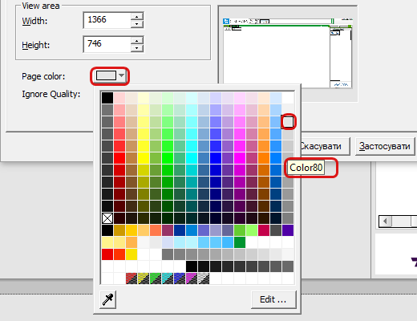

рис.3.1. Вибір кольору `Color80` 

- інші налаштування вказані в таблиці 3.1.

- [ ] Змініть заголовок вікна ("Window title" на вкладці "General" властивостей сторінки) на `Загальна мнемосхема`.
- [ ] В описі ("Description") напишіть "загальна мнемосхема усього виробництва".
- [ ] Збережіть сторінку з іменем `Base` ("File" -> "Save As...").
- [ ] Аналогічно створіть ще дві сторінки на базі шаблону `normal` того ж стилю, роздільної здатності і кольору фону, а назви, заголовки і описи візьміть з таблиці 3.1: 

Таб.3.1. Налаштування основних сторінок проекту.

| Назва сторінки | Заголовок вікна                 | Опис (не обов'язково)                                   |
| -------------- | ------------------------------- | ------------------------------------------------------- |
| Tanks          | Установка приготування продукту | мнемосхема налаштування установки приготування продукту |
| Heat           | Установка підігріву             | мнемосхема налаштування установки підігріву             |

<iframe width="560" height="315" src="https://www.youtube.com/embed/zeNWMUU2ALQ" title="YouTube video player" frameborder="0" allow="accelerometer; autoplay; clipboard-write; encrypted-media; gyroscope; picture-in-picture" allowfullscreen></iframe>

## 5. Підготовка растрових файлів імпорту

- [ ] Відкрийте папку розміщення свого проекту: у Plant SCADA Studio перейдіть в розділ "Projects" (1), виберіть свій проект (2) і натисніть "Open in Explorer" (3) (рис.3.2). 

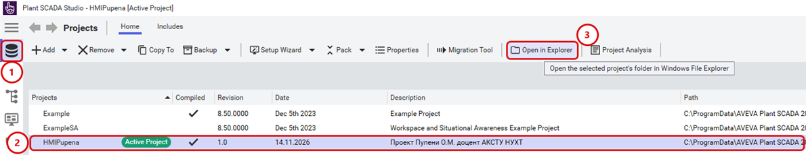

рис.3.2. Відкриття папки проекту з Plant SCADA Studio

- [ ] Скопіюйте у папку проекту файли "Tanks.bmp" та "Hea.bmp", які ви раніше завантажували за [цим посиланням](https://drive.google.com/drive/folders/1Hxq-XNS5WW4BWzxzUgkIgO2EuIVaJO6h?usp=sharing). 

<iframe width="560" height="315" src="https://www.youtube.com/embed/zuXm96BpOSM" title="YouTube video player" frameborder="0" allow="accelerometer; autoplay; clipboard-write; encrypted-media; gyroscope; picture-in-picture" allowfullscreen></iframe>

## 6. Імпорт рисунку на сторінку `Tanks`

- [ ] Прочитайте пункт "Д3.1.6 Робота з кольорами" [додатку 3.1](lab3a1.md)
- [ ] На сторінку `Tanks` імпортуйте раніше скопійований у вашу папку проекту рисунок `Tanks.bmp` ("File" -> "Import...").
- [ ] Розмістіть та за необхідності відмасштабуйте рисунок на сторінці так, щоб він зайняв весь вільний від інших елементів простір.

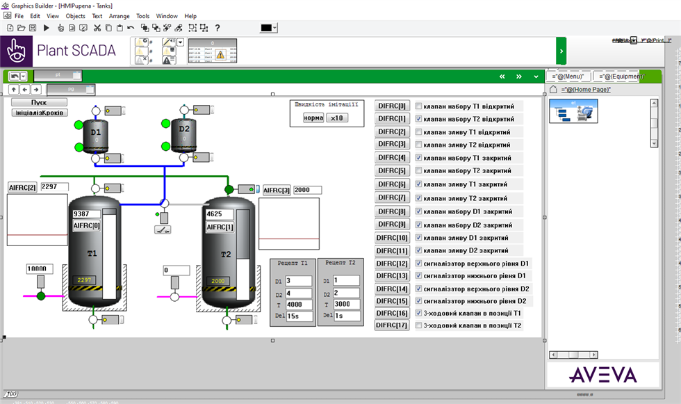

рис.3.3. Розміщення відмасштабованого рисунку на екрані

- [ ] Користуючись інструментами заміни кольорів ("Tools" -> "Swap Colors...") замініть білий фон на прозорий ("Transparent", позначається хрестиком). Рекомендуємо скористатися піпеткою. 
- [ ] Збережіть сторінку.

<iframe width="560" height="315" src="https://www.youtube.com/embed/vFlDeweZTRA" title="YouTube video player" frameborder="0" allow="accelerometer; autoplay; clipboard-write; encrypted-media; gyroscope; picture-in-picture" allowfullscreen></iframe>

## 7. Імпорт рисунку на сторінку `Heat`

- [ ] Аналогічно попередньому пункту імпортуйте на сторінку "Heat" рисунок "Hea.bmp".
- [ ] За необхідності налаштуйте зображення під розміри сторінки. 
- [ ] Замініть задній фон на прозорий. 
- [ ] Збережіть сторінку.

<iframe width="560" height="315" src="https://www.youtube.com/embed/mmbktnbvpSc" title="YouTube video player" frameborder="0" allow="accelerometer; autoplay; clipboard-write; encrypted-media; gyroscope; picture-in-picture" allowfullscreen></iframe>

## 8. Запуск проекту на виконання

- [ ] Скомпілюйте проект. Це можна зробити не тільки з "Plant SCADA Studio", а і також з меню графічного редактору ("File" -> "Compile"). 
- [ ] Якщо проект скомпілювався без помилок – запустіть його на виконання ("File" -> "Run" у Graphics Builder або кнопка запуску в Plant SCADA Studio).
- [ ] Відкрийте пункт меню "Pages" -> "Page List" на панелі "Menu" праворуч – це дасть змогу відобразити усі сторінки, які наявні в проекті (рис.3.4).

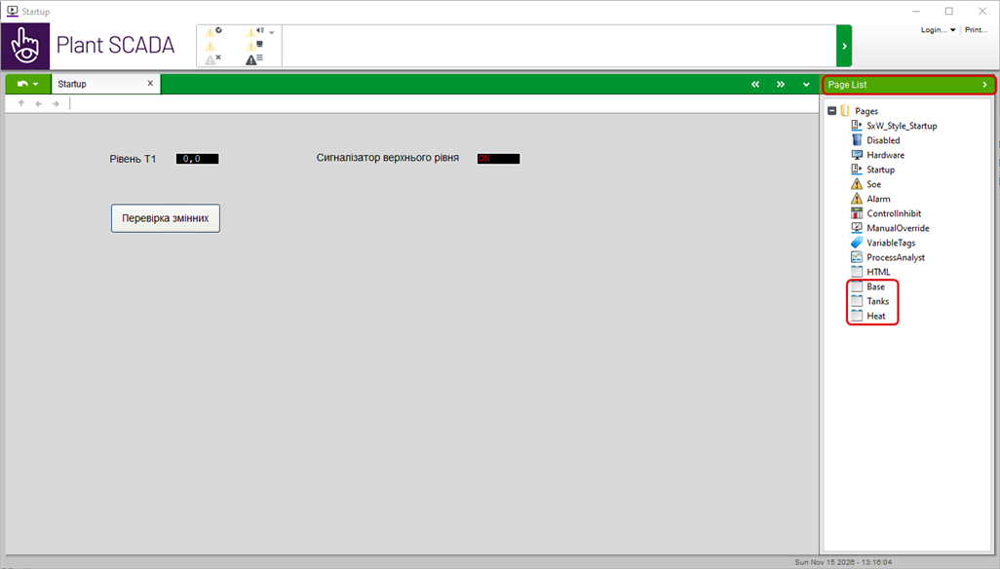

рис.3.4. Відображення меню Page List

- [ ]  Відкрийте сторінки `Tanks` та `Heat`, перевірте, чи відображаються на них імпортовані рисунки.

<iframe width="560" height="315" src="https://www.youtube.com/embed/3BwVN_ro3d8" title="YouTube video player" frameborder="0" allow="accelerometer; autoplay; clipboard-write; encrypted-media; gyroscope; picture-in-picture" allowfullscreen></iframe>

## 9. Фіксація рисунків як фону

- [ ] Прочитайте пункт "Д3.1.3. Графічні елементи" [додатку 3.1](lab3a1.md)
- [ ] Зафіксуйте імпортовані рисунки на сторінках "Tanks" та "Heat" ("Edit" -> "Lock object"), щоб вони були в якості підкладки.  
- [ ] Збережіть сторінки.    

Тепер дані рисунки є підкладкою, яка може використовуватися як канва для рисування поверху. Згодом цю підкладку можна буде видалити.

<iframe width="560" height="315" src="https://www.youtube.com/embed/s89g1JYQTJs" title="YouTube video player" frameborder="0" allow="accelerometer; autoplay; clipboard-write; encrypted-media; gyroscope; picture-in-picture" allowfullscreen></iframe>

## 10. Вставлення символів для резервуарів

- [ ] Прочитайте пункт "Д3.1.15 Робота з символами" [додатку 3.1](lab3a1.md) 
- [ ] На сторінці "Tanks" вставте символ `tank_tall_large` з бібліотеки `tanks_cyl_conb_30` ("Edit" -> "Paste Symbol...") для танків Т1 та Т2. 
- [ ] Налаштуйте їх розміри за необхідністю.

<iframe width="560" height="315" src="https://www.youtube.com/embed/j2NtN7_Prks" title="YouTube video player" frameborder="0" allow="accelerometer; autoplay; clipboard-write; encrypted-media; gyroscope; picture-in-picture" allowfullscreen></iframe>

## 11. Вставлення символів для дозаторів

- [ ] На сторінці "Tanks" вставте символ `tank` з бібліотеки `tanks_cyl_conb_30` для дозаторів D1 та D2. 
- [ ] Налаштуйте їх розміри за необхідністю. 

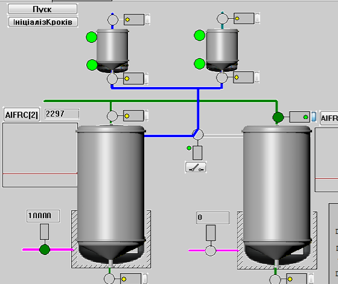

рис.3.5. Вигляд сторінки "Tanks" після вставлення символів для ємностей  

**Зауважте! Використання об'ємних рисунків без потреби не рекомендується, так як це створює додаткове непотрібне навантаження на зовнішній вигляд, відволікає увагу і може погіршити ситуаційне сприйняття. У даній роботі показаний приклад використання готових бібліотечних символів.**     

<iframe width="560" height="315" src="https://www.youtube.com/embed/geJXYJuw8OI" title="YouTube video player" frameborder="0" allow="accelerometer; autoplay; clipboard-write; encrypted-media; gyroscope; picture-in-picture" allowfullscreen></iframe>

## 12. Рисування теплової камери для танку

- [ ] Прочитайте пункт "Д3.1.4. Властивості та анімація графічних елементів" [додатку 3.1](lab3a1.md) 

- [ ] Використовуючи прямокутники, нарисуйте теплову камеру для танків. Зробіть камери заповненими ("Filled") кольором "Color17" та розмістіть за танками, використовуючи команду меню "Arrange" -> "Send Backwards" (рис.3.6). Зверніть увагу, що "Send Backwards" переміщує елемент на один рівень назад відносно елементів, з якими він перекривається, а "Send to Back" – на самий задній план (тобто й за підкладку).

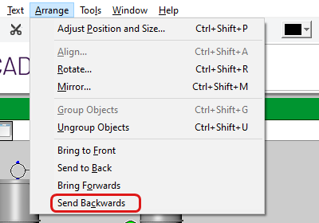

рис.3.6. Команди для взаємного розміщення елементів по осі "Z"  

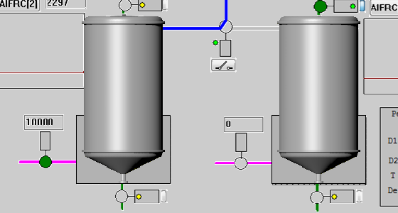

рис.3.7. Вигляд теплових сорочок

<iframe width="560" height="315" src="https://www.youtube.com/embed/kynIKLX6hdk" title="YouTube video player" frameborder="0" allow="accelerometer; autoplay; clipboard-write; encrypted-media; gyroscope; picture-in-picture" allowfullscreen></iframe>

## 13. Рисування трубопроводів

- [ ] Прочитайте про особливості рисування трубопроводів у пункті "Д3.1.3. Графічні елементи" [додатку 3.1](lab3a1.md) 
- [ ] Використовуючи елемент "Pipe" ("Objects" -> "Pipe"), нарисуйте усі трубні комунікації, які показані на схемі. Кольори труби задаються властивостями "Highlight color" та "Lowlight color", товщина – "Width". 
- [ ] Намагайтесь не використовувати яскраві кольори.

**Зауважте! Використання об'ємних рисунків, у тому числі трубопроводів, та різноманіття кольорів не рекомендується, так як це створює додаткове непотрібне навантаження на зовнішній вигляд, відволікає увагу і може погіршити ситуаційне сприйняття. У даній роботі показаний приклад використання готових бібліотечних символів.**     

<iframe width="560" height="315" src="https://www.youtube.com/embed/5k2IwqH87og" title="YouTube video player" frameborder="0" allow="accelerometer; autoplay; clipboard-write; encrypted-media; gyroscope; picture-in-picture" allowfullscreen></iframe>

## 14. Видалення підкладки та написи

- [ ] На сторінці "Tanks" видаліть рисунок-підкладку, що був раніше зафіксований.
  - поставте опцію "Edit" -> "Break Lock Mode"
  - виділіть і видаліть підкладку ("Edit" -> "Delete")
  - зніміть опцію "Edit" -> "Break Lock Mode"
- [ ] Відредагуйте за необхідності трубопроводи та їх розміщення, при цьому можна тимчасово відв'язатися від прив'язки до сітки ("View" -> "Snap to Grid"). 
- [ ] Слідкуйте, щоб труби були співвісні з патрубками ємностей, а символи клапанів стояли точно на трубах. Для точного вирівнювання виділіть елемент і скористайтеся меню "Arrange" -> "Adjust Position and Size..." (для труби X – це координата її осі), панеллю статусу або клавішами-стрілками.
- [ ] Зробіть написи біля танків ("Т1" та "Т2") та на дозаторах ("D1" та "D2"), використовуючи інструмент "Text".
- [ ] Збережіть сторінку.

Результат має бути схожим на рис.3.8.  

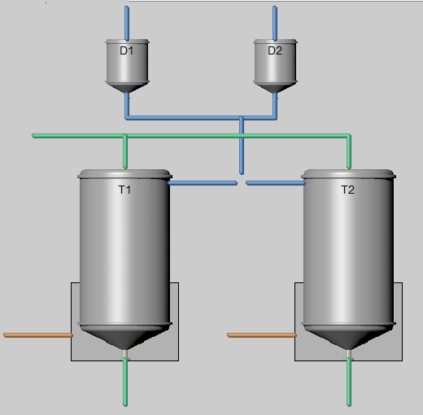

Рис.3.8 Фрагмент сторінки "Tanks" після створення векторного рисунку та видалення підкладки 

<iframe width="560" height="315" src="https://www.youtube.com/embed/G425h3KTmlU" title="YouTube video player" frameborder="0" allow="accelerometer; autoplay; clipboard-write; encrypted-media; gyroscope; picture-in-picture" allowfullscreen></iframe>

## 15. Кнопки "Пуск" та "Ініціалізація кроків"

- [ ] Прочитайте пункт "Д3.1.5 Обробка подій кліку лівої кнопки миші" [додатку 3.1](lab3a1.md) 

- [ ] Використовуючи елементи "Button", реалізуйте:

- кнопку "Пуск", яка буде інвертувати змінну `T_SB1` при натисканні ("Input" -> "Touch" -> "Up command": `T_SB1 = NOT T_SB1`);

- кнопку "Ініціалізація кроків", яка буде виставляти в "1" змінну `InitSFC` (`InitSFC = 1`).

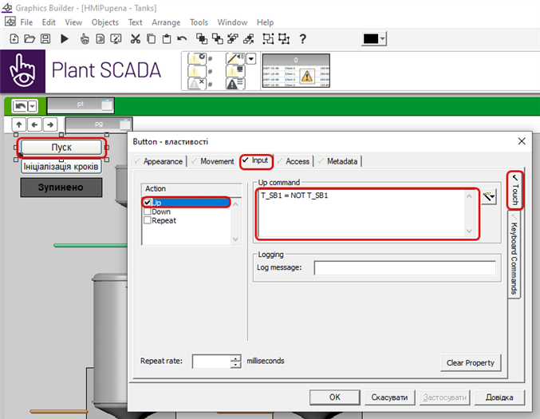

Рис.3.9 Приклад налаштування дії натискання кнопки "Пуск"

<iframe width="560" height="315" src="https://www.youtube.com/embed/DQigsgyNBD0" title="YouTube video player" frameborder="0" allow="accelerometer; autoplay; clipboard-write; encrypted-media; gyroscope; picture-in-picture" allowfullscreen></iframe>

## 16. Відображення стану установки кольором

- [ ] Прочитайте пункт "Д3.1.9 Налаштування анімації кольору" [додатку 3.1](lab3a1.md) 
- [ ] Використовуючи елемент "Rectangle", зробіть графічний індикатор роботи установки ("Fill" -> "Color", тип "On / off", "ON color when" = `T_SB1`), який буде:

- заповнений темно-сірим кольором ("OFF color"), коли `T_SB1=0`;

- заповнений світло-сірим кольором ("ON color"), коли `T_SB1=1`;

- [ ] Збережіть сторінку, скомпілюйте проект, запустіть на виконання.
- [ ]  Перевірте, чи працює кнопка "Пуск" та відповідний графічний індикатор, натискаючи на кнопку. 

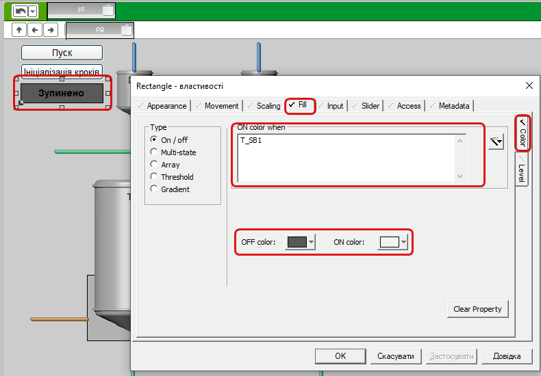

Рис.3.10. Налаштування анімації кольору по змінній 

**Зауважте!** Колір "OFF color" збігається з кольором заповнення ("Appearance" -> "Fill" -> "Color") елемента: зміна одного з них змінює інший. 

<iframe width="560" height="315" src="https://www.youtube.com/embed/2NsIeFeH338" title="YouTube video player" frameborder="0" allow="accelerometer; autoplay; clipboard-write; encrypted-media; gyroscope; picture-in-picture" allowfullscreen></iframe>

## 17. Відображення стану установки текстом

- [ ] Прочитайте пункт "Д3.1.8 Налаштування текстового відображення" [додатку 3.1](lab3a1.md) 

- [ ] Розмістіть елемент "Number" ("Objects" -> "Number", на панелі інструментів позначений `##`) на фоні графічного індикатору. Зробіть товстий шрифт ("Appearance" -> "General" -> "Style" = "Bold"). 
- [ ] Використайте його для відображення стану роботи програми ("Appearance" -> "Display Value", тип "On / off"):

- відображається текст "Зупинено" ("OFF text"), коли `T_SB1=0`;

- відображається текст "Виконується" ("ON text"), коли `T_SB1=1`;

- [ ] Збережіть сторінку, скомпілюйте проект. 

**Не зупиняйте виконавчу систему перед перевіркою. Достатньо повторно відкрити змінену сторінку! Надалі після кожного пункту намагайтеся перевіряти працездатність змін!** 

- [ ] Перевірте, чи працює текстовий індикатор.

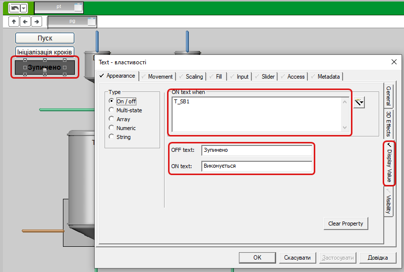

Рис.3.11. Налаштування анімації тексту по змінній 

<iframe width="560" height="315" src="https://www.youtube.com/embed/Pql6xMJOVZc" title="YouTube video player" frameborder="0" allow="accelerometer; autoplay; clipboard-write; encrypted-media; gyroscope; picture-in-picture" allowfullscreen></iframe>

## 18. Відображення рівнів

- [ ] Прочитайте пункт "Д3.1.10 Анімація заповнення" [додатку 3.1](lab3a1.md) 

- [ ] Використовуючи елемент "Rectangle" та анімацію заповнення ("Fill" -> "Level"), реалізуйте стовпчикову діаграму для рівнів в танках Т1 та Т2: 

- тег `T1_LT1` для танку Т1, світло-сірий колір заливки (колір заповнення на вкладці "Appearance"), темно-сірий фон ("Background color");

- тег `T2_LT1` для танку Т2, світло-сірий колір заливки, темно-сірий фон;

- розміщуйте стовпчик усередині корпусу танка з невеликим відступом від краю та так, щоб він не заходив на фланець і конічне днище;

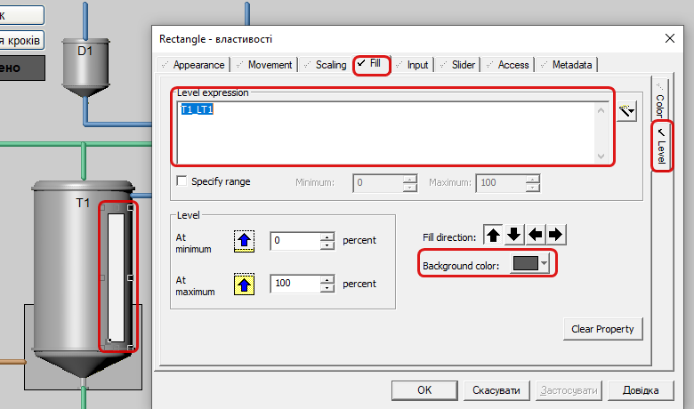

Рис.3.12. Налаштування анімації заповнення  

- [ ] Збережіть сторінку, скомпілюйте проект. Перевірте роботу елементів при включеній кнопці "Пуск". 

<iframe width="560" height="315" src="https://www.youtube.com/embed/NVKtJ11h2S8" title="YouTube video player" frameborder="0" allow="accelerometer; autoplay; clipboard-write; encrypted-media; gyroscope; picture-in-picture" allowfullscreen></iframe>

## 19. Відображення числового значення параметрів

- [ ] Прочитайте налаштування числового поля в пункті "Д3.1.8 Налаштування текстового відображення" [додатку 3.1](lab3a1.md) 
- [ ] Використовуючи елемент "Number", зробіть текстовий індикатор для значень змінних тегів рівнів та температур в танках. Значення температури повинно відображатися разом з одиницями вимірювання (формат `##.# EU`).

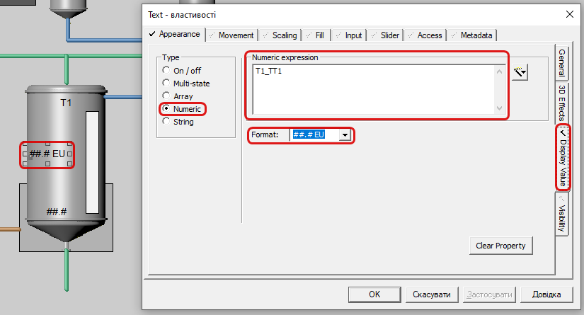

Рис.3.13. Налаштування анімації числового відображення

<iframe width="560" height="315" src="https://www.youtube.com/embed/BnVlBHhrJkc" title="YouTube video player" frameborder="0" allow="accelerometer; autoplay; clipboard-write; encrypted-media; gyroscope; picture-in-picture" allowfullscreen></iframe>

## 20. Відображення стану сигналізаторів рівнів дозаторів

- [ ] Використовуючи елемент "Ellipse", зробіть сигналізатори нижніх (`D1_LSL`, `D2_LSL`) та верхніх (`D1_LSH`, `D2_LSH`) рівнів дозаторів: 

- темно-сірий в стані "0" 
- світло-сірий в стані "1".

- [ ] Перевірте відображення сигналізаторів

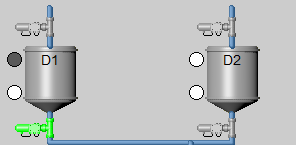

Рис.3.14. Відображення стану індикаторів в режимі виконання

<iframe width="560" height="315" src="https://www.youtube.com/embed/_A1PF95cs9Y" title="YouTube video player" frameborder="0" allow="accelerometer; autoplay; clipboard-write; encrypted-media; gyroscope; picture-in-picture" allowfullscreen></iframe>

## 21. Відображення стану клапанів подачі теплоагентів

- [ ] Використовуючи символи з бібліотеки "valve_solonoid" (бажано сірого кольору, наприклад `up_small_grey`), вставте зображення на місце клапанів подачі теплоагенту в танки. 
- [ ] Біля символів, використовуючи елемент "Number", реалізуйте виведення тегів `T1_TV1` та `T2_TV1`.
- [ ] Перевірте відображення клапанів.

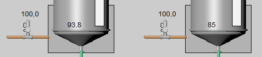

Рис.3.15. Відображення стану клапанів пари в режимі виконання

<iframe width="560" height="315" src="https://www.youtube.com/embed/DqvIcGv3pmo" title="YouTube video player" frameborder="0" allow="accelerometer; autoplay; clipboard-write; encrypted-media; gyroscope; picture-in-picture" allowfullscreen></iframe>

## 22. Відображення стану дискретних ВМ через анімацію символів  

- [ ] Прочитайте налаштування анімації символів в пункті "Д3.1.15 Робота з символами" [додатку 3.1](lab3a1.md) 
- [ ] Використовуючи елемент "Symbol Set" (тип "On / off") та символи з бібліотеки "valve_solonoid" (бажано сірого та зеленого кольору, наприклад `left_small_grey` для "OFF symbol" та `left_small_green` для "ON symbol"), реалізуйте відображення команд на клапани:
- набору танків `T1_LVS2`, `T2_LVS2`
- зливу танків `T1_LVS1`, `T2_LVS1`
- набору дозаторів `D1_LVS2`, `D2_LVS2`
- зливу дозаторів `D1_LVS1`, `D2_LVS1`
- [ ] Перевірте відображення дискретних ВМ.

Для швидкого створення однотипних елементів налаштуйте один, після чого скопіюйте його ("Edit" -> "Copy", "Edit" -> "Paste") та змініть у копії тільки вираз "ON symbol when". Точно розмістити елемент можна через "Arrange" -> "Adjust Position and Size...".

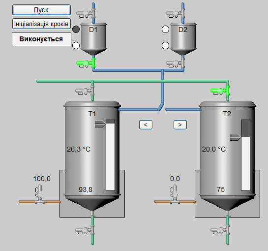

Рис.3.16. Відображення стану клапанів в режимі виконання

**Зауважте! Використання зеленого кольору як стану "ВКЛ" не рекомендується сучасними стандартами! У даній роботі показаний приклад використання готових бібліотечних символів.**     

<iframe width="560" height="315" src="https://www.youtube.com/embed/S0kxhkZ38-w" title="YouTube video player" frameborder="0" allow="accelerometer; autoplay; clipboard-write; encrypted-media; gyroscope; picture-in-picture" allowfullscreen></iframe>

## 23. Створення панелі зміни рецепту для танку 1

- [ ] Прочитайте про реалізацію введення числового значення тегу в пункті "Д3.1.14 Робота з клавіатурними командами" [додатку 3.1](lab3a1.md) 
- [ ] Реалізуйте панель зміни рецепту для танку 1 (див. рис. 1 [Завдання](task.md)), використовуючи вже знайомі вам анімаційні елементи та анімацію введення значення з клавіатури:

- для зручності (за бажанням) налаштуйте ("View" -> "Grid Setup...") та включіть прив'язку до сітки ("View" -> "Snap to Grid")
- можна скористатися меню "Arrange" -> "Align..." для вирівнювання елементів по горизонталі та вертикалі

- нарисуйте прямокутник для фону параметрів налаштування рецепту першого дозатору та впишіть туди текстові поля `D1`, `D2` і т.д. 

- створіть числові поля для виведення змінних першого рецепту, теги: `T1_KS_D1CNT_SP`, `T1_KS_D2CNT_SP`, `T1_KS_TT1_SP`, `T1_KS_DEL_SP`

- для створених елементів зробіть можливість введення значення завдання з клавіатури ("Input" -> "Keyboard Commands": "Add", послідовність клавіш `#### ENTER`, команда, наприклад, `T1_KS_D1CNT_SP = ArgValue1`) 

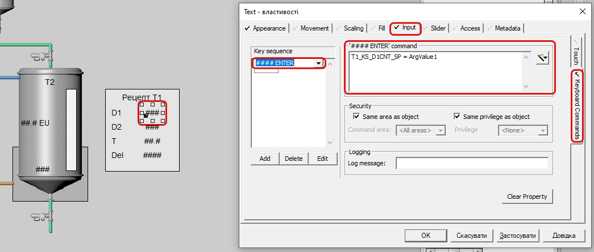

Рис.3.17. Налаштування поля для вводу на панелі зміни рецепту

- [ ] Перевірте роботу панелі вводу: наведіть курсор миші на поле, наберіть на клавіатурі нове значення і натисніть `Enter`; впевніться, що значення аналогічно змінилося в ПЛК.

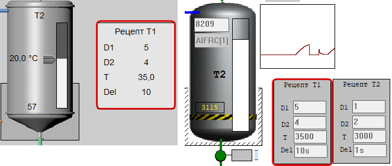

Рис.3.18. Відображення налаштування рецептів в режимі виконання в Plant SCADA (ліворуч) та Unity PRO (праворуч) 

<iframe width="560" height="315" src="https://www.youtube.com/embed/c12xLMfCfqo" title="YouTube video player" frameborder="0" allow="accelerometer; autoplay; clipboard-write; encrypted-media; gyroscope; picture-in-picture" allowfullscreen></iframe>

## 24. Створення панелі зміни рецепту для танку 2

- [ ] Повторіть аналогічні дії до попереднього пункту для рецепту танку 2.

<iframe width="560" height="315" src="https://www.youtube.com/embed/m_hd6qqlXsQ" title="YouTube video player" frameborder="0" allow="accelerometer; autoplay; clipboard-write; encrypted-media; gyroscope; picture-in-picture" allowfullscreen></iframe>

## 25. Створення перемикача для дозатору

- [ ] Прочитайте про анімацію видимості в пункті "Д3.1.4. Властивості та анімація" [додатку 3.1](lab3a1.md) 
- [ ] Нарисуйте два трубопроводи, що розходяться на подачу з дозаторів (рис.3.19). 
- [ ] Використовуючи анімацію видимості ("Appearance" -> "Visibility" -> "Hidden when"), покажіть переключення дозаторів на танк Т1 та танк Т2, теги: 

- прихований при `T_LVS3_T1OPN = 0` перемикач на танк 1
- прихований при `T_LVS3_T2OPN = 0` перемикач на танк 2

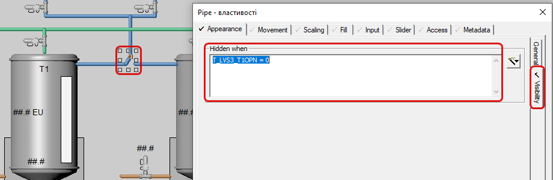

Рис.3.19. Налаштування анімації видимості для перемикача дозатора

- [ ] Створіть дві кнопки для команди на перемикач:

-  `T_LVS3 = 0` команда переключення на танк 1
-  `T_LVS3 = 1` команда переключення на танк 2

- [ ] Скомпілюйте і перевірте роботу. Перевірку краще робити в режимі роботи програми керування "Зупинено".

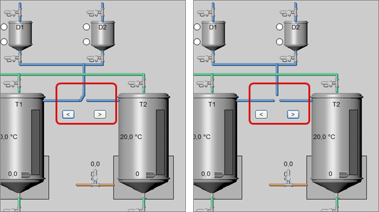

Рис.3.20. Вигляд мнемосхеми з перемикачами в режимі виконання: перемикач в позиції Т1 (ліворуч) та Т2 (праворуч)

<iframe width="560" height="315" src="https://www.youtube.com/embed/vxT7K68ctwg" title="YouTube video player" frameborder="0" allow="accelerometer; autoplay; clipboard-write; encrypted-media; gyroscope; picture-in-picture" allowfullscreen></iframe>

## 26. Використання анімації руху

- [ ] Прочитайте пункт "Д3.1.12. Анімація руху" [додатку 3.1](lab3a1.md) 
- [ ] Розмістіть символ `pointer2_e_grey` з бібліотеки `thumbs` на відображенні стовпчикового індикатору (біля нижньої межі), як це показано на рис.3.21.
- [ ] Виділіть прямокутник (стовпчикову діаграму) та з використанням панелі статусу (у правому нижньому куті вікна Graphics Builder) дізнайтеся його висоту. 

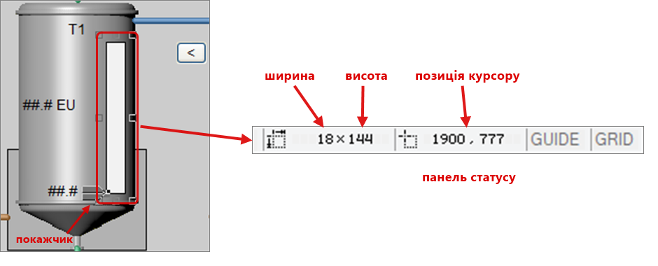

Рис.3.21 Місце розміщення покажчика рівня та визначення висоти стовпчика за панеллю статусу 

- [ ] Використовуючи анімацію руху ("Movement" -> "Vertical"), забезпечте рух даного елементу по вертикалі разом з видимим рівнем. При цьому Ви можете скористатися отриманим значенням висоти для вказівки максимального зміщення ("At maximum ... pixels (up)").
- [ ] Зробіть аналогічну дію і для танку 2.
- [ ] Скомпілюйте і перевірте роботу. Це краще робити в режимі "Виконується".   

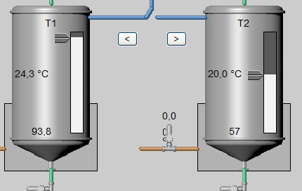

Рис.3.22. Вигляд мнемосхеми з анімацією руху

<iframe width="560" height="315" src="https://www.youtube.com/embed/BRx4FVTQCvU" title="YouTube video player" frameborder="0" allow="accelerometer; autoplay; clipboard-write; encrypted-media; gyroscope; picture-in-picture" allowfullscreen></iframe>

## 27. Реалізація основного змісту мнемосхеми для установки підігріву

- [ ] Використовуючи вже відомі вам елементи та анімацію, реалізуйте мнемосхему для процесу нагрівання ("Heat"). Якщо якісь теги, що використовуються в анімаціях, не створені в проекті, для їх визначення скористайтеся документом [Завдання](task.md). Також для визначення того, які теги використовуються в анімаціях, можна скористатися операторським екраном Unity PRO (подивитися прив'язку елементів), так як імена тегів Plant SCADA співпадають з назвою змінних в проекті ПЛК. Зверніть увагу, що час роботи програмного задатчика не передбачено виводити на дисплеї, але Ви можете за бажанням реалізувати це самостійно (потрібна зміна програми і в ПЛК). Можлива наступна послідовність дій:

- нанесіть базові статичні векторні елементи поверх підкладки: підігрівник (прямокутник), трубопроводи продукту та гарячої води (елемент "Pipe" невеликої товщини), кола приладів (TT1, TT2, HS1sp, TC1, TC1s, TK1_sp, HC1) з позначеннями у два рядки (наприклад, "TC" / "1", вирівнювання "Centre"), лінії зв'язку між ними, функціональні блоки ("Програмний задатчик", "Ведучий регулятор", "Ведений регулятор", "Блок ручного керування") у вигляді прямокутників із заокругленими кутами ("Corner Radius") та написи, у тому числі дрібні підписи входів/виходів регуляторів (`pv`, `sp`, `out`, `kp`, `Ti`);

- для відображення (та зміни) значень у чорних полях, як на рис.3.23, використайте джини `Parameter_2` з бібліотеки `keyentry` ("Edit" -> "Paste Genie...", тег вказується у вікні "Genie - Parameter with Border"), так як це було зроблено в лабораторній роботі №2: температури `HEA_TT1`, `HEA_TT2`, збурення `smHEA_Z1`, задатчик `HEA_TC1_SP`, параметри регуляторів `HEA_TC1_KP`, `HEA_TC1_TI`, `HEA_TC1s_KP`, `HEA_TC1s_TI` та вихід блоку ручного керування `HEA_TV1`; 

- плинні значення на лініях зв'язку (`HEA_TT1` на вході pv, `HEA_TC1_SP` на вході sp, `HEA_TK1_SP` – вихід програмного задатчика, `HEA_TC1_OUT`, `HEA_TT2`, `HEA_TC1s_OUT`, `HEA_TV1` біля клапана) відобразіть елементами "Number"; 

- видаліть підкладку;

- розмістіть елементи відображення стану та значень з відповідною анімацією: еліпси з анімацією кольору, лінії переключення з анімацією видимості;

- розмістіть кнопки або інші зображення для керування станом програмного задатчика (`HEA_TK1_ON`), веденого регулятору (`HEA_TC1s_OFF`), блоку ручного управління (`HEA_TC1_AUTO`);   

Можливий варіант кінцевої мнемосхеми показаний на рис.3.23

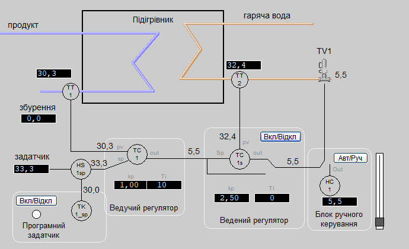

   Рис.3.23 Варіант виконання мнемосхеми "Heat" в режимі виконання 

- [ ] Збережіть сторінку, скомпілюйте проект і перевірте роботу мнемосхеми, порівнюючи з тією, що в Operator Screens Unity PRO.  

## 28. Використання віртуальної клавіатури введення значення 

- [ ] Прочитайте пункт "Д3.2.5. Функція виклику віртуальної клавіатури" [додатку 3.2](lab3a2.md) 
- [ ] У елементі відображення заданого значення (знаходиться праворуч від `HS1sp`) реалізуйте введення з віртуальної клавіатури (тег `HEA_TC1_SP`): "Input" -> "Touch" -> "Up command": `HEA_TC1_SP = FormNumPad("Завд", HEA_TC1_SP, 4+16)`.

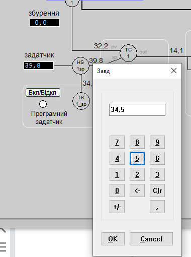

 Рис.3.24. Варіант виконання з віртуальною клавіатурою

**Зауважте!** При включеному програмному задатчику (`HEA_TK1_ON = 1`) значення `HEA_TC1_SP` в ПЛК перезаписується значенням з програмного задатчика, тому перевірку ручного введення уставки краще робити при вимкненому задатчику.

<iframe width="560" height="315" src="https://www.youtube.com/embed/t7HT5ZoN-eo" title="YouTube video player" frameborder="0" allow="accelerometer; autoplay; clipboard-write; encrypted-media; gyroscope; picture-in-picture" allowfullscreen></iframe>

## 29. Створення повзункового регулятору

- [ ] Прочитайте пункт "Д3.1.13. Повзунок" [додатку 3.1](lab3a1.md) 

- [ ] Реалізуйте можливість зміни значення виходу на клапан (тег `HEA_TV1`) за допомогою повзунку, для цього: 

- нарисуйте вертикальну лінію і два прямокутники (основу та сам повзунок), як це показано на рис.3.25

- визначте висоту лінії за допомогою панелі статусу

- для прямокутника-повзунка на вкладці "Slider" -> "Vertical" вкажіть тег `HEA_TV1`, увімкніть "Continuous update of tag" та впишіть висоту лінії в якості максимального зміщення по вертикалі ("At maximum") 

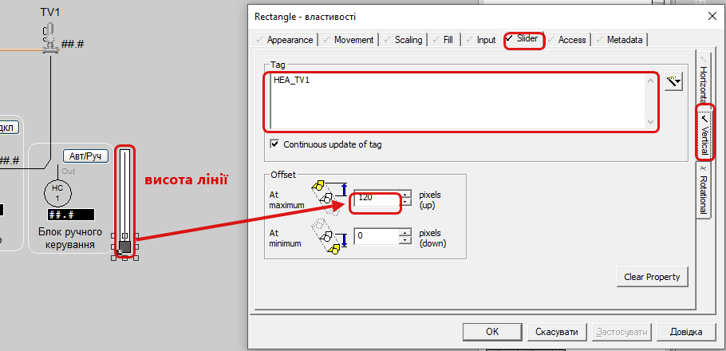

   Рис.3.25 Варіант реалізації вертикального повзунка

- [ ] Перевірте роботу повзунка. Зверніть увагу, що змінювати значення `HEA_TV1` з повзунка має сенс тільки в ручному режимі ("Авт/Руч"), інакше значення перезаписується регулятором. 

<iframe width="560" height="315" src="https://www.youtube.com/embed/v5clddZbcPQ" title="YouTube video player" frameborder="0" allow="accelerometer; autoplay; clipboard-write; encrypted-media; gyroscope; picture-in-picture" allowfullscreen></iframe>

## 30. Створення системних клавіш та клавіатурних команд

- [ ] Прочитайте пункт "Д3.1.14. Робота з клавіатурними командами" [додатку 3.1](lab3a1.md) 

- [ ] Створіть системну клавішу "cmdHome" з прив'язкою до кнопки `ESC` (у Plant SCADA Studio "Setup" -> "Keyboard Keys", "Key Name" = `cmdHome`, "Key Code" = `KEY_ESC`).
- [ ] Створіть системну клавішу "cmdInfo" з прив'язкою до комбінації `CTRL+I` ("Key Code" = `KEY_I_CTRL`). Не забудьте натиснути "Save".

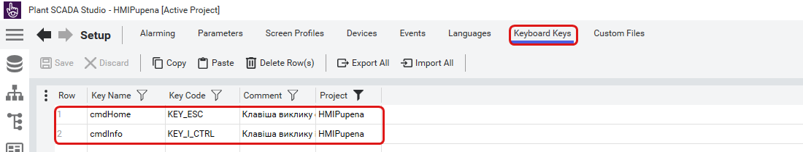

 Рис.3.26. Створення системних клавіш 

- [ ] Створіть загальносистемну клавіатурну команду, яка забезпечує по натисненню "cmdHome" відкривання сторінки "Base" (у Plant SCADA Studio "Visualization" -> "Keyboard Commands": "Key Sequence" = `cmdHome`, "Command" = `PageDisplay("Base");`).

- [ ] Прочитайте пункт "Д3.2.4. Функція InfoForm" [додатку 3.2](lab3a2.md) 
- [ ] У редакторі графіки створіть клавіатурну команду на сторінках "Tanks" та "Heat" ("File" -> "Properties" -> вкладка "Keyboard Commands": "Add", послідовність `cmdInfo`, команда `InfoForm(1)`), яка буде викликати функцію InfoForm. 

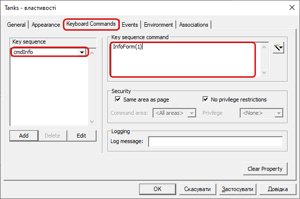

 Рис.3.27. Налаштування команд сторінки

- [ ] Перевірте роботу клавіатурних команд на усіх основних мнемосхемах, для цього:

- скомпілюйте проект і перезапустіть виконавчу систему Plant SCADA, так як в проекті були внесені системні зміни
- відкрийте сторінку "Tanks" та наведіть курсор на якийсь елемент, наприклад рівень, і натисніть комбінацію `CTRL+I`; повинна з'явитися інформаційна форма про елемент ("Dynamic Text Information" для елемента "Number" або "Legacy Number Information" для джина), подивіться її зміст  
- аналогічну дію проведіть для сторінки "Heat" (рис.3.28) 
- натисніть "Esc" – повинна відкритися сторінка "Base"

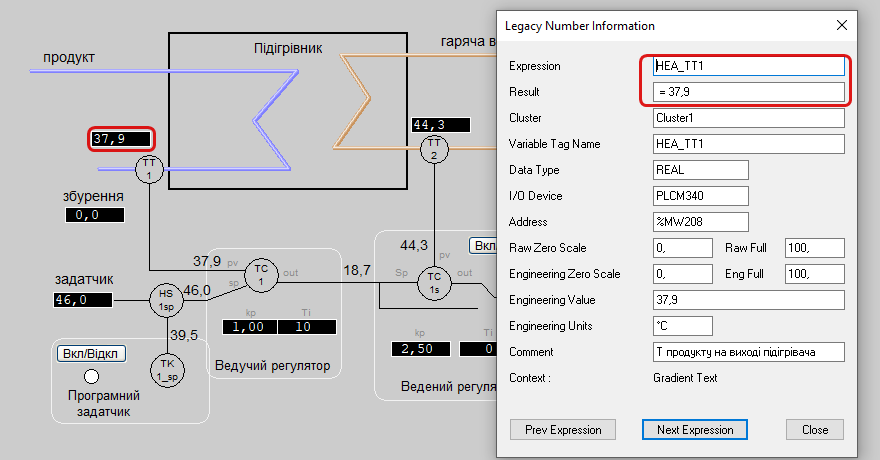

Рис.3.28. Вигляд інформаційної форми в режимі виконання

<iframe width="560" height="315" src="https://www.youtube.com/embed/5RST6haVCBE" title="YouTube video player" frameborder="0" allow="accelerometer; autoplay; clipboard-write; encrypted-media; gyroscope; picture-in-picture" allowfullscreen></iframe>

## 31. Створення резервної копії проекту

- [ ] Зробіть резервну копію проекту ("Projects" -> "Backup"), скопіюйте її на змінний носій або на хмарне сховище. У випадку роботи в лабораторії – покажіть викладачу, і з його відома видаліть свій проект. 

 

## **Питання до захисту** 

1. Які типи сторінок можуть відображатися на екрані оператору АРМу?
2. Поясніть своїми словами, що таке мнемосхема.
3. Які механізми використовують, щоб оператор міг контролювати велику кількість параметрів технологічного процесу?
4. Зміною яких властивостей графічних елементів можна показати стан технологічних параметрів? Як прийнято називати такі зміни?
5. Які загальні рекомендації щодо використання кольору в графічній підсистемі?
6. Якими способами можна показати стан дискретної змінної?
7. Якими способами можна показати стан аналогової змінної?
8. Які типи графічних файлів може створювати графічна підсистема Plant SCADA. Розкажіть про призначення кожного з них.
9. Розкажіть про призначення шаблону сторінки Plant SCADA. Чи може сторінка створюватися на базі порожнього шаблону? Яким чином до проекту підключити бажані існуючі в інших проектах шаблони?
10. Прокоментуйте призначення основних об'єктів з палітри графічних об'єктів графічної підсистеми Plant SCADA.
11. Яким чином у Plant SCADA реалізована анімація зміни кольору? Продемонструйте на прикладах.
12. Яким чином у Plant SCADA реалізована анімація зміни позиції та розміру? Продемонструйте на прикладах.
13. Яким чином у Plant SCADA реалізована анімація зміни графічного зображення? Продемонструйте на прикладах.
14. Яким чином у Plant SCADA реалізована анімація заповнення? Продемонструйте на прикладах.
15. Яким чином у Plant SCADA реалізована анімація зміни тексту? Продемонструйте на прикладах.
16. Яким чином у Plant SCADA реалізована анімація відображення числового значення? Продемонструйте на прикладах.
17. Розкажіть та покажіть на прикладах механізми використання символів Plant SCADA.
18. Які способи введення/зміни даних у Plant SCADA ви знаєте? Продемонструйте один з них на прикладі (за вибором).
19. Як у Plant SCADA реалізовані повзункові задавачі? Покажіть на прикладі.
20. Як у Plant SCADA реалізовані механізми налаштування виконання команд з миші? Покажіть на прикладі.
21. Як у Plant SCADA реалізовані механізми налаштування виконання команд з клавіатури? Покажіть на прикладі вводу значення змінної з клавіатури.
22. Поясніть, що таке Cicode, Cicode команди, Cicode вирази та Cicode функції у Plant SCADA.     
