[До лабораторної роботи 3](lab3.md)

## Додаток 3.1. Базові можливості графічної підсистеми та робота з графічним редактором Plant SCADA 

### Д3.1.1. Редактор графіки

Для створення графічної частини проекту, тобто людино-машинного інтерфейсу AVEVA Plant SCADA (раніше – Citect SCADA), використовується редактор графіки Graphics Builder. У редакторі графіки створюються та редагуються такі об'єкти:

-     графічні сторінки (Pages): дисплейні вікна з графічними елементами та анімацією; 

-     шаблони сторінок (Templates): шаблони з графічними елементами та анімацією, що використовуються як основа для сторінок; 

-     символи (Symbols): набір графічних елементів, що згруповані разом для багаторазового використання в якості готового бібліотечного графічного компоненту;

-     джини (Genies): набір графічних елементів з анімацією, що можуть бути багаторазово використані як готовий анімований бібліотечний компонент (графічна функція); 

-     супер джини (Super Genies): спеціальний вид сторінки, що використовується у якості спливаючих діалогових вікон усередині джинів; 

Доступ до цих об'єктів для створення, редагування чи видалення проводиться через меню "File" редактору графіки ("New...", "Open...") або розділу "Visualization" Plant SCADA Studio (вкладка "Pages", рис.Д3.1.1). 

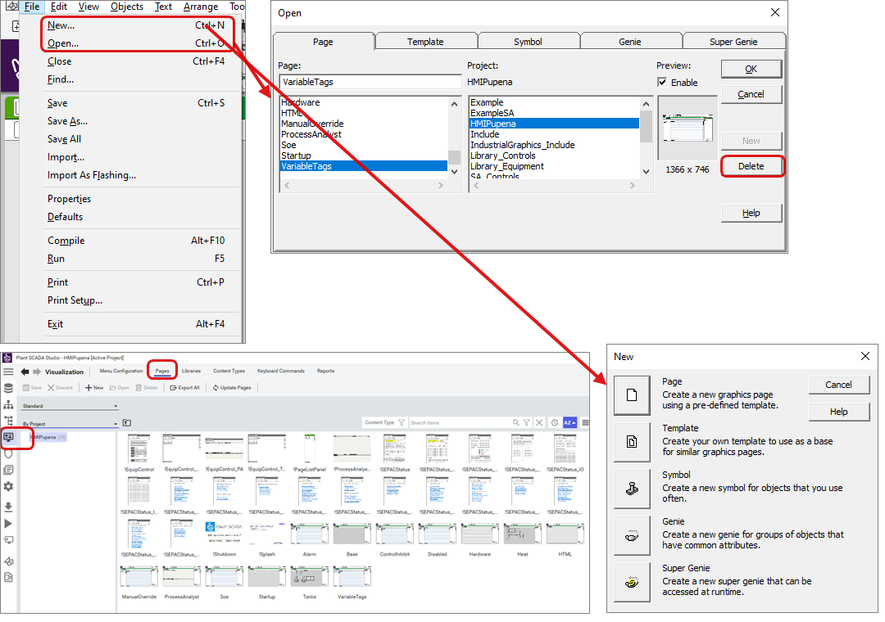

Рис.Д3.1.1. Доступ до елементів графічної підсистеми Plant SCADA 

Зверніть увагу, що видалення об'єктів у редакторі графіки можливе тільки у вікні відкриття ("File" -> "Open..."), використовуючи кнопку "Delete" (див. рис.Д3.1.1). 

Ряд властивостей редактору графіки налаштовується у вікні "Tools" -> "Options...". Зокрема там є опція вибору необхідності відображення системних сторінок ("List system pages", тих, назва яких починається з "!"). 

Для зручності розміщення елементів може знадобитися сітка, налаштування якої доступне через меню "View" ("Grid Setup...", "Snap to Grid").  

### Д3.1.2. Основи роботи зі сторінками (Pages) та шаблонами (Templates)

Графічна підсистема у Plant SCADA базується на представленні дисплейних вікон у вигляді ***сторінок*** (***Pages***). Графічні сторінки створюються на базі шаблону, що означує для сторінки:

-     розміри вікна;

-     колір фону сторінки;

-     поведінку вікна сторінки за замовченням;

-     може мати вбудовані графічні елементи та анімацію; 

Шаблон полегшує створення сторінки, так як окрім властивостей розміру та кольору фону може мати велику кількість вбудованих графічних елементів та анімацію, що надає сторінці певну базову функціональність. Ці елементи шаблону не будуть доступні для редагування на сторінці і будуть видимі як фон. У шаблони вбудовують меню, банери тривог, панелі статусу та інші елементи, що необхідно бачити на всіх сторінках. На базі готових шаблонів Plant SCADA дуже просто створити сторінки переглядачів тривог, трендів, звітів, вказавши тільки необхідний шаблон. 

Протягом розвитку SCADA-програми Citect/Plant SCADA розробники створили багато шаблонів, які відрізнялися своїм виглядом та підходами до побудови людино-машинного інтерфейсу. Ці шаблони створювалися як певний набір типових рішень з загальними властивостями (вигляд меню, тривог і т.п.) та об'єднувалися єдиним ***стилем***. Класичні стилі (bottom, standard, top, version2) увійшли як частина наперед-встановленого проекту "***Include***", який неявно включається у всі проекти. Інші стилі можуть бути використані при включенні інших наперед-встановлених проектів у свій проект. Так, наприклад, у попередній лабораторній роботі при створенні нового проекту було вказано стиль SxW_Style_1 (див. ЛР№2), після чого у включених проектах нового проекту (розділ Plant SCADA Studio "Projects" -> вкладка "Includes") з'явилися записи з іменем проекту "SxW_Style_Include" та "Library_Equipment". 

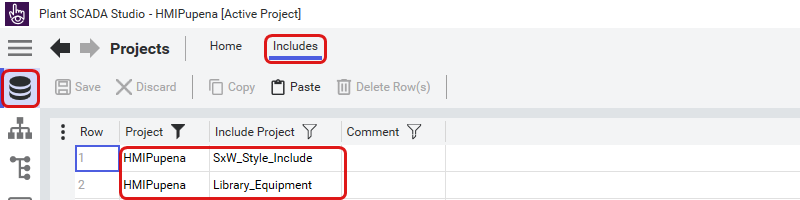

Рис.Д3.1.2. Включені проекти

При створенні нової сторінки ("File" -> "New..." -> "Page") редактор графіки пропонує вибрати стиль ("Style") з доступних в розроблюваному проекті та включених в нього проектах (рис.Д3.1.3). Рекомендується створювати сторінки в проекті на базі якогось одного стилю, інакше окрім стилістичних невідповідностей сторінок також можуть виникнути непередбачувані ситуації, викликані конфліктом Cicode команд різних шаблонів.

 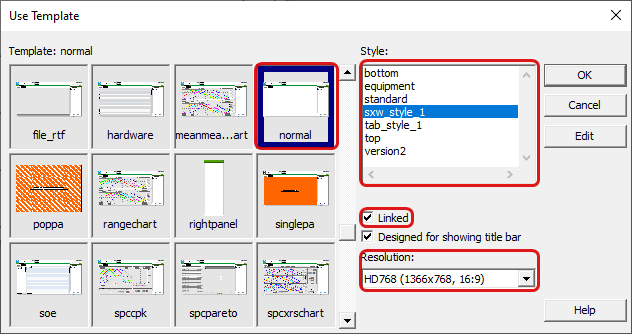

Рис.Д3.1.3 Вибір шаблону для сторінок ("Use Template")

Після вибору стилю, у вікні створення вибирається роздільна здатність ("Resolution") шаблонів сторінок та сам шаблон. Для звичайних сторінок мнемосхем доцільно вибирати шаблон "normal", який має класичні елементи навігації (меню), банери тривог та інші загальнодоступні на всіх сторінках елементи, характерні для даного стилю. Окрім шаблонів різних за призначенням типів сторінок (наприклад трендів, тривог, звітів), доступний також шаблон "blank", у якого відсутня будь-яка вбудована анімація. Такі сторінки можуть знадобитися, наприклад, для створення спливаючих вікон.        

За замовченням зв'язок сторінки з шаблоном, на базі якого вона була створена, залишається. Цю опцію ("Linked") можна відмінити (див. рис. Д3.1.3), у цьому випадку зміни в шаблоні не будуть відбуватися на сторінці, яка створена на базі нього.

Вибір шаблону, розміру вікна, кольору фону можна зробити у будь-який час шляхом зміни властивостей сторінки, які наведені на вкладці "Appearance" (рис.Д3.1.4). Доступ до властивостей сторінки проводиться шляхом виклику пункту "Page Properties..." контекстного меню сторінки або пункту меню "File" -> "Properties". Контекстне меню сторінки викликається правим кліком у будь-якому місці сторінки, що не містить графічного елементу.  

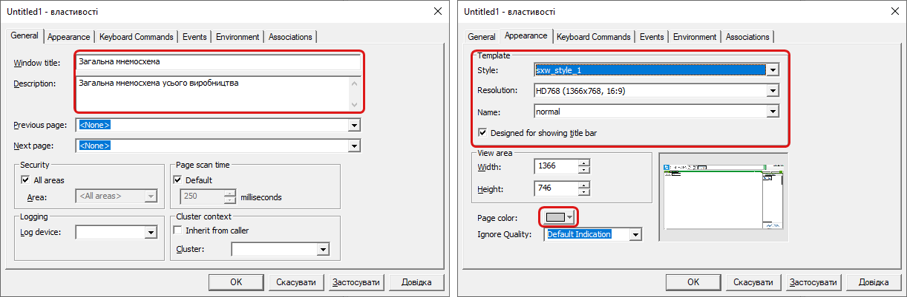

Рис.Д3.1.4 Загальні властивості сторінок (вкладки "General" та "Appearance") 

У загальних властивостях сторінки (вкладка "General", див. рис.Д3.1.4) можна також вказати заголовок вікна ("Window title"), опис ("Description"), назву попередньої ("Previous page") та наступної ("Next page") сторінки. Ці назви сторінок використовуються в режимі виконання у командах меню навігації. 

За замовченням, період сканування сторінки ("Page scan time") береться з однойменного параметру проекту, однак його можна змінити для кожної сторінки окремо. Це значення вказує системі на те, з якою періодичністю на сторінці обробляти анімацію та виконувати Cicode-функції. Враховуючи, що в анімації використовуються значення змінних, вони також будуть оновлюватися з тією ж періодичністю.

Після будь-яких змін на сторінці, щоб вони збереглися в проекті, її треба зберегти: "File" -> "Save". Після компіляції проекту не обов'язково перезавантажувати всю виконавчу систему Plant SCADA для того, щоб зміни вступили в силу. Достатньо повторно відкрити відредаговану та скомпільовану сторінку.

Інші властивості сторінок будуть розглянуті в інших розділах. 

### Д3.1.3. Графічні елементи 

Зміст графічних сторінок Plant SCADA наповнюється графічними елементами. Вони розміщуються розробником на сторінці та налаштовуються на етапі розробки, використовуючи редактор графіки. Графічні елементи можуть бути статичними, які не змінюють свої властивості, та динамічними, одна або декілька властивостей яких залежить від значення змінних або результату виразів. 

Вставка елементів може проводитись через команди пунктів меню здебільшого "Objects" та "Edit". Plant SCADA для зручності пропонує палітру інструментів (див. рис.Д3.1.5). Активація/деактивація відображення палітри доступна через меню "View" -> "Show Tools" (F3). У Plant SCADA 2023 R2 пропонуються такі графічні інструменти:

-     для рисування ліній ("Free Hand Line", "Straight Line"), прямокутників ("Rectangle"), еліпсів ("Ellipse"), багатокутників ("Polygon");

-     "Pipe" - для рисування труб;

-     "Text" - для вставки статичного тексту;

-     "Number" - для вставки тексту, що змінюється в залежності від значення змінної чи виразу;

-     "Button" - для вставки командних кнопок;

-     "Symbol Set" – для вставки анімації, що показує на сторінці різні символи в залежності від значення змінної чи виразу;

-     "Trend" - для вставки елемента відображення змінної у вигляді простого тренду;

-     "Cicode Object" – для вставки функцій Cicode, що викликаються при кожній обробці сторінки; 

-     "Web Content" – для вставки вбудованого вікна з веб-вмістом;

-     "Scheduler" – для вставки компоненту планувальника;

-     "Paste Symbol" ("Edit" -> "Paste Symbol...") – для вставки бібліотечного графічного елементу; 

-     "Paste Genie" ("Edit" -> "Paste Genie...") – для вставки бібліотечного графічного елементу з вбудованою анімацією; 

-     "ActiveX" ("Edit" -> "Insert ActiveX Control...") – для вставки графічного компоненту ActiveX, який зареєстрований у Windows на даному ПК;

-     "Process Analyst" ("Edit" -> "Insert Process Analyst...") – для вставки компонента Аналізатора процесу у вигляді тренду; 

-     "Database Exchange" ("Edit" -> "Insert Database Exchange...") – для вставки компоненту обміну з базами даних.

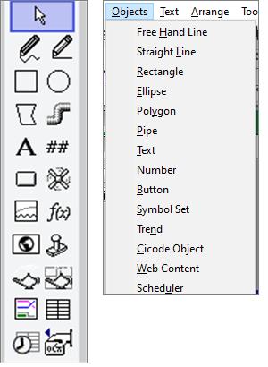

Рис.Д3.1.5 Палітра інструментів та відповідні пункти меню "Objects" графічного редактору

 Налаштування багатьох графічних інструментів розглядається нижче. Елементи "Trend", "Genie", "Process Analyst", "Cicode Object" будуть розглядатися в наступних лабораторних роботах. Елементи "Database Exchange", "Web Content", "Scheduler" та інші не будуть задіяні в лабораторних роботах даного курсу.

На сторінки можна також імпортувати графічні файли через меню "File" -> "Import...". Кольори імпортованої графіки можна відредагувати (наприклад замінити кольори) за допомогою вбудованих інструментів (див. Д3.1.6 Робота з кольорами). 

Графічні елементи можна групувати, виділивши їх разом та викликавши відповідну команду з контекстного меню ("Group") або меню "Arrange" -> "Group Objects". Редагувати властивості елементів всередині групи можна, доступившись до них через комбінацію "CTRL" + подвійний лівий клік миші. 

Якщо необхідно **зафіксувати** певний набір графічних елементів для використання їх в редакторі в якості фону, можна вибрати необхідні елементи та викликати команду меню "Edit" -> "Lock object". Для тимчасового відключення режиму фіксації для усіх фіксованих об'єктів на сторінці викликається команда "Edit" -> "Break Lock Mode". Відміна фіксації для вибраних об'єктів проводиться через команду меню "Edit" -> "Unlock Object".

Розміри графічних елементів та позицію курсору можна побачити в панелі статусу (нижній правий куток вікна редактора). Точно задати позицію та розміри виділеного елемента можна через меню "Arrange" -> "Adjust Position and Size...". Взаємне розміщення елементів по осі Z змінюється командами меню "Arrange": "Bring to Front", "Send to Back", "Bring Forwards", "Send Backwards".

Кожен елемент на сторінці має унікальний ідентифікатор – Animation Number (**AN**), який можна подивитися у його властивостях на вкладці "Access". Ідентифікатор AN використовується в багатьох функціях в якості вказівника на елемент, який задіяний у функції. Крім того, за цим ідентифікатором можна зробити перехід до потрібного елементу, використовуючи меню "Tools" -> "Goto Object...".

Більшість графічних елементів налаштовуються інтуїтивно зрозуміло. Однак налаштування деяких потребує пояснення. Так, наприклад, для рисування **трубопроводів** (елемент "Pipe"), після його вибору, на схемі натискається і утримується ліва кнопка миші, і з утриманням рисується перший сегмент. Далі кожен одинарний клік миші створює наступний сегмент, а подвійний клік миші завершує рисування труби. Утримання клавіші "CTRL" змушує рисувати сегменти під прямим кутом. Для тексту (елемент "Text") спочатку набирається текст, а потім кліком миші вказується місце його розміщення.     

### Д3.1.4. Властивості та анімація графічних елементів

Графічні елементи мають багато спільних налаштувань. Деякі з цих налаштувань означують залежність поведінки властивостей елементу в режимі виконання від значення змінної або виразу, а також ті операції, які необхідно провести при певних діях оператора. Якщо якась властивість елементу змінюється в залежності від значення змінної чи виразу, або, навпаки, операція над елементом приводить до певної дії – то кажуть, що цей елемент ***анімований*** або ***динамічний***. Статичні елементи, такі як, наприклад, лінія, еліпс чи текст, за замовченням не мають анімації, однак якщо їх властивість анімувати – вони стають динамічними. У Plant SCADA до одного елементу можна застосувати декілька різних анімацій, змінюючи відповідні властивості. Властивості, що залежать від значення змінної чи виразу, будемо також називати ***анімованими***.  

Доступ до налаштування властивостей елементу відбувається через подвійний клік або пункт "Properties..." контекстного меню (рис.Д3.1.6). Усі властивості згруповані в 2-х рівневі панелі налаштувань, де перший рівень надається через горизонтальні ***вкладки***, а другий – через вертикальні ***закладки***, що доступні на кожній вкладці. Так, наприклад, на рис.Д3.1.6 показані властивості "Appearance" -> "General". У вкладці "Appearance" доступні також закладки "3D Effects" та "Visibility".     

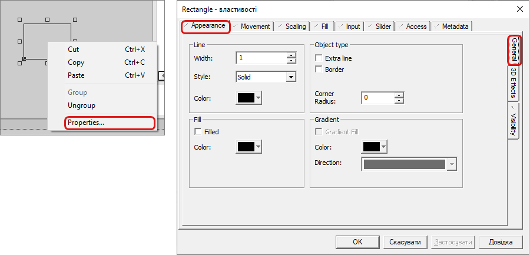

Рис.Д3.1.6 Налаштування властивостей елементу 

На вкладці "Appearance" можна налаштувати: стиль ("Style"), товщину ("Width") та колір лінії ("Color"); заповнення елементу, вказавши властивість "Filled", колір заповнення та градієнт ("Gradient"); стиль відображення (об'ємні властивості, "3D Effects").  

Для анімації властивостей елементу, як правило, необхідно вказати ***Cicode вираз*** (див. також Д3.2.1). Вираз записується таким чином, щоб його результат давав значення потрібного типу, якого потребує анімація. Так, наприклад, на рисунку Д3.1.7 показане вікно налаштування властивості **видимості елементу** ("Appearance" -> "Visibility" -> "Hidden when"). У даному випадку елемент буде прихований, коли значення змінного тегу `T1_LT1` буде більше нуля. Слід звернути увагу на те, що результат виразу у даному випадку повинен бути булевим (типу так/ні). Частковим випадком виразу є змінна (тег). У випадку анімації видимості (рис.Д3.1.7) замість виразу можна було б вказати тег типу DIGITAL.   

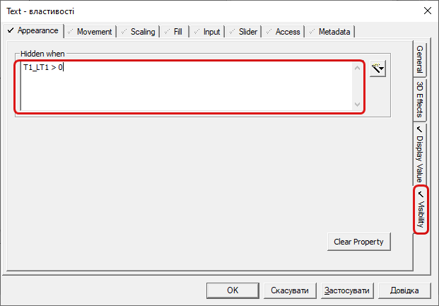

Рис.Д3.1.7 Використання Cicode виразів 

Для вставки у вираз змінних та функцій можна скористатися помічником – кнопкою праворуч від поля виразу з пунктами "Insert Tag..." та "Insert Function..." (див. рис.Д3.1.8). 

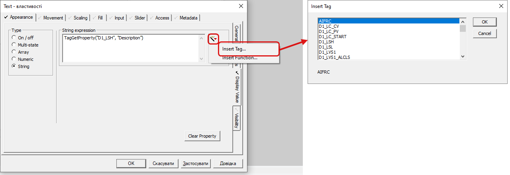

Рис.Д3.1.8 Помічник вставки змінних та функцій 

### Д3.1.5. Обробка подій кліку лівої кнопки миші "Input" -> "Touch"

Базові графічні елементи мають можливість обробляти кліки миші. Налаштування обробників проводиться у вкладці "Input" -> "Touch" (див. рис.Д3.1.9). Є можливість налаштувати команди (див. Д3.2.1. Cicode команди) для різних типів дій ("Action"): 

-     "Up" – відпускання лівої кнопки миші;

-     "Down" – натискання лівої кнопки миші;

-     "Repeat" – тримання лівої кнопки миші в натиснутому стані.  

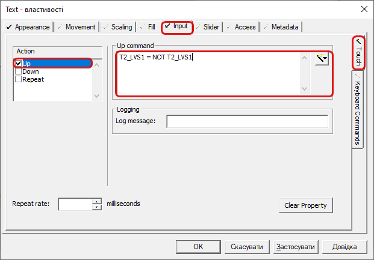

Рис.Д3.1.9 Налаштування обробника лівого кліку миші 

Для кожної дії прописується ***Cicode команда***, яка повинна виконуватися при виникненні дії (події). Наприклад, на рис.Д3.1.9 показане налаштування дії "Up", яке в режимі виконання забезпечить інвертування значення тегу `T2_LVS1` після відпускання лівої кнопки миші. Слід звернути увагу на те, що в полі "Up command" недостатньо просто вказати якесь ім'я тегу, адже у цьому випадку не буде відомо, що саме треба зробити з цим тегом.

Для дії "Repeat" треба також налаштувати періодичність виклику команди ("Repeat rate") при утриманні лівої кнопки натиснутою. У такому випадку "Repeat command" буде викликатися з вказаною періодичністю.

У полі "Log message" вказується текст, що буде записаний в журнал дій оператора. Детальніше це буде розглянуто в наступних лабораторних роботах.    

### Д3.1.6. Робота з кольорами у Plant SCADA

Кольори для властивостей елементів Plant SCADA можна вибрати з палітри існуючих ("Favorite Colors") або задати їх у форматі RGB чи HLS (кнопка "Edit ..." палітри, див. рис.Д3.1.10). Палітру можна змінювати, тобто редагувати існуючі кольори палітри ("Replace") або добавляти свої ("Add"), даючи їм імена ("Name"). У палітру входять також такі специфічні кольори, як кольори миготіння ("Flashing") та прозорий ("Transparent", позначається хрестиком).  

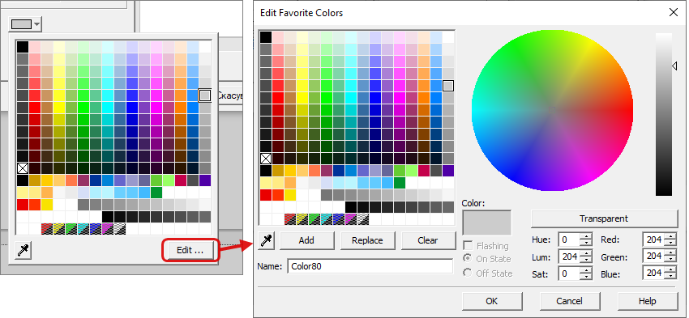

Рис.Д3.1.10 Кольорова палітра та її налаштування ("Edit Favorite Colors") 

Палітру можна налаштувати також через меню "Tools" -> "Edit Favorite Colors...". 

Окрім палітри, в меню "Tools" доступні також утиліти налаштування ("Adjust Colors...") та заміни кольорів ("Swap Colors...", рис.Д3.1.11). 

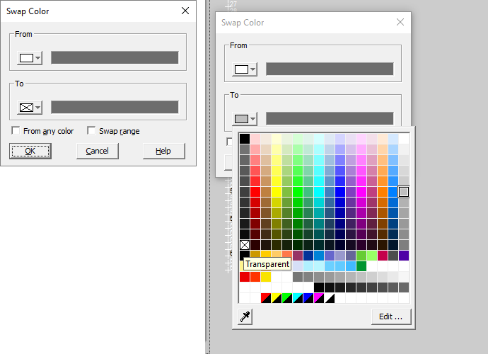

Рис.Д3.1.11 Інструмент заміни кольорів 

У пункті "From" вибирається, який колір треба змінити, а в "To" – на який. У палітрі вибору кольору доступний інструмент "піпетка", яким можна вибрати потрібний колір безпосередньо на сторінці. 

### Д3.1.7. Властивості загального вигляду "Appearance"

На вкладці "Appearance" доступні загальні властивості зовнішнього вигляду елементу (рис.Д3.1.12). Кількість та перелік властивостей "Appearance" та відповідно закладок залежить від типу елементу. Для усіх елементів можливо налаштувати властивість видимості через закладку "Visibility". Призначення інших властивостей розглянуто в інших розділах додатку.   

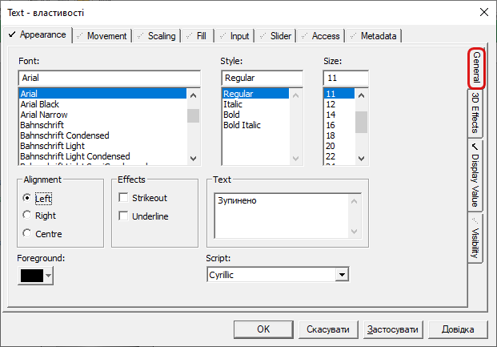

Рис.Д3.1.12 Налаштування загальних властивостей вигляду (вкладка "Appearance", закладка "General" для текстового елементу)

### Д3.1.8. Налаштування текстового відображення та анімації

Для текстових елементів на вкладці "Appearance" доступні властивості тексту ("Appearance" -> "General": шрифт, стиль, розмір, вирівнювання, колір) та налаштування анімації тексту ("Appearance" -> "Display Value"). У таблиці Д3.1.1 наведений перелік можливостей налаштування анімації тексту.  

Таб.Д3.1.1.Типи анімацій тексту. 

| **Властивість**                  | **Призначення**                                              | **Коментар до прикладу**                                     |
| -------------------------------- | ------------------------------------------------------------ | ------------------------------------------------------------ |
| 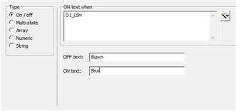 | "On / off": відображає різний текст при нульовому і ненульовому результаті виразу | При `D1_LSH=0` відображає текст "Відкл", інакше "Вкл"         |
| 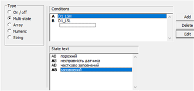 | "Multi-state": відображає різний текст в залежності від комбінації станів дискретних (DIGITAL) змінних або виразів, що повертають 0/1; товстим шрифтом в станах показується стан 1 | `D1_LSH=0 & D1_LSL=0` -> "порожній"   `D1_LSH=1 & D1_LSL=0` -> "несправність датчика"   `D1_LSH=0 & D1_LSL=1` -> "частково заповнений"   `D1_LSH=1 & D1_LSL=1` -> "заповнений" |
| 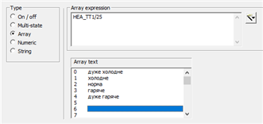 | "Array": відображає різний текст в залежності від значення виразу    | `HEA_TT1/25 ≈ 0 `-> "дуже холодне"   `HEA_TT1/25 ≈ 1` -> "холодне"   `HEA_TT1/25 ≈ 2` -> "норма"   `HEA_TT1/25 ≈ 3 `-> "гаряче"   `HEA_TT1/25 ≈ 4` -> "дуже гаряче"  |
| 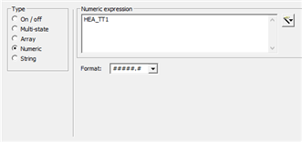 | "Numeric": відображає числове значення виразу з заданим форматом ("Format"); якщо формат заданий як `<default>`, то він береться з налаштування тегу | відображає числове значення змінної `HEA_TT1` у форматі 5 символів до коми і один після без одиниць вимірювання. |
| 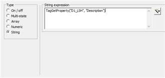 | "String": відображає символьний рядок, заданий виразом                  | відображає значення властивості "Description" (коментар) тегу `D1_LSH` |

### Д3.1.9. Налаштування анімації кольору ("Fill" -> "Color")

Елементи можуть змінювати колір в залежності від значення змінних або виразів. Для налаштування кольорів елементів на вкладці "Fill" доступні властивості анімації кольору ("Fill" -> "Color"). Типи анімацій кольору зведені в таблиці Д3.1.2. Зверніть увагу, що колір "OFF color" (а також колір першого стану) пов'язаний з кольором заповнення на вкладці "Appearance".

Таб.Д3.1.2.Типи анімацій кольору 

| **Властивість**                  | **Призначення**                                              | **Коментар до прикладу**                                     |
| -------------------------------- | ------------------------------------------------------------ | ------------------------------------------------------------ |
| 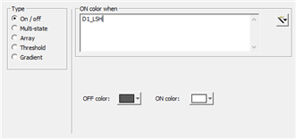 | "On / off": змінює колір при нульовому і ненульовому результаті виразу  | При `D1_LSH=0` елемент заповнений темно-сірим кольором, інакше – білим |
| 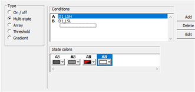 | "Multi-state": змінює колір в залежності від комбінації станів дискретних (DIGITAL) змінних або виразів | `D1_LSH=0 & D1_LSL=0` -> темно-сірий  `D1_LSH=1 & D1_LSL=0` -> сірий   `D1_LSH=0 & D1_LSL=1` -> мигаючий чорний-червоний   `D1_LSH=1 & D1_LSL=1` -> білий |
| 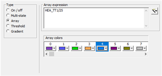 | "Array": змінює колір в залежності від значення виразу                | `HEA_TT1/25 ≈ 0` -> фіолетовий   `HEA_TT1/25 ≈ 1` -> синій   `HEA_TT1/25 ≈ 2` -> зелений   `HEA_TT1/25 ≈ 3` -> помаранчевий   `HEA_TT1/25 ≈ 4` -> блакитний |
| 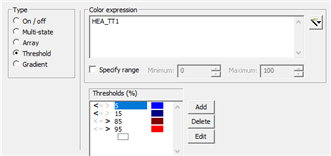 | "Threshold": змінює колір в залежності від того, в який діапазон (у % від діапазону виразу) попадає значення виразу | `HEA_TT1 < 5` -> синій   `5 < HEA_TT1 < 15` -> темно-синій   `15 < HEA_TT1 < 85` -> не змінюється відносно заданого у "Appearance"   `85 < HEA_TT1 < 95` -> бордовий   `95 < HEA_TT1` -> червоний |
| 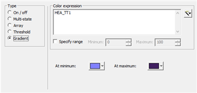 | "Gradient": змінює колір градієнтно в заданому діапазоні в залежності від значення виразу | Колір визначається відповідністю значення `HEA_TT1` у відсотках до градієнту від світло-фіолетового ("At minimum") до темно-фіолетового ("At maximum") кольорів |

### Д3.1.10. Анімація заповнення ("Fill" -> "Level")

Ступінь заповнення вибраним в налаштуваннях кольором графічного елементу може змінюватися в залежності від результату виразу ("Level expression"), вказаного на вкладці "Fill" -> "Level" (рис.Д3.1.13). При цьому вказується відповідність ступені наповненості (у %, "At minimum"/"At maximum") до вказаного діапазону виразу. Якщо у якості виразу вказується змінна, то діапазон може братися з властивостей діапазону тегу (мінімуму і максимуму в одиницях виміру), для чого опція "Specify range" не виставляється. Колір заливки береться з властивостей загального вигляду ("Appearance"), а фон вказується у властивості "Background color". Вибір напрямку заливки вказується у властивості "Fill direction".   

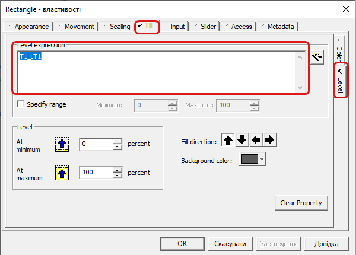

Рис.Д3.1.13 Налаштування анімацій заповнення (вкладка "Fill" -> "Level")

### Д3.1.11. Анімація зміни розміру ("Scaling")

За допомогою анімації масштабування (вкладка "Scaling") можна прив'язувати ширину елементу (закладка "Horizontal") та висоту елементу (закладка "Vertical") у відсотках до їх нормальних розмірів у відповідності до результату виразу "Scaling expression" (див. рис.Д3.1.14). Можна задати мінімум та максимум виразу, що співвідносяться до "At minimum" та "At maximum" масштабу відповідно, для чого виставляється опція "Specify range" та вписуються потрібні значення. Якщо опція не вказується, то значення будуть братися з властивостей діапазону тегу (мінімуму і максимуму в одиницях виміру), вказаного в полі "Scaling expression". Масштабування проводиться відносно осі, вказаної в налаштуваннях "Centre axis offset".   

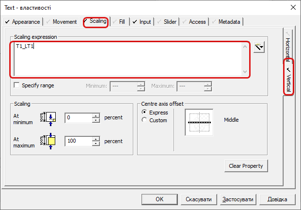

Рис.Д3.1.14 Налаштування анімацій зміни розміру (вкладка "Scaling")

### Д3.1.12. Анімація руху ("Movement")

Позиція елемента по вертикалі або/та горизонталі може бути прив'язана до значення виразу. Налаштування анімації руху проводиться через вкладку "Movement", відповідно в закладках "Horizontal" та "Vertical" (див. рис.Д3.1.15). Також можна реалізувати анімацію обертання через закладку "Rotational". Рух задається через зміщення елементу в пікселях ("Offset") відносно початкової точки. Зміщення при мінімумі результату "Movement expression" задається в полі "At minimum", аналогічно для максимального зміщення – "At maximum". Мінімум та максимум величини може братися з властивостей діапазону тегу (мінімуму і максимуму в одиницях виміру) або вказуватися явно, після виставлення опції "Specify range". 

Для анімації обертання вказуються не значення зміщення, а кути обертання відносно початкової позиції. Точка осі, відносно якої буде відбуватися обертання, вказується в "Centre axis offset".

Для одного елементу може одночасно задаватися анімація руху по двом осям і обертання.       

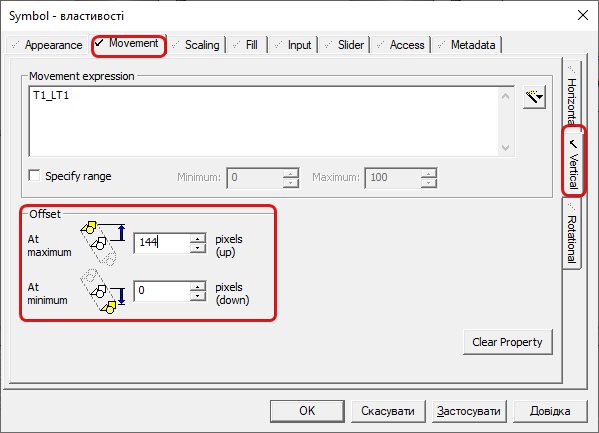

Рис.Д3.1.15 Налаштування анімацій руху (вкладка "Movement" -> "Vertical")

### Д3.1.13. Повзунок ("Slider")

У Plant SCADA елемент можна рухати мишею, тим самим змінюючи значення величини тегу. Ця анімація налаштовується через вкладку "Slider" (рис.Д3.1.16). Переміщення доступне по горизонталі ("Horizontal") чи вертикалі ("Vertical"), або по обом осям одночасно. Зміщення в пікселях відносно початкового ("At minimum") та кінцевого ("At maximum") положення відповідає значенням властивостей діапазону тегу (мінімуму і максимуму в одиницях виміру). 

Опція "Continuous update of tag" задає режим миттєвого запису значення в тег при кожному русі. Якщо опція не виставлена, то запис проводиться тільки після відпускання кнопки миші.  

На закладці "Rotational" можна задати поведінку кругового регулятора. Ця анімація доступна тільки при відсутності інших типів повзунка. Аналогічно анімації обертання, тут вказується кут повороту та зміщення початкової точки осі.    

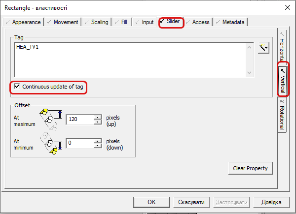

Рис.Д3.1.16 Налаштування повзунка (вкладка "Slider" -> "Vertical")

### Д3.1.14. Робота з клавіатурними командами

У Plant SCADA передбачена можливість обробки клавіатурних команд. Для цього спочатку клавішам клавіатури або їх комбінації дають певне ім'я, а потім назначають цій поіменованій клавіші певну клавіатурну команду, в якій прописують дію, що повинна виконуватися при натисканні цієї клавіші. 

Багато клавіатурних клавіш вже прописані на рівні включеного системного проекту "Include". Це такі клавіші як "ENTER", клавіші миші та навігації. Власні клавіші створюються в Plant SCADA Studio в розділі "Setup" -> "Keyboard Keys". На рис.Д3.1.17 показаний приклад створення клавіші клавіатури з іменем ("Key Name") "cmdHome", яка відповідає за натискання ESC (вказується в полі "Key Code" як `KEY_ESC`). Таке розділення назви клавіші та її реальної відповідності клавіатурі дає можливість у будь-який момент часу назначити іншу фізичну клавішу логічній клавіші.

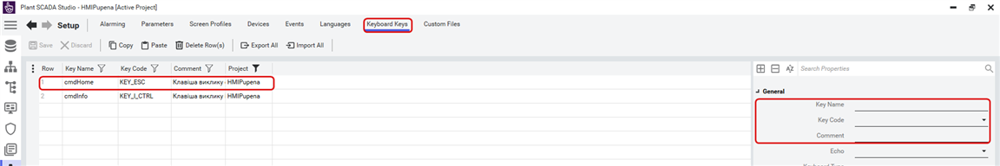

Рис.Д3.1.17 Створення клавіатурної комбінації (клавіші)

Клавіші або їх послідовностям надаються певні клавіатурні команди. Ці команди можуть бути назначені на:

-     рівні всієї системи, тобто незалежно від того, яка сторінка відкрита в даний момент (редагується в Plant SCADA Studio "Visualization" -> "Keyboard Commands");

-     рівні сторінки, тобто команди будуть працювати на сторінці, де вони означені (редагується в редакторі графіки у властивостях сторінки, вкладка "Keyboard Commands");

-     рівні елементу, тобто коли елемент отримує фокус вводу (редагується в редакторі графіки у властивостях елементу "Input" -> "Keyboard Commands"). 

На рис. Д3.1.18 показаний приклад клавіатурної команди системного рівня, в якій при натисненні клавіші `cmdHome` буде викликана Cicode функція відкриття сторінки "Base". Тобто на будь-якій сторінці при натисканні ESC буде відкрита основна сторінка проекту з іменем "Base".

 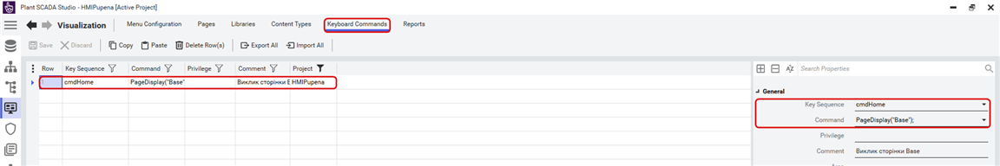

Рис.Д3.1.18 Створення клавіатурної команди рівня усього проекту

На рис. Д3.1.19 показаний приклад клавіатурної команди рівня сторінки (налаштовується у властивостях сторінки), в якому при натисканні одночасно клавіш "CTRL" та "I" буде викликана функція InfoForm. Клавіша "cmdInfo" (`KEY_I_CTRL`) створюється в Plant SCADA Studio, як показано вище.   

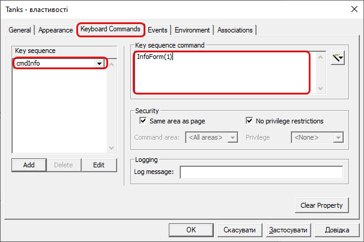

Рис.Д3.1.19 Створення клавіатурної команди рівня сторінки

На прикладі з рис.Д3.1.20 для одного з елементів (налаштовується у властивостях елементу "Input" -> "Keyboard Commands") означені дві клавіатурні команди, назначені на послідовності клавіш `PGUP` та `PGDN`. Клавіші вже існують в проекті, так як вони прописані в "Include", тому їх не потрібно створювати. Таким чином, при попаданні фокусу на елемент оператор зможе натискати `PgUp` для збільшення значення тегу `HEA_TC1_SP` та `PgDn` для зменшення.   

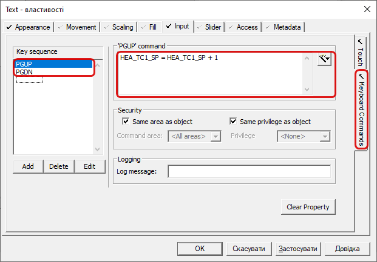

Рис.Д3.1.20 Створення клавіатурної команди рівня елементу

Для введення символьної послідовності або числового значення тегу у Plant SCADA передбачені спеціальні "змінні": `Arg1`, `Arg2` … `Arg8`. Зауважимо, що у даному випадку "змінна" - це умовна назва, так як даний механізм використовує записи міток в проекті "Include", але для користувача це умовно можна назвати "змінною". Якщо в символьну послідовність вписати декілька символів `#`, то в режимі роботи набрана оператором послідовність з цієї кількості символів на клавіатурі буде записана в змінну `Arg1` у вигляді текстового рядку. Якщо в набраній оператором послідовності зустрічається кома (`,`), наступні символи будуть записані в `Arg2` і т.д. Таким чином оператор може ввести одразу до восьми текстових значень, розділених комою. Якщо необхідно вводити числове значення, замість `Arg1` зручніше користуватися спеціальною змінною сторінки `ArgValue1`. На рис.Д3.1.21 показаний приклад налаштування властивостей клавіатурних команд елементу для введення числового значення з клавіатури. У даному випадку після натиснення оператором до 4-х символьних клавіш і після цього клавіші `ENTER` у `Arg1` буде збережене значення послідовності символів, яке, пройшовши попередню перевірку на коректність значення, буде записане у змінну `HEA_TC1_SP`.  

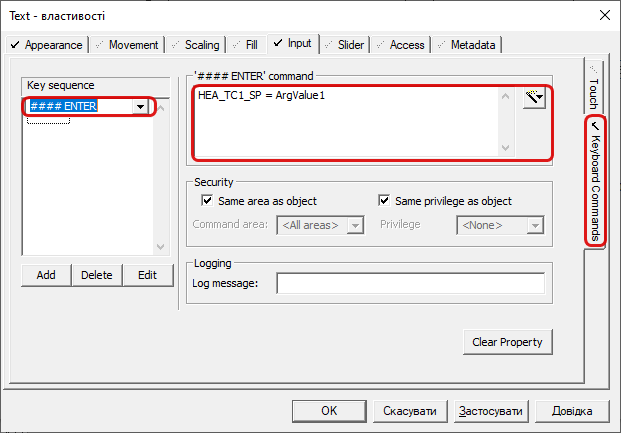

Рис.Д3.1.21 Створення клавіатурної команди для введення значення змінної

Введення значення в режимі виконання може бути виконане після попадання фокусу на елемент (наведення на нього курсору миші). При цьому поле для вводу не активується, а введені символи відображаються під елементом. Введення значення можливе для будь-якого елементу, а не тільки тексту.    

### Д3.1.15. Робота з символами та анімацією символів ("Symbol Set")

***Символи*** (***symbols***) – це графічні елементи, згруповані разом і доступні в якості готового бібліотечного елементу. Бібліотеки символів, що доступні в проекті, включають в себе символи усіх включених в нього проектів. Враховуючи, що проект "Include" включається в проект неявно, розробнику доступний великий набір символів, які містяться в ньому. Кожен проект може вміщувати декілька поіменованих бібліотек, кожна з яких може містити десятки символів. Ім'я символу буде складатися з назви бібліотеки і безпосередньо імені самого символу, які розділені крапкою.

Вставку символу на сторінку можна зробити через пункт меню "Edit" -> "Paste Symbol..." (F6) (рис.Д3.1.22). Спочатку вибирається потрібна бібліотека ("Library"), потім символ. Вставлений символ за замовченням зв'язаний з бібліотечним прототипом (опція "Linked"). Такий зв'язок дає можливість, змінюючи прототип в бібліотеці, автоматично змінювати усі його екземпляри.       

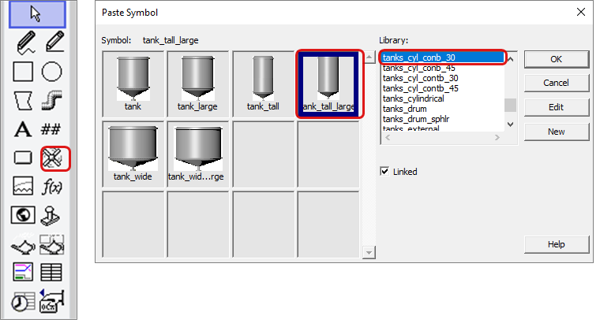

Рис.Д3.1.22 Інструмент "Symbol Set" на панелі інструментів та вставка символу ("Paste Symbol")

Для символів доступно декілька налаштувань анімацій, аналогічно іншим елементам. Додатково є спеціалізований елемент "Symbol Set" (див. рис.Д3.1.22), призначений для анімації зміни символів у залежності від значення виразу. Більшість налаштувань типів зміни символів аналогічні до налаштувань анімації кольору (див. Д3.1.9), за винятком нового типу – "Animated". Ця анімація передбачає два стани: 

-     стан відключення, тобто коли вираз ("Animate when") повертає нульове значення: у цьому випадку буде відображатися символ, вказаний як "Off";

-     стан включення, тобто коли вираз повертає ненульове значення: у цьому випадку зображення буде змінюватися покадрово, кожен кадр якого заданий символом "Frame X";

Вибір символу для кожного стану чи кадру проводиться кнопкою "Set...". На рис. Д3.1.23 показаний приклад налаштування анімації, в якій буде відображатися сірий символ мішалки в стані `Mixer=0`, а при `Mixer=1` буде відбуватися поступова зміна зелених символів мішалки в різних позиціях, що дасть ефект її обертання.        

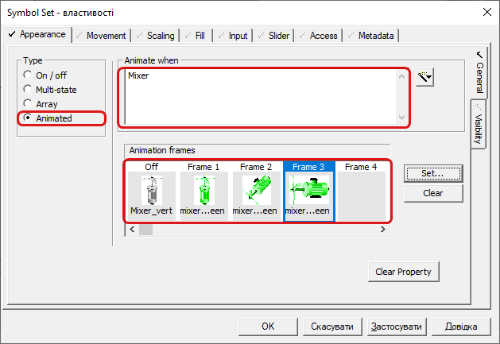

Рис.Д3.1.23 Налаштування анімації набору символів "Animated"

Треба врахувати, що анімація "Symbol Set" може працювати тільки з символами в растровому форматі. Для перетворення векторних елементів в растр можна скористатися командою "Tools" -> "Convert to Bitmap". 

У графічному редакторі можна створювати свої символи ("File" -> "New..." -> "Symbol") і зберігати їх у власних бібліотеках. 
